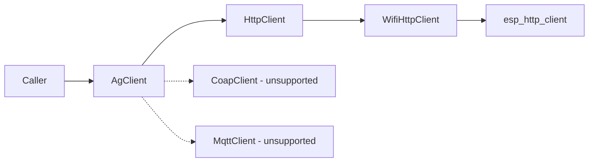

# airgradient-client

AirGradient server client for Wi-Fi HTTP configuration fetch and measurement
posting. `AgClient` exposes additional protocol interfaces whose implementations
are currently unsupported; see [Not Yet Implemented](#not-yet-implemented).

## Status

`Stable`.

Implemented and verified end-to-end:

- `NetworkType::Wifi` initialisation
- `http_fetch_config()` and `http_post_measures()` with full
  response-code mapping to `AgClientResult`

Other public methods (CoAP, MQTT, cellular `begin()`) are stubbed; see
[Not Yet Implemented](#not-yet-implemented).

## Scope

This component owns:

- AG-server URL construction and response code interpretation
- `Measures` → JSON serialization (with dual-channel averaging) for the
  HTTP path
- Protocol-client interfaces (`HttpClient`, `MqttClient`, `CoapClient`)
- WiFi HTTP backend (`WifiHttpClient`) over `esp_http_client`
- Vendored `coap-packet` and `payload-encoder` libraries (held for the
  future cellular CoAP backend)

This component does not own:

- Network bring-up (WiFi stack must be ready before `http_*` calls)
- Config parsing (returns the raw JSON body to the caller)
- OTA binary download (owned by `airgradient-ota`)

## Directory Layout

```text
components/airgradient-client/
  clients/             -- protocol client interfaces (HTTP, MQTT, CoAP)
  types/               -- NetworkType, AgClientResult, MeasuresInput
  services/            -- AgClient, payload serializer, TLS cert
  backends/            -- WifiHttpClient (esp_http_client wrapper)
  lib/                 -- vendored coap-packet and payload-encoder
  tests/               -- host tests + AgClientTestAccess friend
  CMakeLists.txt
  Kconfig
  README.md
```

## Public Includes

```cpp
#include "services/ag_client.h"
#include "types/client_types.h"
```

The `clients/` interfaces and `backends/` are internal: callers never
instantiate them directly.

Callers pass their `Measures`, `MeasuresBasic`, or `MeasuresAGo` value
directly; `AgClient` provides one overload per variant for each
measure-taking method, so no conversion happens at the call site.

## Design



`AgClient` builds URLs, serializes measures to JSON, and maps transport +
status outcomes to `AgClientResult` (`Ok`, `BufferTooSmall`,
`TransportError`, `ServerError`, `NotRegistered`). The protocol-specific
interfaces are the mock seam for host tests. The configured device model
selects the configuration-fetch route at build time; measurement posts retain
the shared `/measures` route.

## Usage

```cpp
AgClient client;
if (!client.begin("aabbccddeeff", NetworkType::Wifi)) {
    // handle init failure
}

// Unset fields retain invalid sentinels and are omitted from the payload.
MeasuresBasic m{};
m.temp_hum_a.temperature = 23.5f;
const uint32_t boot_minutes = 6; // Sample product uptime at POST time.

if (client.http_post_measures(m, -55, boot_minutes) == AgClientResult::Ok) {
    // shipped
}
```

The same call works with `Measures` (full) and `MeasuresAGo` via
overloads — the appropriate overload is selected at the call site by
type. The caller supplies `boot` as a `uint32_t` device uptime value for every
HTTP measurement POST.

## JSON Payload Contract

The HTTP serializer emits only valid fields. Dual-channel fields use the
mean when both channels are valid, the single valid channel when only one
is valid, and are omitted when neither channel is valid. Rounding happens
after the dual-channel reduction so precision is preserved during the
average.

| Field family | JSON properties | Precision |
|---|---|---|
| Wi-Fi signal | `wifi` | Integer |
| Device uptime | `boot` | Unsigned 32-bit integer |
| CO2 | `rco2` | Integer |
| Temperature / humidity | `atmp`, `rhum` | 2 decimals |
| PM atmospheric mass | `pm01`, `pm02`, `pm10` | 1 decimal |
| PM standard mass | `pm01Standard`, `pm02Standard`, `pm10Standard` | 1 decimal |
| PM particle counts | `pm003Count`, `pm005Count`, `pm01Count`, `pm02Count`, `pm50Count`, `pm10Count` | Integer |
| TVOC / NOx | `tvocIndex`, `tvocRaw`, `noxIndex`, `noxRaw` | Integer |
| Power | `volt`, `light` | 2 decimals |
| O3 / NO2 electrodes | `measure0` through `measure4` | 3 decimals |

Particle-count units follow the shared `PMData` convention: counts are
stored as particles per 0.1 L before they reach this serializer. Drivers
whose native output uses different units are responsible for conversion.

## Configuration

| Symbol | Default | Purpose |
|---|---|---|
| `CONFIG_AG_DEVICE_MODEL_ONE_OPEN_AIR` | `y` | Use the `/one/config` configuration route |
| `CONFIG_AG_DEVICE_MODEL_MAX` | `n` | Use the `/one/config` configuration route |
| `CONFIG_AG_DEVICE_MODEL_GO` | `n` | Use the `/go/config` configuration route |
| `CONFIG_AG_CLIENT_CELLULAR_SUPPORT` | `n` | Reserved for future cellular work |

The device-model symbols are mutually exclusive members of the
shared `AG_DEVICE_MODEL` choice from `airgradient-common`. The Measures variant
is picked per call site by the overload the caller chooses; there is no
compile-time Measures variant selector for this component.

## Dependencies

- `components/airgradient-common/` — `Measures` types and `AG_LOG*` macros
- `esp_http_client` — WiFi HTTP backend
- `json` — bundled cJSON for JSON serialization

## Tests

Host tests live in `components/airgradient-client/tests/` and run through
the top-level [tests runner](../../tests/README.md). They use a friend
class (`AgClientTestAccess`) to inject a hand-rolled `MockHttpClient`. The host
target uses the default One / Open Air model.

## Validation

End-to-end smoke test:
[`products/reference/main/test_airgradient_client.cpp`](../../products/reference/main/test_airgradient_client.cpp).
Brings up WiFi, then runs three cases against the live backend and
verifies each `AgClientResult` mapping:

| Scenario | fetch_config | post_measures |
|---|---|---|
| Registered SN, valid domain | `Ok` | `Ok` |
| Unregistered SN, valid domain | `NotRegistered` | `ServerError` |
| Valid SN, unresolvable domain | `TransportError` | `TransportError` |

The `429 -> Ok` (rate-limited) and `BufferTooSmall` mappings are not
reachable deterministically on hardware and rely on the host tests.

## Not Yet Implemented

The following methods are present on `AgClient`'s public API so call
sites can be wired today, but they currently fail loudly.

- `begin(sn, NetworkType::Cellular, modem)` — returns `false` and logs
- `coap_fetch_config()` / `coap_post_measures()` — abort
- `mqtt_connect()` / `mqtt_disconnect()` / `mqtt_publish_measures()` —
  abort
- Any `http_*` call when `begin()` was given `NetworkType::Cellular` —
  aborts (HTTP is WiFi-only by design)

The `coap-packet` and `payload-encoder` libraries are vendored in
`lib/` ahead of the cellular CoAP implementation; they compile but
nothing in the active code path uses them yet.

## Notes

- Calling a method whose backend is not yet implemented aborts with a
  clear error log. This is by design — it surfaces programming bugs
  early rather than silently no-op'ing.
