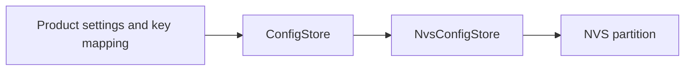

# airgradient-config

Shared configuration persistence: a typed key-value `ConfigStore` interface
and reusable backends. Owns the storage mechanism, not product settings
schemas.

## Status

`Stable`.

## Scope

This component owns:

- typed key-value persistence for `int`, `bool`, `string`, and `float`
- a shared storage interface for configuration backends
- an ESP-IDF NVS backend
- common result semantics for storage operations (`OK`, `NOT_FOUND`, `ERROR`)

This component does not own:

- product-specific settings structs
- product defaults
- product-level validation rules
- remote / local config merge policy
- device-specific configuration meaning
- shared host-side config simulation (no shared need yet)

The shared pattern is **product settings schema + shared config store**:
each product defines its own settings struct and explicit mapping to keys
while the shared component provides the persistence API and backends.

## Directory Layout

```text
components/airgradient-config/
  hal/
  backends/
  CMakeLists.txt
  README.md
```

- `hal/` — `ConfigStore` interface and `ConfigStoreResult` enum
- `backends/` — concrete storage implementations (currently NVS)

## Public Includes

```cpp
#include "hal/config_store.h"
#include "backends/nvs_config_store.h"
```

Guideline:

- include from `hal/` when depending on the abstract storage interface
- include from `backends/` only when instantiating a concrete backend

## Design



Each product owns the settings struct, defaults, validation, and the
mapping from struct fields to storage keys. The shared component never
sees the product-specific struct.

### Result Semantics

Storage operations return one of:

- `OK`
- `NOT_FOUND`
- `ERROR`

Product-level invalid values are not treated as storage errors. Recommended
handling:

1. product code loads defaults first
2. product code overlays stored values when present
3. product code validates loaded values
4. invalid loaded values fall back to product defaults for that field

## Public API

| Method | Returns | Purpose |
|---|---|---|
| `get_int(key, out)` / `set_int(key, value)` | `ConfigStoreResult` | Typed integer persistence |
| `get_bool(key, out)` / `set_bool(key, value)` | `ConfigStoreResult` | Typed boolean persistence |
| `get_string(key, out)` / `set_string(key, value)` | `ConfigStoreResult` | Typed string persistence |
| `get_float(key, out)` / `set_float(key, value)` | `ConfigStoreResult` | Four-byte IEEE-754 float persistence |
| `erase(key)` | `ConfigStoreResult` | Remove a key |
| `commit()` | `ConfigStoreResult` | Flush pending writes to backing storage |

See [`hal/config_store.h`](hal/config_store.h) for the full interface.

`NvsConfigStore` stores floats as NVS blobs of exactly `sizeof(float)` bytes.
The backend requires a four-byte IEEE-754 `float`; missing keys return
`NOT_FOUND`, while a wrong blob size or NVS type returns `ERROR`.

## Usage

The product initializes NVS before using the backend. `NvsConfigStore` opens
its namespace lazily on the first operation and closes it on destruction;
there is no separate `init()` method. Check both write and commit results.

```cpp
NvsConfigStore store("settings");
int interval = DEFAULT_PM_INTERVAL_SEC;
const auto result = store.get_int("pm_interval", interval);
if (result == ConfigStoreResult::ERROR) { return; }
// NOT_FOUND leaves the product default in place; validate loaded values.
if (store.set_int("pm_interval", interval) != ConfigStoreResult::OK) {
    return;
}
if (store.commit() != ConfigStoreResult::OK) { return; }
```

For a concrete product example, see
[`go_settings.cpp`](../../products/go/main/go_settings.cpp).

## Dependencies

- `nvs_flash` — ESP-IDF NVS storage (NVS backend only)

## Tests

Host tests are not yet provided for this component. Product-specific
config logic is tested where that logic lives (e.g.
[`go_settings.tests.cpp`](../../products/go/tests/go_settings.tests.cpp)).
There is no component-local `tests/` directory.
