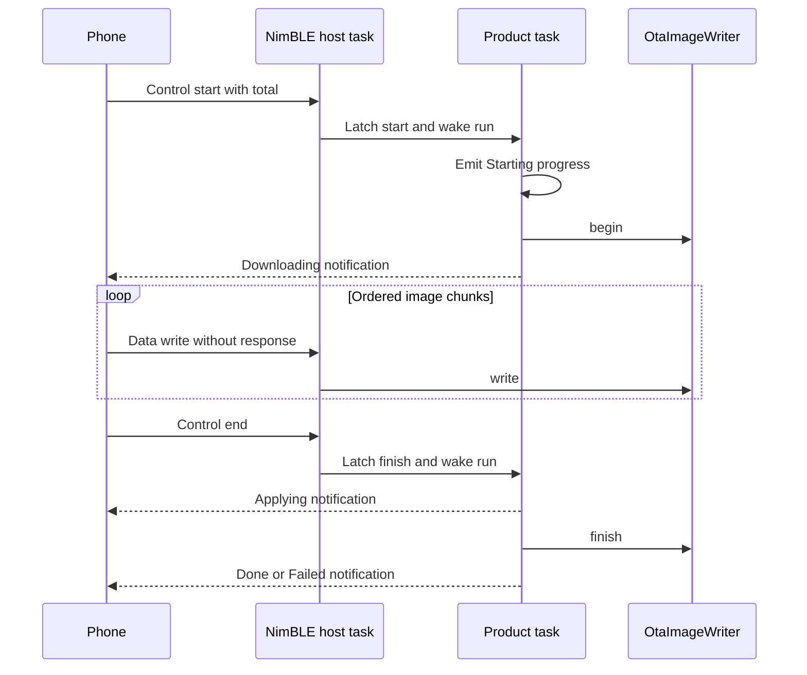

# BLE Push OTA

Current BLE update contract and execution model for `OtaBleService`. Start with
the [component README](../README.md) for shared writer responsibilities,
configuration, dependencies, and the Wi-Fi pull path.

## Files

| File | Responsibility |
|---|---|
| [`ota_ble_service.h`](../services/ota_ble_service.h) | Product integration and lifetime contract |
| [`ota_ble_service.cpp`](../services/ota_ble_service.cpp) | GATT registration, command processing, transfer execution |
| [`ota_ble_protocol.h`](../services/ota_ble_protocol.h) | Stable CBOR keys and numeric wire values |
| [`ota_image_writer.h`](../hal/ota_image_writer.h) | Image writer shared with pull transports |

## Ownership and Integration

The product initializes and secures `AgBleServer` before calling `setup()`, and
starts advertising afterward. The service borrows the server and writer; both
must outlive it. It neither starts advertising nor initializes or destroys the
BLE stack. Forward server disconnects to `handle_disconnect()`.

Call `run(timeout_ms)` from one product task. It is blocking and non-reentrant.
An idle return is `Ok` even when no transfer occurred, so do not reboot merely
because `run()` returned `Ok`. Track the `Starting` progress event and terminal
outcome. Install the progress callback before running the service.

`Starting` fires on the product task before partition preparation; use it to
pause competing work and inhibit sleep. Progress and terminal callbacks also
run on this task. `is_active()` is readable across tasks. The product owns
teardown coordination, reboot after success, image validation after boot, and
rollback policy. See [Go's OTA service](../../../products/go/docs/ota_service.md)
for a product integration.

## Protocol

The service UUID is `ab9a0001-1e3c-4f5a-9b6d-0a1b2c3d4e5f`. Characteristic
UUIDs share the suffix `-1e3c-4f5a-9b6d-0a1b2c3d4e5f`:

| Characteristic Prefix | Operation | Payload |
|---|---|---|
| `ab9a0002` | Authenticated write with response | Control: CBOR map with `op` |
| `ab9a0003` | Authenticated write without response | Data: raw image bytes |
| `ab9a0004` | Authenticated notification subscription | Status: CBOR map with `state`, `result`, `bytes` |

Status has no readable value. Subscribe before sending Control. A Control
write response acknowledges receipt, not completion of partition preparation.

| Control `op` | Contract |
|---|---|
| `start` | Required unsigned `total` in `1..UINT32_MAX`; optional informational `fw` string. Wait for `Downloading` before sending Data |
| `end` | Send after all Data writes; accepted only while downloading with no terminal command pending |
| `abort` | Request termination of an active transfer; ignored while idle |

Control, Data, and firmware-string limits are in the
[component configuration table](../README.md#configuration). Limit each Data
write to both the negotiated ATT payload size and the configured Data maximum.
There are no chunk sequence numbers, resume offsets, or per-chunk ACKs. Data
order and the declared total determine framing. Show progress using Status
`bytes`, which counts successfully flashed bytes rather than phone-side queued
bytes. `fw` is informational, not an image compatibility check.

Wire values are explicit constants independent of C++ enum ordering:

| Status Field | Values |
|---|---|
| `state` | Downloading `1`, Applying `2`, Done `3`, Failed `4` |
| `result` | Ok `0`, FlashError `1`, InvalidImage `2`, TransportError `3`, Aborted `4`, InvalidArgument `5` |

`Starting` is a product progress event, not a wire state. Unknown control ops
are ignored. Malformed or oversized Control while idle reports a failed status;
such input while active does not replace the running transfer.

## Behavior

Control callbacks latch commands and wake `run()`. Data callbacks write directly
to the image writer on the NimBLE host task. Partition preparation, finish,
and abort execute on the product task. There is no dedicated worker or chunk
queue. A pre-transfer rejection is the exception to product-task Status
emission: it can notify directly from the host callback.

### Design Rationale and Constraints

The design avoids a per-chunk response round trip and copy/worker handshake.
Throughput depends on negotiated MTU, connection interval, and packets per
connection event. Historical ESP32-C5/BlueZ measurements found flash writes
short relative to link delivery, motivating direct writes from the callback;
those measurements are not a throughput guarantee for other products.

The stack-heavy preparation and finish operations run on the product task.
Data writes still consume NimBLE host stack and block that task until they
return. Products should pause heavy competing BLE work and verify stack
headroom on hardware. The progress watchdog detects absent byte progress;
it cannot interrupt a stuck flash call.

Writer sequencing depends on the ready notification before Data, ordered
Data/END delivery on the host task, and pending-terminal guards that reject
later Data callbacks. These rules are not a general-purpose writer lock.
Do not access the writer independently or destroy the service during a live
`run()` call.

The service requests a fast connection interval during transfer and restores
the relaxed interval after a non-success terminal. These are hints to the
central, which can reject them. On success no restoration is requested because
the product is expected to reboot; the service itself never reboots.

## Edge Cases / Errors

- A second `start` while active is ignored.
- Data before the ready notification while `Starting` terminates with
  `TransportError`. Data while idle, applying, or after a pending terminal
  command is ignored.
- Empty, oversized, or overflowing Data while downloading terminates with
  `TransportError`; a writer failure maps to `FlashError`.
- `end` requires exactly the declared byte count. A truncated image aborts
  rather than being finalized. Writer validation failures propagate at finish.
- Disconnect, explicit abort, and a silent sender terminate the transfer.
  Notification delivery on a disconnected link is not guaranteed.
- Stall detection samples byte progress on the configured progress interval;
  it is not a precise per-byte timer. Products still own system recovery.

## Verification

The [component tests](../README.md#tests) cover protocol bounds, command/state
sequencing, byte counts, writer failures, and progress callbacks. Native tests
do not establish real BLE throughput, task stack headroom, flash timing, or
live blocking-loop behavior; those require hardware verification.
