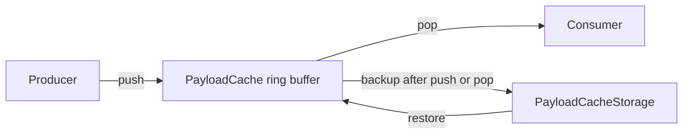

# airgradient-payload-cache

Bounded FIFO payload queue derived from the shared `Measures` types,
persisted through a small storage HAL so the queue logic stays
host-testable.

## Status

`Stable`.

## Scope

This component owns:

- a bounded FIFO payload queue
- a shared payload cache type derived from the common measures structs
- a storage HAL for persisting cached payloads
- an ESP-IDF RTC-backed storage implementation

This component does not own:

- payload upload logic
- network retry policy
- product-specific measurement scheduling
- sensor reading orchestration

## Directory Layout

```text
components/airgradient-payload-cache/
  hal/
  services/
  backends/
  tests/
  Kconfig
  CMakeLists.txt
  README.md
```

- `hal/` — `PayloadCacheStorage` interface and `PayloadCacheType` alias
- `services/` — `PayloadCache` queue logic, independent of ESP-IDF
- `backends/` — concrete storage backends (e.g. RTC retained memory)
- `tests/` — host-side tests owned by this component

## Public Includes

```cpp
#include "hal/payload_cache_types.h"
#include "hal/payload_cache_storage.h"
#include "services/payload_cache.h"
#include "backends/rtc_payload_cache_storage.h"
```

Guideline:

- include from `hal/` when depending on the payload type or storage
  interface
- include from `services/` when wiring the queue
- include from `backends/` only when instantiating a concrete backend

## Design



The queue is a fixed-size ring buffer with `head` / `tail` indices and
overwrite-oldest behavior when full. Usable capacity is `N - 1` so
`head == tail` continues to mean empty. Both `push()` and successful `pop()`
back up the changed queue immediately. A popped item is already removed from
retained storage; callers that need retry-on-upload-failure must retain or
requeue it themselves. `backup()` does not report storage failures to callers.

## Usage

```cpp
RtcPayloadCacheStorage backend;
PayloadCache cache(backend, CONFIG_PAYLOAD_CACHE_MAX_SIZE);
cache.restore();                  // reload persisted contents on boot

cache.push(measures);             // enqueue (overwrites oldest if full)

PayloadCacheType payload;
if (cache.pop(payload)) {
    // Already removed and persisted; caller owns delivery and retry.
}
```

See [`services/payload_cache.h`](services/payload_cache.h) for the
complete API.

## Configuration

Configurable through Kconfig under **AirGradient Payload Cache**:

| Symbol | Default | Purpose |
|---|---|---|
| `CONFIG_PAYLOAD_CACHE_MAX_SIZE` | `16` | Ring-buffer slot count (range 2–1024). Usable capacity is one less. |
| `CONFIG_PAYLOAD_CACHE_TYPE_FULL` | selected | Store `Measures` |
| `CONFIG_PAYLOAD_CACHE_TYPE_BASIC` | — | Store `MeasuresBasic` |
| `CONFIG_PAYLOAD_CACHE_TYPE_AGO` | — | Store `MeasuresAGo` |

## Dependencies

- `components/airgradient-common/` — `Measures` types and shared utilities
- `esp_common` — RTC retained memory attributes (RTC backend only)

## Tests

Host tests live under `components/airgradient-payload-cache/tests/` and
run through the [tests runner](../../tests/README.md). Tests can mock
`PayloadCacheStorage` without compiling the RTC backend.
