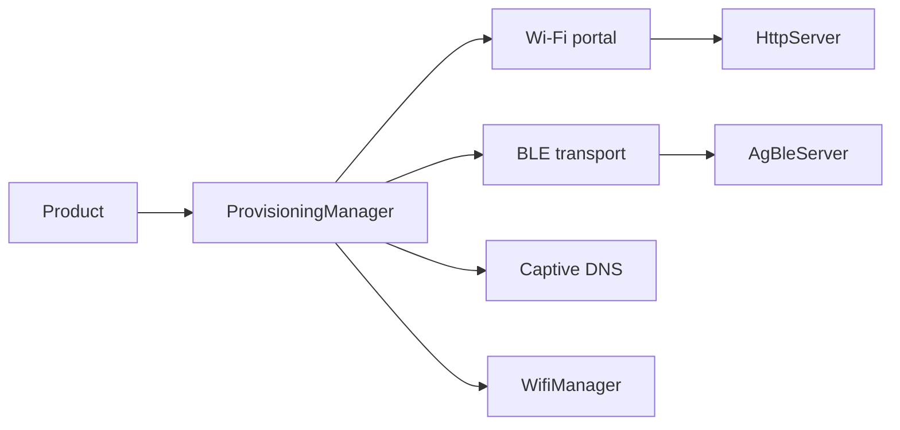

# airgradient-provisioning

Wi-Fi onboarding over BLE or a captive portal. The manager coordinates
credentials, network connection, and transport teardown; products supply the
borrowed services and their own UI and application policy.

## Status

`Stable`.

## Scope

Owns the provisioning state machine, transport selection, captive portal/DNS,
BLE provisioning service, credential parsing, scan filtering, and lifecycle
events. Standalone sessions manage the selected listeners and radios; attached
sessions reuse a product-owned BLE server.

Products own `WifiManager`, `AgBleServer`, and `HttpServer` instances, UI,
application-level server checks, and persistence of static IP and cloud policy.
The manager saves verified Wi-Fi credentials through `WifiManager`; the saved
network store belongs to `airgradient-wifi`.

## Directory Layout

```text
components/airgradient-provisioning/
  types/                     public types and enums
  services/                  public ProvisioningManager API
  internal/                  transports, scan filter, DNS codec, JSON parser, timer, QR encoder
  vendor/                    third-party sources (qrcodegen, MIT)
  assets/portal.html         embedded captive-portal page
  tests/                     host tests
  CMakeLists.txt
  docs/                      lifecycle and transport contracts
  README.md
```

- `types/` — pure C++ types, no ESP-IDF dependencies
- `services/provisioning_manager.h` — provisioning manager API
- `internal/` — transport plumbing and pure-C++ utilities; not part of
  the public API
- `assets/portal.html` — self-contained HTML/CSS/JS shipped via
  `EMBED_FILES`

## Public Includes

```cpp
#include "services/provisioning_manager.h"
#include "services/provisioning_qr.h" // QR helpers for the Provisioning screen
#include "types/provisioning_types.h"
```

## Design



Choose `BleOnly` (default), `WifiOnly`, or `Both` with `start()`. In `Both`,
the first connected client selects the transport and the unused side is torn
down. `start_attached()` accepts `BleAttached` and leaves BLE/radio ownership
with the product. See [lifecycle](docs/lifecycle.md) for exact prerequisites,
state transitions, and stop/restart contracts.

Callbacks can run on network, HTTP, BLE, or timer tasks. Signal the product's
own task; do not block or call back into the manager from its event callback.
Keep borrowed services and callback captures alive until the session stops.

## Usage

The product prepares the borrowed services and a complete configuration first;
see [startup prerequisites](docs/lifecycle.md#preconditions-for-start).

```cpp
ProvisioningManager manager;
manager.set_on_event(on_provisioning_event); // enqueue to product task
if (!manager.start(wifi, ble, http, config)) { return; }
// Product task handles queued events and decides when to stop.
manager.stop();
```

For a complete integration, see the reference product's
[provisioning smoke test](../../products/reference/main/test_provisioning.cpp).
Go's [portable provisioner](../../products/go/docs/portable_provisioner.md)
shows attached-session policy.

## Documentation

- [Lifecycle](docs/lifecycle.md) — transport selection, ownership, state machine,
  callbacks, persistence, timeouts, and diagnostics.
- [BLE transport](docs/ble_transport.md) — GATT services, security, status codes,
  and pagination.
- [Captive portal](docs/captive_portal.md) — discovery, browser behavior, and
  portal implementation constraints.
- [Public types](types/provisioning_types.h) — configuration defaults and event
  payloads; this component has no Kconfig options of its own.

## Provisioning QR Helper

`services/provisioning_qr.h` exposes a small QR-code encoder shared across
products' Provisioning screens:

- `encode_go_to_app_qr(QrCode*)` — companion-app deep-link URL.
- `encode_wifi_qr(ssid, password, auth, QrCode*)` — `WIFI:` join
  descriptor for the captive-portal SoftAP; reserved chars in SSID and
  password are escaped per the Wi-Fi Alliance spec.

`QrCode` is a caller-owned POD (~212 B at `QR_MAX_VERSION = 6`).
Products encode once on screen entry / transport switch and render many
frames from the cached buffer.  Module pixel size, quiet zone, and
origin live in the product's display layer.

Encoder parameters: ECC `LOW` with `boostEcl`, automatic mask, max
version 6 (41×41 modules).  Bump `QR_MAX_VERSION` if a future payload
needs more bits — stack use scales with the buffer length.

### Third-Party Attribution

`vendor/qrcodegen.{c,h}` is Project Nayuki's QR Code generator library
(MIT).  See the header preamble for the full notice.

## Dependencies

- `components/airgradient-common/` — shared types and RTOS abstraction
- `components/airgradient-ble/` — `AgBleServer` interface (borrowed)
- `components/airgradient-wifi/` — `WifiManager` (borrowed)
- `components/airgradient-http-server/` — `HttpServer` interface
  (borrowed)
- `json` (ESP-IDF managed) — cJSON for portal and BLE JSON
  encoding/decoding
- `esp_timer`, `lwip` (ESP-IDF) — one-shot inactivity timer, scan
  pagination timer, and captive DNS UDP socket

## Tests

Host tests live under
[`components/airgradient-provisioning/tests/`](tests/) and run through
the [top-level tests runner](../../tests/README.md). They cover:

- `ScanFilter` — dedup, sort, cap, RSSI floor
- DNS query parse / A-response build
- `provisioning_json` — shared credential JSON parsing (ssid, password,
  disableCloud, staticIp), strict static IP validation, error enum
- `BleTransport` — GATT setup/teardown, credential write callback,
  scan pagination via timer, status notifications, advertising
  stop/start on connect/disconnect, teardown during active connection
- `ProvisioningManager` state-machine transitions (start, stop,
  connect, fail, retry, timeout, teardown verification), BLE
  integration (dual-transport credentials, scan result fanout,
  `send_ble_status()`, BLE client timeout pause/resume, mixed AP + BLE
  client timeout suppression)
- credential persistence on got-IP (persist on success, persist nothing
  on connect failure, `CREDENTIALS_NOT_SAVED` + still-`Connected` when
  the store write fails)
- portal JSON handlers via `TestHttpRequest` (scan, provision, status,
  captive probe redirect)
- provisioning mDNS profile content, HTTP-before-mDNS startup,
  mDNS-before-route teardown, nonfatal setup/start failures, and
  BLE-only/attached isolation
- `stop()` teardown contract (routes wiped, HTTP server stopped, BLE
  deinit'd, Wi-Fi reverted to STA)
- `provisioning_qr` — go-to-app and Wi-Fi QR encoding, finder-pattern
  smoke, oversized-payload rejection, empty-SSID rejection

The captive DNS responder and `esp_timer`-backed timers are exercised
on hardware only.
