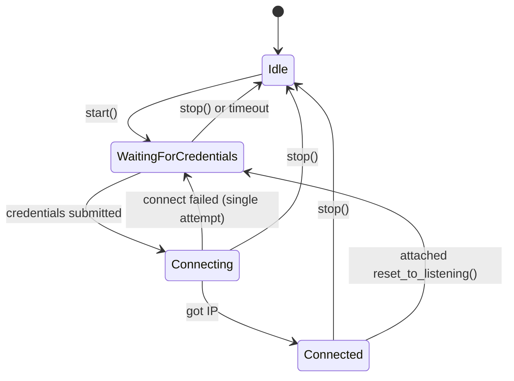

# Provisioning Lifecycle

Transport ownership, state transitions, teardown, and callback contracts for
firmware integrators. Start with the [component README](../README.md).
The implementation is in [provisioning_manager.cpp](../services/provisioning_manager.cpp);
its [public header](../services/provisioning_manager.h) defines the caller API.

## Transport Selection

`ProvisioningConfig::transport` controls which side(s) the manager
brings up. The default is **`BleOnly`** because it is the safest
single-transport flow on ESP32-C5 with AUTO band mode (no SoftAP
client, so the PMF SA-Query disassoc documented for the captive flow
cannot bite).

| Mode | Wi-Fi Mode After Start | BLE Init | Portal Routes | SoftAP | Captive DNS | Portal mDNS | First-Client Teardown |
|---|---|---|---|---|---|---|---|
| `BleOnly` (default) | `Sta` | yes | no | no | no | no | n/a |
| `WifiOnly` | `ApSta` | no | yes | yes | yes | yes | n/a |
| `Both` | `ApSta` | yes | yes | yes | yes | yes | yes — whichever side wins |
| `BleAttached` | unchanged | no (borrowed) | no | no | no | no | n/a |

`BleAttached` is entered via `start_attached()` (not `start()`); the
product owns the server lifecycle and the Wi-Fi radio. See
[Attached Transport](#attached-transport).

In `Both` mode the manager subscribes to AP-client-joined and
BLE-client-connected events. The first side to receive a real client
"commits" the session; the other side is torn down immediately:

- **AP-first commit:** BLE is `deinit()`'d, advertising stopped,
  callbacks cleared. Frees ~28–30 KB of heap in production.
- **BLE-first commit:** provisioning mDNS is stopped and cleared first,
  then the DNS responder is stopped and all HTTP routes are
  unregistered before Wi-Fi reverts to `Sta` (drops the AP). The HTTP
  server is left running to avoid a bind/unbind cycle; the product may
  register its own routes only after `stop()` returns.

After a side is torn down, repeat commits (e.g. a second BLE central
reconnecting) are short-circuited by per-side `_*_active` guards in
the manager — the teardown helpers are idempotent in observable state
but also avoid re-entering ESP-IDF for no benefit.

Argument validation is also gated by transport: `ap.ssid` is enforced
only when Wi-Fi will run, `ble.device_name` only when BLE will run.
`hostname` is consumed only by the Wi-Fi side. An invalid or missing
hostname makes mDNS profile setup fail nonfatally; the portal remains
available by captive DNS and direct AP IP.
The `start()` argument list does not change — callers may pass an
unused `AgBleServer&` to a `WifiOnly` start (or an unused
`HttpServer&` to a `BleOnly` start) without the manager touching it.

## Runtime Transport Switching

These switching rules apply to standalone sessions. For attached sessions, the
product must restore the next transport's prerequisites itself.

Products may switch transports mid-session as a back-to-back
`stop()` then `start(new_cfg)` against the same `ProvisioningManager`
instance. Contract:

- After `stop()` returns and `Stopped` has fired, the manager is in
  `Idle` and a fresh `start()` with a different transport is legal
  without any other intervening calls.
- `set_on_event()` registration is persistent across cycles. `stop()`
  does not clear it; only the destructor does (as a safety net for
  capture lifetime).
- `stop()` (default `stop_http_server=true`) satisfies the next
  `start()`'s preconditions: BLE deinit'd, routes unregistered, HTTP
  server stopped, Wi-Fi back to `Sta`.
- `stop(false)` keeps the HTTP server running. A subsequent
  `start(WifiOnly)` or `start(Both)` requires a fresh HTTP server and
  will fail its precondition. Use `stop()` (default) if you intend to
  switch into a transport that needs the portal, or stop the HTTP
  server yourself before the next `start()`.
- Repeated `BleOnly ↔ WifiOnly` round trips have been observed to
  fragment the heap by ~3 KB free / ~3.3 KB DMA per cycle. A single
  switch in a provisioning session sits well above the
  management-frame allocation threshold. Designs that expect many
  toggles per session should monitor
  `heap_caps_get_largest_free_block(MALLOC_CAP_DMA)` and bail out
  early.

## Attached Transport

`BleAttached` runs the same provisioning protocol (scan + credentials +
status notifications) over a BLE server the product already initialised
and advertises — for AirGradient Go, the bonded Portable data link. It
reuses `BleOnly`'s transport wiring but changes the lifecycle so it does
not fight the owning service for the shared server:

- `start_attached(wifi, ble, config)` registers the provisioning service
  and DIS via `BleTransport::setup_on_server()` (no `init` /
  `set_security` / advertising, no connect/disconnect callbacks), installs the
  WifiManager result callbacks, and parks in `WaitingForCredentials`
  without enabling the radio. `config.transport` must be `BleAttached`.
- BLE scan/credential writes are forwarded to the **attached request
  hook** (`set_attached_request_hook()`) instead of touching Wi-Fi on
  the NimBLE task. The product marshals to its own task and drives the
  manager via `request_scan()` / `submit_credentials()` after powering
  the radio.
- `reset_to_listening()` re-opens the session (`Connected →
  WaitingForCredentials`) after the product's verify-then-drop.
- `stop()` skips the post-connect hold and uses `BleTransport::detach()`
  (clears char callbacks + cancels the page timer, **no** `deinit` — the
  server belongs to the owner) and does not change the Wi-Fi mode.

Characteristic properties are unchanged (`READ_ENC` / `WRITE_ENC`); they
are not raised to `AUTHEN` so other consumers (Just Works links) keep
working. On a bonded MITM link, `ENC` already implies authenticated.

The AirGradient Go product wiring lives in
[`products/go/docs/portable_provisioner.md`](../../../products/go/docs/portable_provisioner.md).

## State Machine



Connection attempts use `max_retry_count = 0` — a single STA attempt
per credential submission. On failure, `ConnectFailed` fires within
~6 seconds and the manager returns to `WaitingForCredentials` so the
user can retry from either transport.

## Lifecycle Events

| Event | Meaning | `data` Populated? | `ip` Populated? |
|---|---|---|---|
| `Started` | transports active, waiting for credentials | no | no |
| `Connecting` | credentials received, STA connect in progress | yes | no |
| `ConnectFailed` | connect attempt failed, still listening | no | no |
| `Connected` | STA has an IP address | yes | yes |
| `Stopped` | provisioning torn down | no | no |

`Stopped` includes a `stop_reason` field: `ProductRequested` (explicit
`stop()` call) or `TimedOut` (inactivity timeout expired).

## Inactivity Timeout

Attached mode disables this timer and leaves session duration to the product.

- Controlled by `ProvisioningConfig::overall_timeout_ms` (0 = disabled).
- Timer starts when entering `WaitingForCredentials`.
- Timer pauses when any client connects (AP STA join or BLE central
  connect).
- Timer resumes when all clients disconnect (both AP and BLE counts
  reach zero).
- On expiry: manager performs full teardown (same as `stop()`) and
  fires `Stopped` with `TimedOut` reason.

## Preconditions for `start()`

- The `HttpServer` instance must **not** be started and must **not**
  have any routes registered — but only when the selected transport
  will run the Wi-Fi side (`WifiOnly` or `Both`). For `BleOnly` the
  HTTP server is borrowed-but-untouched.
- The `AgBleServer` instance must **not** be initialized — but only
  when the selected transport will run the BLE side (`BleOnly` or
  `Both`). For `WifiOnly` the BLE server is borrowed-but-untouched.
- `ProvisioningConfig::ap.ssid` must not be empty when Wi-Fi will run.
- `ProvisioningConfig::hostname` should provide a valid mDNS hostname
  when Wi-Fi will run. Profile setup failure is nonfatal.
- Provisioning attempts to replace any retained mDNS profile while the
  Wi-Fi side runs and clears the provisioning profile during teardown.
  The caller must reinstall its own profile after `stop()` returns when
  replacement succeeds.
- `ProvisioningConfig::ble.device_name` must not be `nullptr` when BLE
  will run.
- The event callback should be set before `start()`.

## What `start()` Does

The bring-up sequence is gated by `ProvisioningConfig::transport`.
Common to standalone modes: WifiManager STA callbacks are wired, the DHCP
timeout is set, and `Started` is emitted at the end.

| Step | `BleOnly` | `WifiOnly` | `Both` |
|---|---|---|---|
| Validate `ap.ssid` | skip | enforce | enforce |
| Validate `ble.device_name` | enforce | skip | enforce |
| Register portal HTTP routes | no | yes | yes |
| Init BLE, create GATT services, set security, start advertising | yes | no | yes |
| Wire AP-client join/leave callbacks | no | yes | yes |
| Set Wi-Fi mode | `Sta` | `ApSta` | `ApSta` |
| Start SoftAP | no | yes | yes |
| Start captive DNS responder | no | yes | yes |
| Start HTTP server on `http_port` | no | yes | yes |
| Install and start manual `_http._tcp` mDNS after HTTP start | no | yes | yes |
| Arm inactivity timeout (if `overall_timeout_ms > 0`) | yes | yes | yes |
| Emit `Started` | yes | yes | yes |

## What `stop()` Does

The following sequence describes standalone sessions. Attached mode skips the
post-connect hold, detaches BLE without destroying the server, and leaves
Wi-Fi mode under product control.

1. Cancels the inactivity timeout.
2. If called from `Connected`, blocks for ~1.5 s so the captive-portal
   browser can poll `/api/status` once and observe the success state
   before the AP is dropped.
3. Stops and clears the provisioning-owned mDNS profile, if it was
   successfully installed. If the HAL stop fails, the profile remains
   retained for the caller to clear or replace after `stop()` returns.
4. Stops the captive DNS responder (no-op if it was never started, as
   in `BleOnly`).
5. Clears BLE transport callbacks, then calls `teardown()` (no-op if
   BLE was never set up, as in `WifiOnly`; otherwise calls
   `ble.deinit()`).
6. For a session that borrowed HTTP (`WifiOnly` or `Both`), calls
   `http.unregister_all()` — wipes all registered routes.
7. For that HTTP instance, optionally calls `http.stop()` (default `true`;
   pass `false` to keep the server running for product routes).
8. Detaches all WifiManager callbacks.
9. Sets Wi-Fi mode to `Sta` — drops the AP (no-op for `BleOnly`),
   preserves any active STA association.
10. Emits `Stopped`.

The ~1.5 s hold only applies when stopping from `Connected`. From
other states (`WaitingForCredentials`, `Connecting`) the teardown is
immediate.

## What `stop(false)` Does Differently

For sessions that borrowed HTTP, this is the same as `stop()` except the
HTTP server stays running (not stopped).
Routes are still wiped. After `stop(false)` returns, the product can
register its own routes on the same server without a bind/unbind cycle.

## Destruction

The destructor calls `stop()` as a safety net but **clears the event
callback first** to prevent the `Stopped` event from firing into
potentially-destroyed captures. If the product needs the `Stopped`
event, it must call `stop()` explicitly before the manager goes out
of scope.

## Callback Threading

Callbacks fire from various task contexts (WiFi event loop, HTTP
server task, NimBLE task, esp_timer task). Callers must not block
inside callbacks or call back into `ProvisioningManager`. Signal your
own task and do heavy work there.

## Credential Persistence

On a verified got-IP (before emitting `Connected`) the manager calls
`WifiManager::add_network(ssid, password)` to persist the submitted
credential into the saved-networks store. If persistence fails (e.g. a
flash-commit error) the manager still emits `Connected` (the network
genuinely connected), logs the error, and sends `CREDENTIALS_NOT_SAVED`
(code `14`) over BLE so the app can warn that the credential will not
survive a reboot.

## What the Product Must Persist

Beyond the Wi-Fi credential (persisted via `WifiManager::add_network()`
above), the following fields are delivered via the `Connected` event and
the product is responsible for saving and re-applying them:

| Field | Where | Product Responsibility |
|---|---|---|
| `data.static_ip` | `ProvisioningEventInfo` | Save to NVS; call `wifi.set_static_ip()` on every boot before `connect()` |
| `data.disable_cloud` | `ProvisioningEventInfo` | Save to NVS; honor in application logic |

## DHCP Timeout

`ProvisioningConfig::connect_timeout_ms` (default 15000 ms) is
forwarded to `WifiManager::set_dhcp_timeout_ms()`. This bounds how
long the manager waits for DHCP after L2 association — the only
failure mode ESP-IDF does not surface natively.

## Verification

See the [component tests](../README.md#tests) for lifecycle and failure coverage.

## Diagnostics

Lifecycle log lines carry a `transport=<ble-only|wifi-only|both|ble-attached>`
token so multi-mode field logs are unambiguous:

```text
Provisioning: start(): transport=ble-only AP ssid='...' ch=1 port=80 ...
Provisioning: provisioning started transport=ble-only AP='...' ch=1 port=80
Provisioning: stop() requested (state=2 stop_http_server=1 transport=ble-only)
Provisioning: provisioning stopped (reason=0 transport=ble-only)
```

In `Both` mode, the first-client teardown emits an `INFO` summary
plus a pair of `DEBUG`-level heap probes around the work (compiled
out at INFO+ log levels and elided entirely under `TEST_HOST`):

```text
Provisioning: BLE teardown begin free=115200 largest=98304 dma=98304
Provisioning: first AP client committed — tearing down BLE transport
BleProv: BLE teardown
Provisioning: BLE teardown done  free=145148 largest=98304 dma=98304
```

The `begin/done` probes are research telemetry and the format may
change; do not parse them in field tools.
