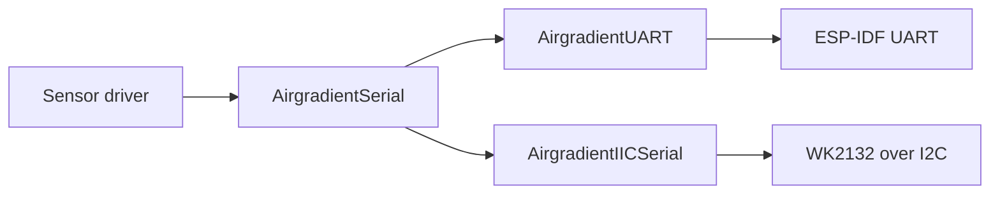

# airgradient-serial

Serial transport interface with native UART and WK2132 I2C-to-UART backends.
Sensor drivers consume the interface while product wiring selects the transport.

## Status

Implemented. The shared interface supports host fakes; concrete UART and bridge
backends depend on ESP-IDF and require hardware verification.

## Scope

Owns serial initialization, byte transfer, and backend-specific buffering.
Products supply UART ports, pins, bridge channel/address selection, and the
bridge's shared I2C bus. Callers own framing, checksums, command timeouts,
retries, synchronization, and sensor power policy.

## Directory Layout

```text
components/airgradient-serial/
  include/                    interface and backend declarations
  airgradient_serial.cpp      default interface behavior and bulk-read helper
  airgradient_uart.cpp        native UART backend
  airgradient_iic_serial.cpp  WK2132 adapter
  vendor/                     WK2132 implementation and registers
  CMakeLists.txt
```

## Public Includes

- [`airgradient_serial.h`](include/airgradient_serial.h) — consumer interface;
  does not include ESP-IDF headers.
- [`airgradient_uart.h`](include/airgradient_uart.h) — native UART construction.
- [`airgradient_iic_serial.h`](include/airgradient_iic_serial.h) — bridge construction.

## Design



### Lifecycle and Ownership

Configure hardware through the concrete constructor, then call `begin(baud)`.
Do not read or write unless initialization succeeds. Calling `begin()` again
while initialized returns success without changing the baud rate; call `end()`
before reconfiguring. The base class is a polymorphic interface with fallback
implementations, not a usable hardware transport: its `begin()` returns `false`.

Keep the transport alive while a driver holds its reference or pointer. For
the bridge, keep the caller-owned I2C bus alive through all operations and
destruction. Serialize access from callers; these adapters do not provide a
transaction mutex. Use them from task context.

Call `end()` explicitly when releasing the transport. Native UART teardown
deletes its driver; its destructor does not call `end()`. Bridge teardown
resets the selected sub-UART, so do not treat it as a transmit flush.

### Transfer Contracts

| Operation | Contract |
|---|---|
| `available()` | Reports buffered bytes; use only after successful initialization |
| `read()` | Returns a byte or `-1`; native UART may wait approximately 10 ms, while the bridge performs I2C reads |
| `read(buf, len)` | Returns the actual byte count; native UART uses a zero-wait receive, while the base implementation repeatedly calls the backend's single-byte read |
| `write(data, len)` | Returns bytes written or zero on failure; callers must check the count |
| `wait_tx_done(timeout_ms)` | Native UART waits for transmitter idle; base and bridge return `false` because completion is unsupported |
| `print(str)` | Writes a non-null, terminated string without reporting a byte count |

Transmit completion does not mean the peer accepted a command. Bulk reads can
return fewer bytes than requested; framing and response deadlines remain with
the consumer. The base bulk-read helper is not a uniform timing guarantee
across backends. Call it through `AirgradientSerial&` for the bridge, whose
concrete single-byte overload hides the inherited overload.

The native backend uses 8 data bits, no parity, one stop bit, and no hardware
flow control. The bridge retries initialization up to three times with 500 ms
delays on failures and combines its hardware FIFO with a 32-byte software ring.
These are implementation settings, not Kconfig options.

## Usage

```cpp
AirgradientUART uart(UART_NUM_1, RX_PIN, TX_PIN);
AirgradientSerial &serial = uart;
if (!serial.begin(SENSOR_BAUD)) { return; }
uint8_t buffer[32];
const int count = serial.read(buffer, sizeof(buffer));
if (count > 0) { consume_bytes(buffer, count); }
serial.end();
```

The symbols for port, pins, baud rate, and consumer are supplied by the caller.
See [sensor drivers](../airgradient-sensors/README.md) for protocol consumers.

## Dependencies

- `esp_driver_uart` — native UART implementation.
- `esp_driver_i2c`, `esp_driver_gpio` — bridge bus and reset pin.
- `esp_timer` — backend timing support.

The WK2132 adapter retains its upstream attribution; vendor sources are not
part of this documentation cleanup.

## Tests

There is no component-local host suite. Consumer tests substitute
`AirgradientSerial` to exercise protocol behavior; the base implementation can
be linked on the host. Concrete backends require ESP-IDF and hardware checks
for baud rate, FIFO behavior, electrical wiring, and timing. See the
[host-test workflow](../../tests/README.md).
