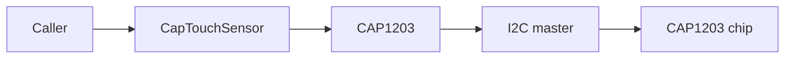

# airgradient-touch

Capacitive touch HAL with the Microchip CAP1203 3-channel controller as the
concrete driver. The driver is a clean re-implementation from the chip
datasheet — no vendor library is used.

## Status

`Stable`.

## Scope

This component owns:

- I2C device registration and identity verification (product /
  manufacturer ID)
- device configuration: sensitivity, per-channel thresholds, enabled
  channels, interrupt channel mask
- touch status reads (which channels are currently touched)
- noise flag reads (optional capability)
- manual recalibration trigger (optional capability)
- interrupt-line acknowledgement (driver-specific, not in HAL)

This component does not own:

- debounce, short-press, long-press, or chord detection
- product-level touch policy

## Directory Layout

```text
components/airgradient-touch/
  hal/
  drivers/
  CMakeLists.txt
  README.md
```

- `hal/` — `TouchChannel` flags, `TouchData` struct, `CapTouchSensor`
  abstract interface with feature-check methods
- `drivers/` — `CAP1203` concrete driver with `Config` struct

## Public Includes

```cpp
#include "hal/cap_touch_sensor.h"
#include "drivers/cap1203.h"
```

## Design



Product code creates a `CAP1203` instance and passes a `CapTouchSensor &`
to any service that only needs touch state. Code that also needs
`clear_interrupt()` holds a `CAP1203 &` directly. ESP-IDF I2C types are
confined to `drivers/` and never leak to callers.

CAP1203 initialization verifies identity, clears sleep and verifies the mode,
then applies configuration and clears the interrupt latch. `set_sleep(true)`
disables sensing and verifies the sleep bits by readback; `set_sleep(false)`
resumes it. Both report communication or verification failures to the caller.

### HAL Feature Checks

Optional capabilities follow the same pattern as `PMSensor`:

| Method | Default | CAP1203 |
|---|---|---|
| `set_sleep(asleep)` | `false` | sets and verifies deep-sleep mode |
| `supports_noise()` | `false` | `true` |
| `supports_calibration()` | `false` | `true` |
| `calibrate(mask)` | no-op `false` | writes `REG_CALIBRATION_ACTIVATE` |

`out.noise` in `TouchData` is only meaningful when
`supports_noise() == true`.

## Usage

```cpp
CAP1203 touch(i2c_bus);   // default I2C address 0x28
if (!touch.init()) { /* handle failure */ }

TouchData data;
if (touch.read(data) && (data.touched & TouchChannel::CH1)) {
    // CH1 touched
}

// read() does not clear the INT latch; ack explicitly to advance state.
touch.clear_interrupt();

if (touch.supports_calibration()) {
    touch.calibrate(TouchChannel::ALL);
}
```

## Dependencies

- `esp_driver_i2c` (private) — I2C master driver

## Tests

This component does not currently own host tests. Touch-dependent
behavior is exercised at the product level via a mocked
`CapTouchSensor &`.

## Notes

### CAP1203 Register Map

| Constant | Address | Description |
|---|---|---|
| `REG_MAIN_CONTROL` | `0x00` | INT bit (bit 0) |
| `REG_GENERAL_STATUS` | `0x02` | Touch event latch |
| `REG_SENSOR_INPUT_STATUS` | `0x03` | Per-channel touch flags |
| `REG_NOISE_FLAG_STATUS` | `0x0A` | Per-channel noise flags |
| `REG_SENSITIVITY_CONTROL` | `0x1F` | delta_sense \[7:4\], base_shift \[3:0\] |
| `REG_SENSOR_INPUT_ENABLE` | `0x21` | Channel enable mask |
| `REG_CALIBRATION_ACTIVATE` | `0x26` | Recalibration trigger mask |
| `REG_INTERRUPT_ENABLE` | `0x27` | Per-channel interrupt mask |
| `REG_REPEAT_RATE_ENABLE` | `0x28` | Per-channel repeat-rate enable mask |
| `REG_THRESHOLD_CH1–3` | `0x30–0x32` | Per-channel threshold (0–127) |
| `REG_PRODUCT_ID` | `0xFD` | Expected: `0x6D` |
| `REG_MANUFACTURER_ID` | `0xFE` | Expected: `0x5D` |
| `REG_REVISION` | `0xFF` | Logged at init, not validated |
