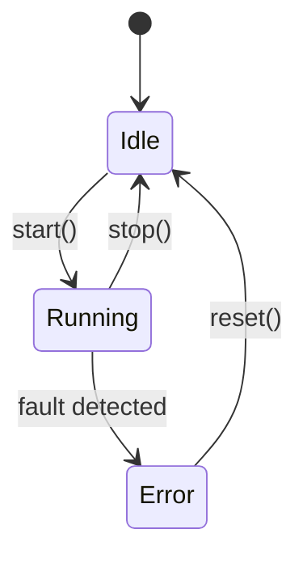

# \<Service Name\>

One-paragraph summary describing what the service does, how it is invoked
(synchronously by the orchestrator, by its own task, etc.), and which
operating modes activate it.

Template instructions: use this for a service or a substantial behavior topic,
not automatically for every class. Keep applicable sections, remove
placeholders, and adjust paths for the destination. Remove this paragraph when
using the template.

## Files

| File | Purpose |
|---|---|
| `products/<product>/main/<service>.h` | Class declaration |
| `products/<product>/main/<service>.cpp` | Implementation |

## Dependencies

| Dependency | Source | Usage |
|---|---|---|
| `<Type>` | `<component>` (`<header>`) | What this service uses it for |

## Public API

Describe important caller contracts. Include ownership, blocking behavior,
side effects, and failure semantics where relevant. Use a table when it helps;
do not enumerate every public method. Group by lifecycle first, then by feature.

| Method | Returns | Purpose |
|---|---|---|
| `init()` | `bool` | One-line description of side effects |
| `start()` | `void` | One-line description |
| `stop()` | `void` | One-line description |
| `<feature_method>()` | `<type>` | One-line description |

See [`<service>.h`](../main/<service>.h) for full signatures and parameter
documentation.

## Behavior

Describe state machines, lifecycle transitions, timing requirements, and
ordering constraints. Identify the task or callback that owns state, how data
is validated, and how events reach consumers. Explain non-obvious decisions
and hardware constraints. Link to the owner of related behavior or wire
contracts instead of repeating it. Use Mermaid for state machines and branched
flows; ASCII is acceptable only for trivial linear sequences.

State machine example:



Trivial linear sequences may stay ASCII:

```text
init -> start -> running -> stop
```

## Edge Cases / Errors

Document partial failures, retry policy, watchdog interactions, and how the
service degrades when a dependency is missing.

## Verification

Link to relevant tests and explain any important coverage boundaries. Link to
manual verification instructions when hardware checks are required.
