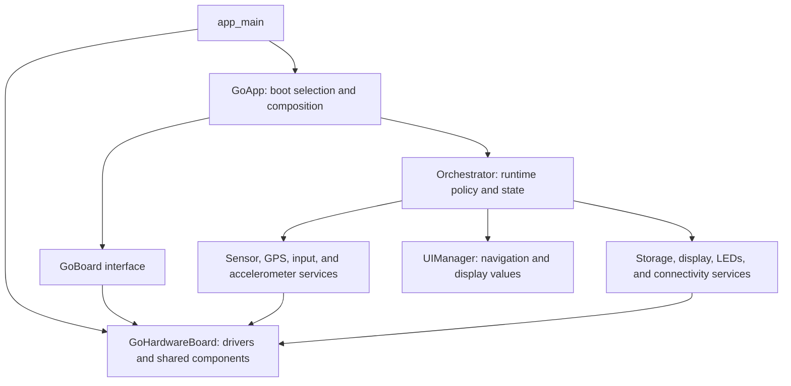
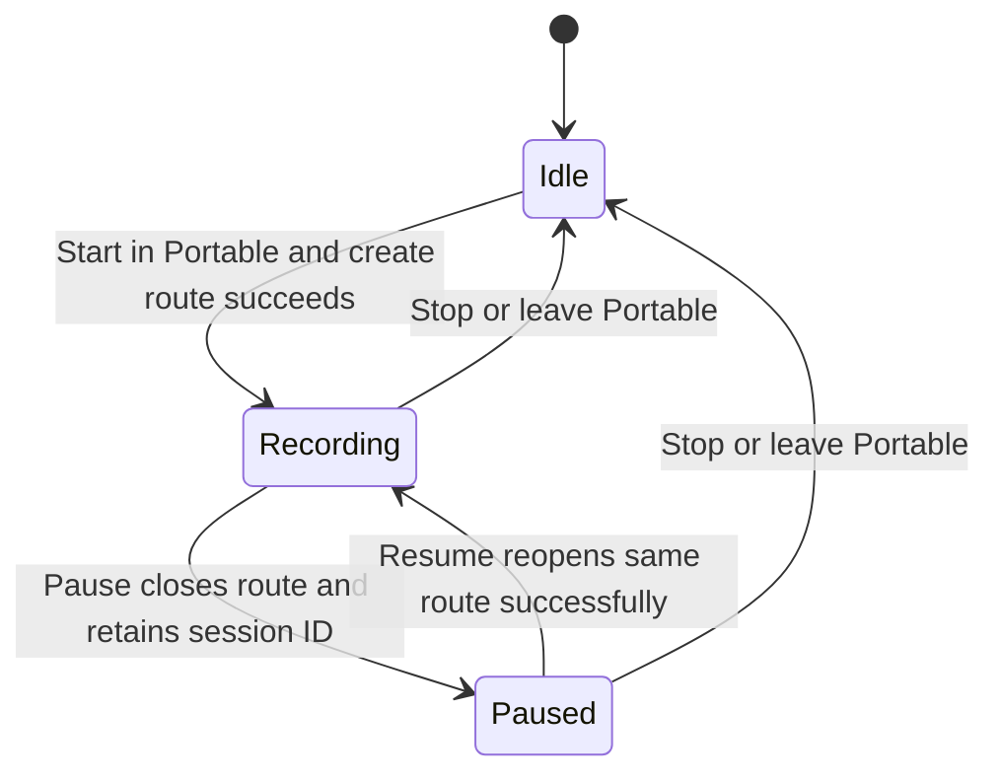
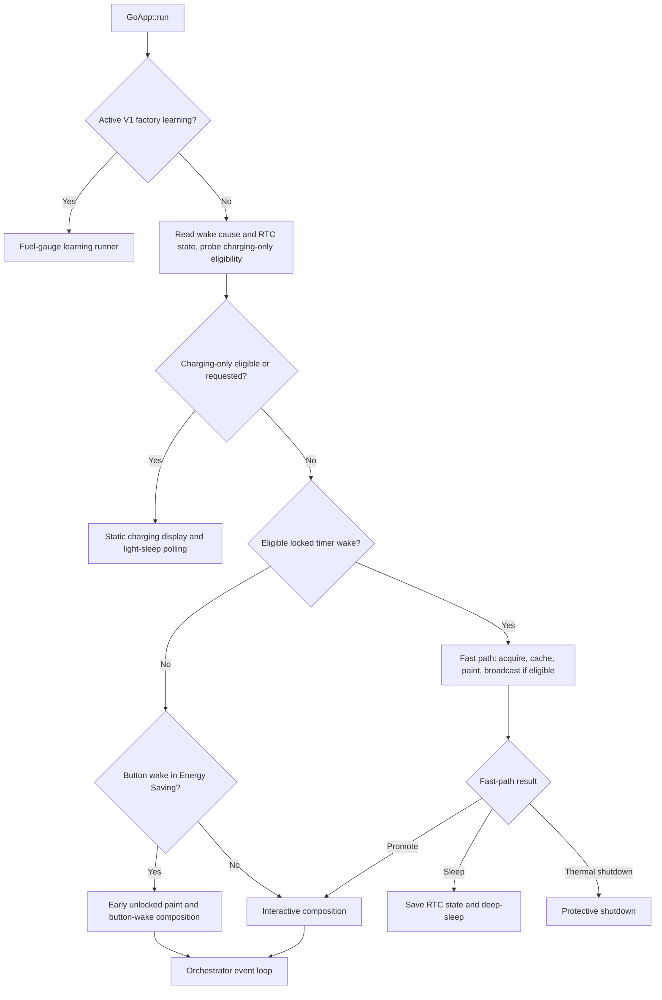
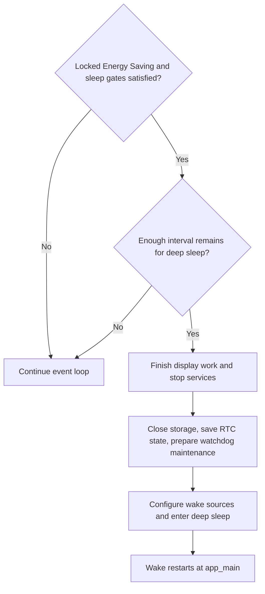
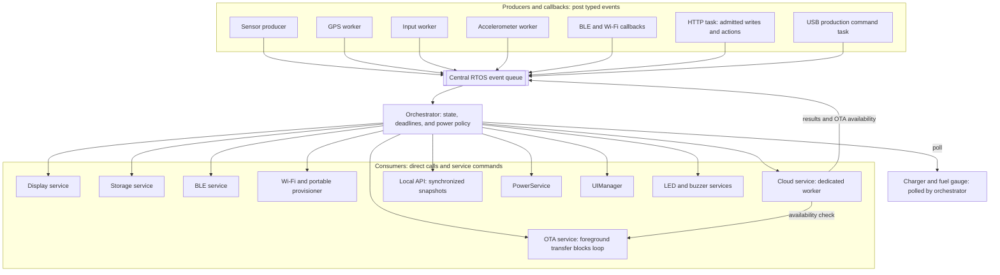
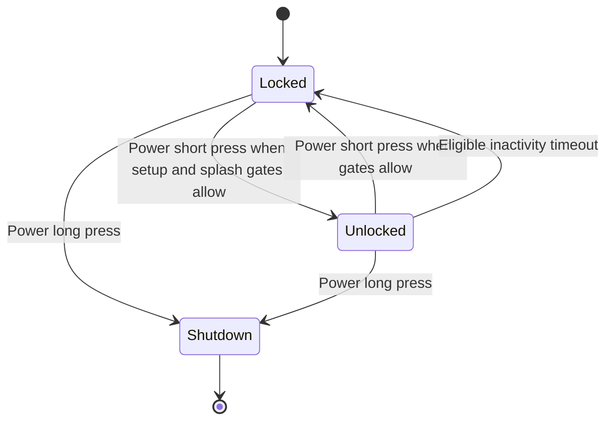
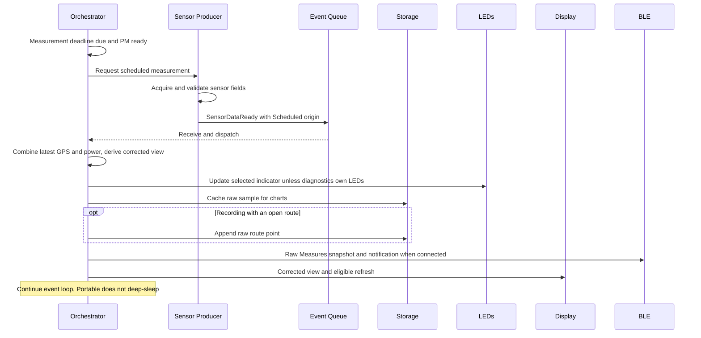
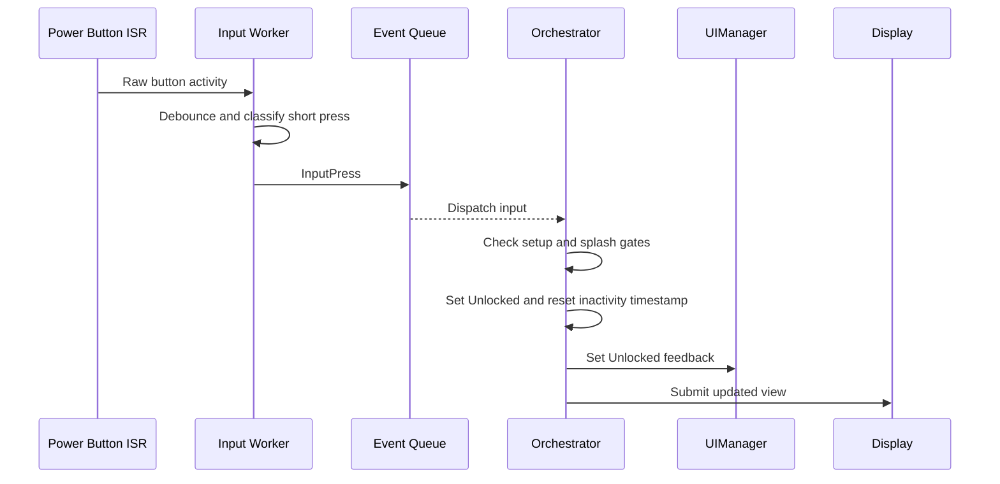

# AirGradient Go Architecture

Go composes shared ESP-IDF components into a battery-powered air-quality monitor
with GPS, an e-paper display, touch/buttons, and BLE or Wi-Fi connectivity.
It measures PM, CO2, TVOC, NOx, temperature, humidity, and pressure; Portable
tracking combines measurements with GPS in persistent route files.
This document explains ownership, boot paths, task boundaries, and data flow.
Use the [product README](README.md) for setup and the
[detailed documentation](#detailed-documentation) for subsystem contracts.

## System Structure

[`app_main()`](main/main.cpp) constructs `GoHardwareBoard` and `GoApp`.
`GoApp` chooses the boot path and composes product services through the
[`GoBoard` interface](main/go_board.h). `GoHardwareBoard` owns hardware drivers
and shared component instances; its lazy accessors reuse initialized objects.
Product services add Go policy, and `Orchestrator` coordinates their runtime
behavior. `UIManager` is a hardware-independent navigation state machine.

### Boot Composition

| Layer | Responsibility | Host-Test Boundary |
|---|---|---|
| [`main.cpp`](main/main.cpp) | Construct the real board and run the app | Hardware entrypoint |
| [`GoApp`](main/go_app.h) | Select boot path, construct services, launch runtime | Mock board and service stubs |
| [`GoBoard`](main/go_board.h) | Abstract hardware factories and platform operations | Interface implemented by the mock board |
| [`GoHardwareBoard`](main/go_hardware_board.h) | Initialize ESP-IDF, buses, drivers, and interrupts | Hardware-specific implementation |
| [`Orchestrator`](main/go_orchestrator.h) and [`UIManager`](main/go_ui.h) | Coordinate runtime policy and navigation | Services and platform operations can be substituted |

### Hardware Boundaries

V1 and V2 share application logic. Runtime eFuse selection determines pin
bindings and capabilities; peripheral probe failures do not select a different
board. Blank, unknown, or unreadable board IDs select V1. V2 uses an I2C expander
for several controls and requires it before initial display access.

Display and NAND share SPI; sensor, charger, gauge, and other peripherals share
I2C. EN_PM isolates the SPS30 bus rather than switching its supply. PowerService
combines the charger and optional board-selected gauge into one `PowerSnapshot`,
using charger-based battery estimation when gauge telemetry is unavailable.
See [Board Variants](docs/hardware_init.md#board-variants) for pins, capabilities,
and driver choices.

### Operating Modes and Application State

Operating mode determines connectivity and sleep policy:

| Mode | Connectivity | Tracking | Sleep |
|---|---|---|---|
| Portable | Connected BLE, with attached provisioning and BLE OTA | Start, pause, resume, and stop | Stays awake |
| Stationary | Wi-Fi cloud, optional local HTTP, and Wi-Fi OTA | Unavailable; entering ends the session | Stays awake |
| Energy Saving (`OperatingMode::Offline`) | Brief public BLE measurement broadcasts on eligible timer wakes | Unavailable; entering ends the session | Locked device can deep-sleep between measurements |

Portable is the default. Mode, lock state, tracking state, and UI screen are
separate state dimensions, with mode constraints enforced by the orchestrator.
Leaving Portable preserves route files but ends Recording or Paused sessions;
returning starts idle. See [Tracking Lifecycle](docs/orchestrator.md#tracking-lifecycle)
and [Settings](docs/settings.md).

| State Dimension | Owner | Architectural Effect |
|---|---|---|
| Operating mode | Orchestrator | Selects radios, tracking availability, GPS policy, and sleep eligibility |
| Behavior | Orchestrator | Idle, Tracking, or Shutdown; Recording and Paused both retain Tracking behavior |
| Tracking state | Orchestrator with StorageService | Idle, Recording, or Paused; only Recording with an open route permits appends |
| Lock state | Orchestrator | Gates menu interaction and Energy Saving sleep |
| UI screen | UIManager, coordinated by orchestrator | Chooses presentation without defining whether tracking or sensing is active |

Start failure leaves Idle; Resume failure leaves Paused. Pause retains live
sensing, chart caching, GPS policy, and connectivity, while route appends stop.
Menus and lock/unlock do not themselves end a tracking session. Energy Saving
clears retained tracking state and suppresses GPS acquisition regardless of its
saved preference. These constraints mean the state dimensions cannot be combined
arbitrarily. See [Tracking Lifecycle](docs/orchestrator.md#tracking-lifecycle).

## Boot and Lifecycle

### Wake and Boot Path

Deep sleep restarts execution at `app_main()`. RTC state carries the sleep
handoff; NVS carries durable settings. A power cut loses RTC state.

The fast path avoids the full orchestrator and producer tasks. It returns a
`BootHandoff` when interactive operation is needed so already acquired data
and painted frames can be reused. It never appends tracking routes.
Button wake paints retained display values early, then initializes services
while the display worker refreshes. Display and NAND share SPI; startup orders
their access to avoid redundant refreshes and storage contention.

Charging-only boot runs without sensors, radios, storage, or the orchestrator.
A power-button wake restarts normal startup. The V1 factory-learning runner is
also a separate boot path, armed explicitly from Hardware Test.

During interactive startup, sensors warm while the first-use guide or splash
is visible. The orchestrator owns onboarding completion and screen transitions.
The USB production command service starts before onboarding and parks after
completion. See [Hardware Initialization](docs/hardware_init.md),
[UI Setup Guide](docs/ui_manager.md#screen-navigation), and
[Serial Command Service](docs/serial_command_service.md).

### Initialization and Handoff

In measurement boot paths, core initialization precedes independent fuel-gauge
initialization and the charger attempt; PowerService and sensors follow.
The charger arms PMID before PM acquisition. Interactive, button-wake,
factory-learning, and promoted fast-path operation restart when charger retries
fail. A fast path returning directly to sleep may continue with the optional
gauge and non-PM sensors. Idempotent board initialization lets promotion reuse
objects already created by the fast path.

`BootHandoff` makes that reuse explicit: it carries whether a frame was painted
and a measurement completed, the initial lock state, whether to suppress the
waking button press, and any retained display or fresh measurement data.
The display snapshot seeds presentation; raw readings come from fresh data or
the raw RTC chart cache, never from corrected display values.

The button-wake path has four architectural stages:

1. Start an unlocked frame from retained display data, after V2 expander setup.
2. Initialize core services and start producers while the display refreshes.
3. Mount NAND after shared SPI becomes available, then compose dependent services.
4. Initialize the orchestrator with the painted-frame handoff and run its loop.

This avoids an empty-frame refresh followed by a second unlocked-frame refresh.
See [Hardware Initialization](docs/hardware_init.md#button-wake-path-goapprun_button_wake_path)
for the sequence and [BootHandoff](docs/hardware_init.md#boothandoff) for fields.

### Onboarding and Manufacturing

The first-use guide is an application gate, not a pause in acquisition. Sensor
warmup and Portable BLE continue while it is visible. Onboarding is durable in
NVS; completing the guide, authenticated BLE engagement, or a normal mode change
ends the gate. Factory reset restores it. The orchestrator protects setup,
pairing, and menu screens from being replaced by an incoming measurement.

Before onboarding, Button 2 short press enters an ephemeral manufacturing
Stationary session. It uses transient factory Wi-Fi, leaves onboarding unset,
and disables local HTTP/mDNS to preserve TLS heap. Manufacturing shutdown clears
routes, credentials, and settings while retaining active measurement corrections.
The USB production command service is independently available before onboarding.
See [Input Handling](docs/orchestrator.md#input-handling),
[Manufacturing Wi-Fi](docs/wifi_service.md#manufacturing-factory-wi-fi), and
[Serial Command Service](docs/serial_command_service.md).

### Sleep and Shutdown

Only locked Energy Saving operation can enter measurement-cycle deep sleep,
after its first measurement and other lifecycle gates permit it. Portable and
Stationary stay awake even when locked. Sleep duration subtracts awake work
from the selected measurement interval; if the remaining duration is below the
deep-sleep threshold, execution stays interactive. Timer fast paths can instead
promote when a power-button press is latched.

User shutdown is distinct from the measurement sleep cycle. On battery, charger
ship mode cuts power and loses RTC state. Releasing the power button leaves the
unit off; holding it through the cut can wake the charger again and cold-boot.
With confirmed USB input, user shutdown requests a charging-only reboot instead.
Battery discharge/temperature trips use protective shutdown handling.

The external watchdog must remain serviced through these transitions: the
interactive loop feeds it, foreground OTA uses progress callbacks, deep sleep
uses the LP-core feeder, and charging-only operation feeds it from the main CPU.
See [Sleep Entry](docs/power_management.md#sleep-entry),
[Shutdown](docs/power_management.md#shutdown-qon--ship-mode), and
[Watchdog Lifecycle](docs/power_management.md#lp-core-watchdog-feed-deep-sleep).

## Runtime Interactions

The orchestrator owns application state and active settings. Background tasks
post typed events to its central queue; it dispatches events, checks deadlines,
and calls service APIs. Most timer deadlines are evaluated in this loop rather
than separate timer tasks. [`go_events.h`](main/go_events.h) defines payloads;
[Orchestrator](docs/orchestrator.md) explains dispatch and state transitions.

### Producer, Orchestrator, and Consumer Layout

These are runtime roles, not disjoint object categories. Cloud receives commands
and produces result events; BLE receives publication calls and produces callback
events. A direct service call may enqueue work on that service's worker rather
than execute all hardware work inline. Sensor requests likewise leave the
orchestrator by task notification and return through the central event queue.

### Event Loop and Handoffs

The loop first checks sleep eligibility, then waits on the central queue until
an event arrives or the nearest deadline expires. It dispatches a received
event and checks due timers. Measurement scheduling, inactivity, PM pre-wake,
BMS polling, and watchdog servicing are evaluated there; they do not require
a separate timer producer task.

| Event Family | Data Crossing the Boundary | Orchestrator Responsibility |
|---|---|---|
| `SensorDataReady`, PM boundary events | Raw measures plus Scheduled/Refresh origin; PM lifecycle completion | Update views, release pending work, control PM bus isolation |
| `GpsFixUpdate`, `ShakeDetected` | Fix snapshot or detection timestamp | Update GPS state or admit a manual refresh |
| `InputPress` | Classified input source and gesture | Apply lock/setup gates, then route to UIManager |
| BLE connection, pairing, Config, and History events | Connection/authentication data or a pending-buffer signal | Own onboarding, settings changes, commands, and export |
| Wi-Fi and provisioning events | Connectivity state, IP, or pending provisioning request | Coordinate radio ownership, setup screens, cloud, and local endpoint |
| Cloud results and `WifiOtaAvailable` | POST result, parsed configuration/actions, or update availability | Recheck policy and apply settings or start foreground OTA |
| `LocalApiRequestReady` | Generation tag for a bounded request FIFO | Consume one matching request, persist settings, or execute an action |
| `SerialCommandRequest` | Parsed production request | Execute supported production commands on the application task |
| Sensor test and calibration completion | Operation result | Update diagnostic UI and applicable client feedback |

The event enum also defines system and user-action events. Ordinary UI handling
does not require another queue hop: `UIManager::handle_input()` returns an action
that the orchestrator executes in the current dispatch. Full payload definitions
live in [`go_events.h`](main/go_events.h); timer gates and dispatch rules live in
[Orchestrator](docs/orchestrator.md#event-loop).

### Task Map and Blocking Boundaries

| Execution Context | Responsibility | Handoff |
|---|---|---|
| Orchestrator | Mode, lock, tracking, settings, power policy, and lifecycle | Receives events and invokes service commands |
| Sensor producer | SensorManager acquisition, gas sampling, PM preparation, diagnostics | `SensorDataReady`, PM boundary events, calibration/test results |
| GPS worker | Receiver acquisition and timed sleep | Protected latest fix and `GpsFixUpdate` |
| Input worker | Debounce and classify buttons/touch | `InputPress` |
| Accelerometer worker | V1 interrupt capture and both boards' diagnostics | `ShakeDetected` and synchronous diagnostic requests |
| NimBLE host | Connection, authentication, and characteristic callbacks | Pending write buffers plus BLE events |
| Cloud worker | Sequential POST, Fetch, and OTA availability checks | Results and `WifiOtaAvailable` |
| Shared HTTP server | Provisioning routes or local API | Snapshot reads; local writes/actions enter an epoch-tagged FIFO |
| USB production command task | Receive commands before onboarding | `SerialCommandRequest` |
| Display, LED, and buzzer workers | Hardware output | Commands and rendered snapshots from application policy |

Power polling runs in the orchestrator; it has no dedicated task. OTA also has
no task of its own: foreground transfer blocks the orchestrator after coordinated
service pauses. History export blocks it while streaming with BLE backpressure.
Display refresh runs asynchronously, but lifecycle transitions can explicitly
wait for a frame to finish. These blocking boundaries matter when adding events
or changing timing.

Sensor acquisition and measurement publication have different clocks. In
always-awake modes, SensorProducer samples gas indices on its own cadence while
the orchestrator requests measurements at the selected interval. PM preparation
also spans multiple worker steps; completion events keep the orchestrator from
requesting acquisition before PM is ready. The Energy Saving timer fast path
does not retain the gas algorithm across deep sleep and uses raw gas placeholders
instead. See [Sensor Producer](docs/sensor_producer.md#task-loop) and its
[Offline Fast Path](docs/sensor_producer.md#offline-fast-path).

GpsService owns receiver access and a protected latest fix, including time
synchronization. Inactive receiver sleep has its own deadline; requesting GPS
does not necessarily make it available immediately. AccelService owns both V1
shake capture and diagnostic access on either board; V2 has no background shake
polling. See [GPS Service](docs/gps_service.md) and
[Accelerometer Service](docs/accel_service.md).

### UI State and Locking

UIManager owns screen navigation and builds `DisplayValues` from application
inputs and synchronized display settings. See
[UI frame inputs](docs/ui_manager.md#frame-inputs-and-settings) and
[display frame ownership](docs/display_service.md#displayvalues) for their
contracts. The orchestrator forwards eligible input, executes returned actions,
and directly selects lifecycle screens such as pairing, provisioning, and
shutdown. Opening a menu does not pause sensing or tracking. The first-use guide
is both a boot-gate screen and a screen that can be reopened from Settings.

| Lock State | Input and Presentation | Sleep |
|---|---|---|
| Locked | Home/dashboard; touch cannot navigate and can show Unlock First feedback | Eligible only in Energy Saving after measurement/lifecycle gates |
| Unlocked | Touch navigates UI; auto-lock applies only when enabled and allowed by the current screen/session | No measurement-cycle deep sleep |

Setup and splash screens suppress ordinary power-button lock toggles. Diagnostic
and other focus screens suppress inactivity auto-lock as defined by the
orchestrator. The power-button long press remains a shutdown request in either
lock state. Button 2 long press requests factory reset; its short press has the
pre-onboarding manufacturing role described above. TouchEnter supports more than
a short press: its long/double gestures also participate in navigation.
See [Input Service](docs/input_service.md) and
[UI Navigation](docs/ui_manager.md#screen-navigation) for gesture and screen rules.

### Shared Resource Ownership

Portable BLE, attached provisioning, and BLE OTA register on one board-owned
`AgBleServer` before advertising. Stationary standalone provisioning takes that
server only after Portable teardown. The orchestrator controls the handoff.

Captive-portal provisioning and local HTTP use one process-lifetime
`HttpServer`. Provisioning releases its routes before the local API activates.
Local GET handlers read synchronized snapshots; config writes and actions go
through a bounded FIFO to the orchestrator, which owns NVS changes and hardware
side effects. See [BLE Service](docs/ble_service.md),
[Wi-Fi Service](docs/wifi_service.md), and [Local Server](docs/local_server.md).

Portable provisioning brings Wi-Fi up only for requested scan/connect work and
then releases it, while retaining the bonded BLE connection. Stationary uses
saved networks or provisioning; cloud starts after connectivity becomes ready.
On Stationary exit, cloud drains in-flight HTTP before Wi-Fi teardown. Local
routes can remain registered through a transient reconnect, while mDNS follows
address availability. Its activation and teardown are separate from the cloud
transport enable switch.

The custom Portable GATT service requires authenticated pairing/bonding. Energy
Saving advertisements are public, non-connectable broadcasts, a separate surface
from that service. Local HTTP relies on the local network trust boundary. See
the [BLE Client Reference](go_ble_client.md#2-pairing-and-security) and
[Local HTTP Security](../../docs/local_http_api.md#security).

### OTA Coordination

BLE OTA pauses sensitive services before the foreground transfer. In Stationary,
the cloud worker checks availability sequentially with POST/Fetch, disarms itself,
and posts `WifiOtaAvailable`. The orchestrator rechecks eligibility; sensing, GPS,
and PM are paused only when download starts, not during the availability probe.

During a committed Stationary update, an already-active local listener can serve
cached GET snapshots while writes and actions are rejected. OTA does not start a
previously disabled endpoint. A non-rebooting result restores the prior access
state; the orchestrator decides whether a successful transfer should reboot.
See [OTA Service](docs/ota_service.md) and
[OTA Orchestration](docs/orchestrator.md#firmware-update-ota).

## Data Flow

### Scheduled Measurement While Tracking

For a Portable session in Recording state, a due measurement follows this path.
Locking changes interaction, not the recording pipeline or Portable's awake policy.

Stationary follows the acquisition and chart-cache path without route appends;
it publishes raw data to the cloud snapshot and corrected data to the local API.
The cloud worker posts independently on its transport schedule. A snapshot
update is not itself a network POST.

### Measurement Views and Consumers

| Consumer | View | Boundary |
|---|---|---|
| Cloud POST, BLE Measures, and Energy Saving broadcasts | Raw | External consumers choose their correction policy |
| Persistent routes and BLE history export | Raw | Corrections never rewrite stored points |
| RTC chart cache | Raw | Rendering applies the current corrections to a scratch view |
| Current display and rendered charts | Corrected | Display-unit conversion follows correction |
| Back LED | Corrected PM2.5 or unchanged CO2 | Follows the selected indicator |
| Local HTTP measures | Corrected | Handler reads a synchronized published snapshot |
| RTC display snapshot | Display state | Used for early paint, never as raw acquisition data |
| Sensor compensation, validation, and health checks | Raw | User correction must not alter sensor diagnostics |

Energy Saving bypasses temperature/humidity correction while retaining PM2.5
correction. A mode change recomputes the view without changing saved calibration.
[Measurement Corrections](docs/measurement_corrections.md) owns the complete
consumer mapping, mode policy, and wake initialization rules.

A manual refresh updates current readings and transport snapshots without
adding chart or route samples or resetting scheduled timers. A pending scheduled
measurement may satisfy the refresh and retain its scheduled origin. See
[Shake-To-Refresh](docs/orchestrator.md#shake-to-refresh).

### Unlock While the Runtime Is Active

This flow starts with an already-running input worker. Waking from deep sleep
instead follows the button-wake boot path, which paints before full composition
and suppresses the waking press so it does not immediately relock the device.
Display submission is distinct from completion of the e-paper refresh.

### Configuration and Persistence

Configuration follows a separate path: UI, BLE, local HTTP, cloud, and production
commands submit changes through the product's validation and persistence logic.
The complete candidate is validated and persisted before activation, then
transport snapshots and affected services are updated. Remote-source policy
can reject local HTTP or cloud writes; it does not gate UI or BLE. See
[Settings](docs/settings.md) for ownership and
[Local Server](docs/local_server.md#configuration) for HTTP admission semantics.

`cloudConnection` controls cloud transport, including automatic Wi-Fi OTA checks;
it does not disable local HTTP or mDNS. `configurationControl` selects local,
cloud, or both remote writers. Authority is checked again when queued work is
consumed, so a previously admitted request need not become active. UI, BLE,
provisioning, and factory/system writers bypass that remote-source gate but still
validate and persist changes. See [Configuration Authority](docs/settings.md#configuration-authority).

| State or Data | Storage | Lifetime and Purpose |
|---|---|---|
| Active settings, onboarded flag, and saved networks | NVS through configuration services | Survive resets and power-off |
| BLE bonds | NimBLE NVS persistence | Restore authenticated relationships across power cycles |
| Chart samples | RTC payload-cache ring buffer | Survive deep sleep; overwritten when full and lost on power cut |
| Retained app state and display snapshot | RTC memory | Restore sleep context and early presentation |
| Tracking routes | SPI NAND filesystem | One file per session; survive power-off subject to successful synchronization |

Normal factory reset clears routes, chart cache, saved networks, BLE bonds, and
Go settings before reboot on success. Manufacturing and explicitly requested
production reset paths preserve active corrections. See
[Factory Reset](docs/orchestrator.md#factory_reset) and
[Storage Durability](docs/storage_service.md#durability-budget) for failure handling.

## Constraints and Decisions

- **Heap:** Wi-Fi/TLS consumes substantial ESP32-C5 heap. Cloud resources are
  deferred until needed; provisioning and OTA coordinate service pauses and
  teardown. [Cloud Service](docs/cloud_service.md) owns tuning details.
- **Power:** PMID stays armed across measurements to avoid boost-start inrush
  resets. Native SPS30 sleep and bus isolation reduce consumption; EN_PM is not
  a supply switch. See [PMID rationale](docs/power_management.md#why-pmid-is-session-armed).
- **Persistence:** RTC charts survive deep sleep, route files survive power-off,
  and NVS stores settings. Route creation and synchronization must succeed before
  making durability claims; see [Storage Service](docs/storage_service.md#durability-budget).
- **Hardware boundaries:** `GoBoard`, shared HALs, and RTOS abstractions let
  boot and policy logic run under `TEST_HOST`. Host tests cover logic; physical
  timing, radio behavior, and peripheral interaction still need device verification.

## Detailed Documentation

- [Settings Service](docs/settings.md)
- [Sensor Producer](docs/sensor_producer.md)
- [Accelerometer Service](docs/accel_service.md)
- [GPS Service](docs/gps_service.md)
- [Input Service](docs/input_service.md)
- [Storage Service](docs/storage_service.md)
- [Display Service](docs/display_service.md)
- [UI Manager](docs/ui_manager.md)
- [Power Management](docs/power_management.md)
- [BLE Service](docs/ble_service.md)
- [Wi-Fi Service](docs/wifi_service.md)
- [Local Server](docs/local_server.md)
- [Cloud Service](docs/cloud_service.md)
- [OTA Service](docs/ota_service.md)
- [Measurement Corrections](docs/measurement_corrections.md)
- [Orchestrator](docs/orchestrator.md)
- [Hardware Init](docs/hardware_init.md)
- [LED Service](docs/led_service.md)
- [Portable Provisioner](docs/portable_provisioner.md)
- [Hardware Test](docs/hardware_test.md)
- [Serial Command Service](docs/serial_command_service.md)
- [Fuel-Gauge Learning](docs/fg_learning.md)
- [BLE Client Reference](go_ble_client.md)
- [Shared Local HTTP Contract](../../docs/local_http_api.md)
- [Release Firmware](../../README.md#release-firmware)
