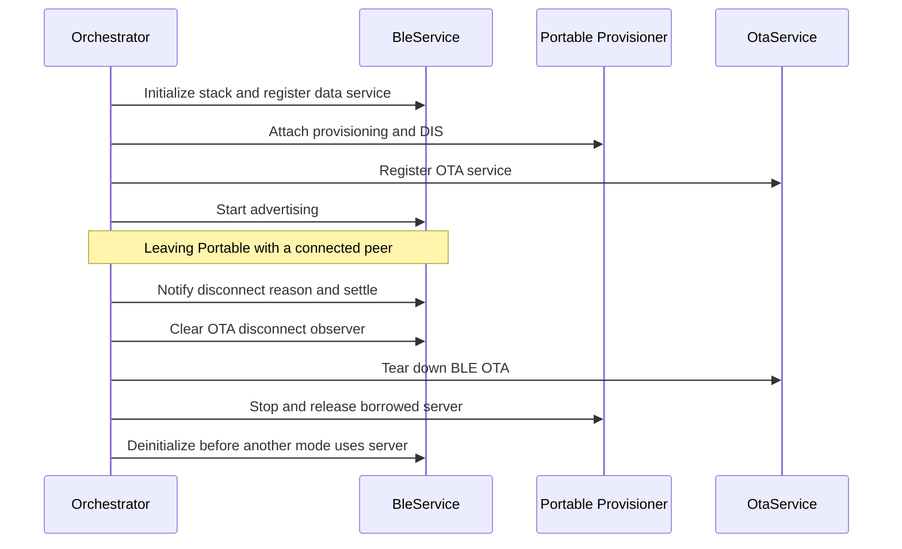
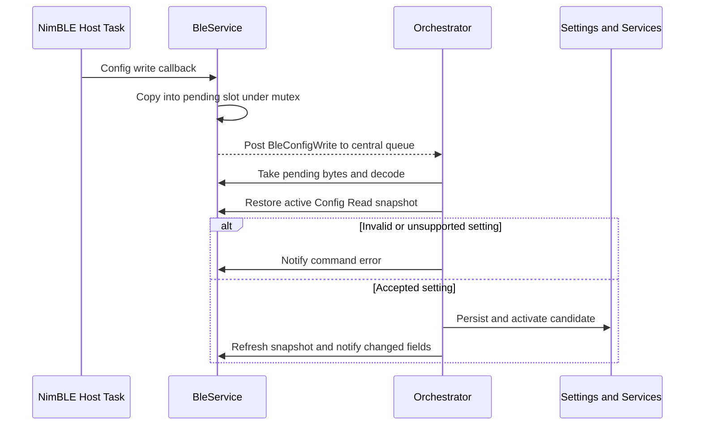
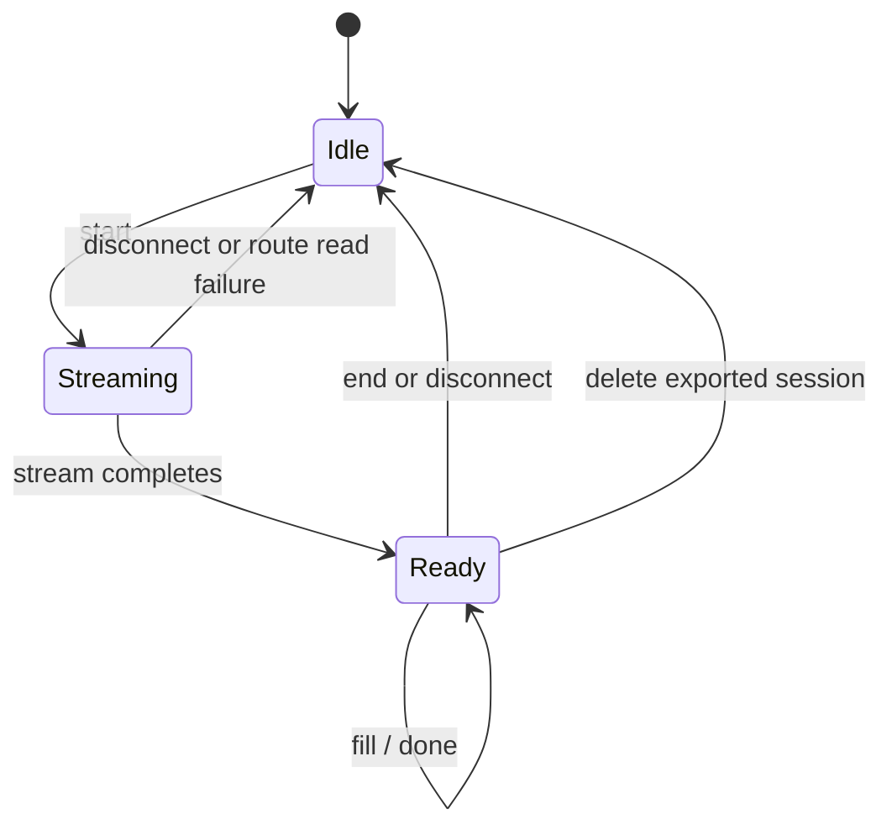

# BLE Service

BLE peripheral service for AirGradient Go. Exposes sensor measurements,
device status, configuration, and stored route data to a connected phone app
over a single custom GATT service. Active only in Portable operating mode.
Called synchronously by the orchestrator for data output; NimBLE callbacks run
in the NimBLE task and post lightweight events to the orchestrator queue.
Offline broadcasts bypass `BleService`; see
[Offline Broadcast Lifecycle](#offline-broadcast-lifecycle).

The [BLE Client Reference](../go_ble_client.md) owns UUIDs, wire payloads,
commands, error values, and client procedures. This document owns firmware
lifecycle, task boundaries, and integration with the orchestrator.

## Files

| File | Purpose |
|---|---|
| [`products/go/main/go_ble.h`](../main/go_ble.h) | `BleService` class declaration |
| [`products/go/main/go_ble.cpp`](../main/go_ble.cpp) | GATT setup, CBOR encoding, NimBLE callbacks, binary history streaming |
| [`products/go/main/go_ble_protocol.h`](../main/go_ble_protocol.h) | BLE CBOR protocol string constants (`BLE_KEY_*`, `BLE_VAL_*`) shared across BLE and orchestrator |
| [`products/go/main/go_ble_advertisement.h`](../main/go_ble_advertisement.h), `.cpp` | Offline 9-byte measurement encoder and wire constants |
| [`products/go/main/go_app.cpp`](../main/go_app.cpp) | Offline broadcast lifecycle around display refresh |

## Dependencies

| Dependency | Source | Usage |
|---|---|---|
| `NimbleBleServer` | `airgradient-ble` (`drivers/nimble_ble_server.h`) | Concrete NimBLE-backed BLE server; constructed lazily by `GoBoard::ble_server()` and borrowed by `BleService` (and by `WifiService` for the Stationary provisioning transport) |
| `AgBleServer`, `AgBleGattService`, `AgBleCharacteristic` | `airgradient-ble` (`hal/ble_server.h`) | Abstract BLE HAL interfaces |
| `AgBleProperty`, `AgBleIoCapability`, `AgBleAuth` | `airgradient-ble` (`hal/ble_types.h`) | Property flags, security enums, callback typedefs |
| `espressif/cbor` | ESP-IDF managed dependency (`^0.6.0~1`) | TinyCBOR `CborEncoder` for all CBOR payloads |
| `MeasuresAGo` | `airgradient-common` (`measures_types.h`) | Sensor measurement data + field-level `is_*_valid()` methods |
| `GpsData` | product ([`gps/gps_types.h`](../main/gps/gps_types.h)) | GPS position/fix data + `is_fix_valid()`, `is_latitude_valid()`, etc. |
| `PowerSnapshot` | product (`go_power.h`) | Battery voltage, percentage, charging state |
| `GoSettings` | product (`go_settings.h`) | Device configuration struct |
| `StorageService` | product (`go_storage.h`) | Route data read for history export, flash usage reporting, and command side effects |
| `RTOS`, `RtosMutex` | `airgradient-common` (`rtos.h`) | `delay_ms()`, `queue_send()`, mutex for pending write buffers |

## Public API

### GATT Responsibilities

| Characteristic | Operations | Firmware Responsibility | Client Contract |
|---|---|---|---|
| Measures | Read, Notify | Publish raw, field-validated sensor/GPS data | [Measures](../go_ble_client.md#5-measures-characteristic) |
| Status | Read, Notify | Keep a full snapshot and publish selected transition deltas | [Status](../go_ble_client.md#6-status-characteristic) |
| Config | Read, Write, Notify | Preserve the readable settings snapshot while dispatching settings and commands | [Config](../go_ble_client.md#7-config-characteristic) |
| History | Write, Notify | Export raw route records with selective retransmission | [History](../go_ble_client.md#8-history-characteristic) |

The [GATT reference](../go_ble_client.md#3-gatt-service-overview) owns UUIDs and
access requirements. Provisioning/DIS and OTA are additional services registered
on the same borrowed server; firmware version comes from DIS, not Status.

### Lifecycle

| Method | Description |
|---|---|
| `BleService(event_queue, storage, ble_server)` | Constructor. `event_queue` is `RtosQueueHandle`, `storage` is `StorageService&`, `ble_server` is the borrowed `AgBleServer&` shared with the Stationary provisioning transport. The orchestrator enforces mutual exclusion across operating modes: Portable owns the server through `BleService`; Stationary provisioning owns it through `WifiService::ProvisioningManager`. |
| `init(serial)` | Convenience wrapper: `init_stack_and_register(serial)` then `start_advertising()`. Returns `false` on failure. |
| `init_stack_and_register(serial)` | Phase 1: init NimBLE, configure security (`DISPLAY_ONLY` + `BOND \| MITM`, always required), register the AGo data service + characteristics and connection callbacks, store the advertised name. Does **not** advertise, so extra GATT services can be slotted in before `start_advertising()`. |
| `start_advertising()` | Phase 3: set the advertised name + service UUID and begin advertising. Latches `_initialized = true` on success. |
| `deinit()` | Stop advertising, disconnect, tear down. Resets all char pointers to `nullptr`, `_connected` to false, `_export_active` to false, `_initialized` to false. Safe to call when not initialized. |
| `set_disconnect_observer(cb)` | Register an optional, nullable disconnect observer. Invoked **first** inside `on_disconnect()` on the NimBLE host task, before the existing handling (advertising restart / `BleDisconnected` post). The orchestrator uses it to forward the disconnect to `OtaService` so an in-flight BLE OTA transfer aborts synchronously. `BleService` keeps sole ownership of the server's single disconnect slot — the observer is a fan-out, not an override. |

In Portable mode the orchestrator drives the two-phase init so the
`PortableWifiProvisioner` can co-register the provisioning service + DIS on the
same server between phases (all GATT services must be registered before
advertising). See
[`portable_provisioner.md`](portable_provisioner.md).

The same two-phase window co-registers the **OTA GATT service**: the orchestrator
calls `OtaService::setup_ble()` between `portable_provisioner.attach()` and
`start_advertising()`. On success it installs a disconnect observer via
`set_disconnect_observer()` so a central disconnect aborts an in-flight transfer
synchronously, and clears the observer on leave-Portable before `deinit()`. A
failed `setup_ble()` is non-fatal (advertise without OTA). See
[`ota_service.md`](ota_service.md) and
[`orchestrator.md` → OTA](orchestrator.md#firmware-update-ota).

### Data Output

| Output | Caller Contract |
|---|---|
| Measures | `notify_measures()` updates the readable raw snapshot and attempts notification while connected. Missing characteristics make it a no-op. |
| Status | `update_status()` owns the full Read value. Tracking and charging helpers refresh that value before sending a delta; disconnect notices leave it unchanged. |
| Config | `update_config()` owns the active settings Read value. `notify_config()` refreshes it before sending changed fields. Snapshot and notification size budgets differ. |
| Command feedback | Progress and result notifications do not replace stored Config. They report application progress separately from GATT write acknowledgement. |

The [client reference](../go_ble_client.md) owns field names and payload shapes.
See [snapshot ownership](#snapshot-and-notification-ownership) for publication
ordering and [`go_ble.h`](../main/go_ble.h) for full signatures.

### Pending Write Retrieval

| Method | Thread Safety | Description |
|---|---|---|
| `take_pending_config_write(buf, buf_size)` | Locks `_config_write_mutex` | Copies raw CBOR, clears pending flag, returns byte count (0 if none pending). |
| `take_pending_history_write(buf, buf_size)` | Locks `_history_write_mutex` | Same pattern for history writes. |

### History Download and Management

| Method | Description |
|---|---|
| `handle_history_list()` | Reads sessions from storage, sends paginated CBOR session list notifications (6 per page). |
| `handle_history_start(session_id)` | Verifies the route file exists, sends `"started"`, streams all points as binary, then sends `"done"`. Existing empty sessions complete with zero points. Aborts with `"error"` on flash failure. |
| `handle_history_fill(point_indices, count)` | Sends binary notifications for requested points, then `"done"`. |
| `handle_history_end()` | Sets `_export_active = false`, sends `"ended"`. |
| `handle_history_delete(session_id)` | Verifies the route file exists, ends export if active for this session, deletes the route file, and sends `"deleted"` or `"error"`. Empty sessions are valid. Caller must check active tracking conflict first. |
| `notify_history_error(err)` | Sends a history error notification. Used by orchestrator for errors detected before delegation (e.g., `"session_active"`). |

All History responses can wait for BLE transmit capacity, including control
responses from List, End, and Delete.

History export reads raw route points and encodes those values directly. Both
`handle_history_start()` and `handle_history_fill()` leave correction policy to
the BLE client. Route files are never rewritten, and route points do not carry a
correction-version identifier.

### Connection State

`is_connected()` is an atomic GAP-link observation, not proof of authentication,
subscription, or delivery. `is_authenticated()` reads the stack's live security
state and requires an active link; the UI uses it for the connected icon.
`is_initialized()` latches only after advertising starts successfully. The
borrowed server exists before that point, so pointer presence is not readiness.

## Behavior

### Registration and Teardown

Leaving Portable sends a disconnect notice and waits
`BLE_MODE_CHANGE_NOTIFY_SETTLE_MS` (200 ms) while connected. This gives the
fire-and-forget notification time to drain; it does not guarantee delivery.
The mode change goes through `change_mode()` regardless of its UI or BLE origin.
A BLE mode write skips its Config delta because teardown follows immediately.
Shutdown uses its existing post-paint dwell for the same purpose.

### Advertising

The public [advertising contract](../go_ble_client.md#advertised-name) is shared
by Portable BLE and Stationary provisioning.

Implementation detail: the name is built by the shared
`compute_ble_adv_name(serial, ...)` helper (declared in `go_ble.h`), which
slices the last four characters of the full 12-char lowercase hex serial. The
caller builds the serial via `build_serial_number()` from `airgradient-common`.
If the serial is null or shorter than four characters, the suffix falls back
to `"0000"` so the name format stays stable.

The same helper is used by `WifiService` so that **Stationary** standalone
provisioning advertises the identical `AirGradient Go <last4>` name rather than
the component default `"AirGradient"`. (In Portable, the attached provisioner
borrows the server `BleService` already advertises, so it inherits this name.)

The 128-bit service UUID is placed in the advertising payload. The complete
local name goes in the scan response (the UUID plus AD flags consume 21 of the
31-byte advertising payload, leaving insufficient room for the full name).
The 19-character name fits comfortably in the 29-byte scan response budget.

Advertising is single-connection: `on_connect()` calls `stop_advertising()`,
`on_disconnect()` calls `start_advertising()`.

Portable mode uses a fixed **500 ms** advertising interval, configured via
`AgBleServer::set_advertising_interval()` and retained across reconnects.
Attached provisioning shares this interval; Stationary standalone provisioning
uses the stack defaults.

### Offline Broadcast Lifecycle

`GoApp::execute_fast_path()` encodes raw measurements and the latest battery
percentage in the 9-byte v1 payload. It advertises the Offline service UUID
list and manufacturer data at a **50 ms** interval during synchronous display
refresh, with no additional wait. The display's 10 ms BUSY-poll delays allow
NimBLE to run. BLE stops and deinitializes before the final sleep decision,
which includes BLE setup and teardown time.

Broadcasting is skipped when deep sleep is not expected, promotion is already
required, a button press is latched, or a shutdown request is pending. Setup
failures release BLE and allow display and sleep handling to continue. These
public advertisements require no bond and contain no GPS data. See the
[client guide](../go_ble_client.md#offline-measurement-broadcasts) for the payload
format, deduplication guidance, and listener command.

### Authentication

`BleService` configures Display Only IO with bonding and MITM protection.
The custom characteristics require authenticated access. The passkey callback
posts `BlePairingRequest` so the orchestrator can render it; the encryption-change
callback posts `BleAuthComplete` for onboarding. Failed pairing leaves onboarding
incomplete. NVS stores bonds for subsequent reconnects.

`is_connected()` reports a GAP link only. `is_authenticated()` queries the live
stack state so a bonded reconnect does not depend on a cached event. See the
[client pairing procedure](../go_ble_client.md#2-pairing-and-security).

### Snapshot and Notification Ownership

The orchestrator publishes raw sensor and GPS data through `notify_measures()`.
The stored characteristic remains readable even without a subscriber. Status
and Config each have a full Read snapshot and separate notification deltas;
command results and disconnect notices must not overwrite those snapshots.
Use the [Status contract](../go_ble_client.md#6-status-characteristic) and
[Config contract](../go_ble_client.md#7-config-characteristic) for client behavior.

The charging transition is detected in the orchestrator's
`on_bms_status_timer()` (the ~5 s fast charging-status poll) on a change in
`is_bms_charging(...)` or the BMS power source; the same handler also refreshes
the display. The four slow Read-only fields (`gps_fix`, `gps_sat`, `flash_kb`,
`used_kb`) are never pushed — clients poll them via Read at a ~30 s cadence
(aligned with the full BMS poll) while a relevant screen is visible.

The legacy tracking boolean derives from `TrackingState` and is true for
Recording and Paused. Route-write eligibility is the orchestrator's separate
`is_recording()` decision; BLE Status does not prove that the last append was
durable. See [Tracking Lifecycle](orchestrator.md#tracking-lifecycle).

`notify_config(prev, cur)` refreshes the full Read snapshot before publishing a
changed-fields delta, so a client reacting with a Read sees the new settings.
A no-op or a change invisible to BLE produces no delta. The stored snapshot and
notifications have separate size budgets because notifications must fit a single
ATT payload; Config Read can use Read-Long.

After taking any Config write, the orchestrator restores the stored value from
active settings, including rejected writes and commands. Otherwise a GATT write
would leave its request bytes as the subsequent Read value. Successful settings
activation refreshes the snapshot again. UI and other settings writers use the
same publication boundary; see [Configuration Updates](measurement_corrections.md#configuration-updates-and-persistence).

### Encoding and Validation

TinyCBOR encodes into caller-provided buffers. Measures uses field-specific
validators to omit invalid fields without changing the raw source data.
GPS fields are considered only for a valid fix; latitude, longitude, and
altitude also pass their own validators. The timestamp is always included.
Status uses a complete snapshot with its documented fallback values rather
than Measures-style omission. See the
[payload conventions](../go_ble_client.md#4-serialization) for numeric types.

[`go_ble_protocol.h`](../main/go_ble_protocol.h) centralizes key names,
operation/command names, and error strings used by the encoders and orchestrator.
Changing a mapping affects the client contract, so update the reference and
encoding/decoding tests together.

Config decoding records requested shared fields separately from changed values.
This lets the orchestrator reject an unsupported hardware field even when a
write would otherwise be a no-op, such as V2 `tled=0`. Rejection order is unknown
keys, invalid values, multiple recognized key occurrences, then unsupported
hardware. The occurrence count includes duplicates and BLE-only settings;
a complete correction group counts as one key. Recognized legacy interval
keys are ignored as documented in the [write contract](../go_ble_client.md#72-write-set-config).

Accepted candidates are persisted before activation. Updating a correction
recomputes the display/LED view without rewriting routes or emitting corrected
Measures. Sensor configuration changes are handed to SensorProducer; GPS aiding
is handed to GpsService. The latter can provisionally seed an unsynchronized
system clock, which affects route timestamps; see
[Set Aiding](../go_ble_client.md#set-aiding-payload) for the contract.

### Callback Handoff and Thread Safety

NimBLE callbacks copy Config and History writes into separate mutex-protected
pending buffers, then post lightweight events. The orchestrator takes and
clears each buffer before decoding. These are single pending slots, not FIFOs:
a later write can overwrite an unconsumed write. A failed event-queue send is
not retried. Clients must serialize operations rather than treat a GATT write
acknowledgement as application completion.

`_connected` is atomic. The pending buffers have individual `RtosMutex` guards.
History export state is mostly manipulated by the orchestrator, but the
NimBLE disconnect callback also clears `_export_active`; that state has no
mutex. This is an existing concurrency limitation, not a single-writer guarantee.

The callback's buffer copy runs on the NimBLE host task; retrieval, decoding,
and side effects run on the orchestrator task. Commands and aiding requests have
their own dispatch paths. A mode change that leaves Portable uses the disconnect
notice and teardown flow instead of a Config delta. Persistence failure leaves
active settings unchanged and produces a command error.

### CO2 Calibration Completion

`Co2CalibrationDone` is a shared completion event with no origin or request ID.
The orchestrator always updates the snackbar and attempts a BLE `cmd_result`;
the BLE notify is a no-op when no client is connected. Consequently, progress
is emitted only for a BLE-originated request, while a connected client can
observe a completion caused by an HTTP or on-device request.

There is no shared calibration busy or duplicate gate. Every decoded BLE
`co2_cal` emits progress and signals the producer, but the producer uses one
overwrite notification slot. Repeated or overlapping requests can coalesce and
results cannot be correlated to individual writes. Clients send one request at
a time and wait for a `cmd_result` before retrying, but cannot prove that result
belongs to their write.

### History Export

The client reference retains the [complete download and gap-recovery diagrams](../go_ble_client.md#84-download-protocol-flow).
The firmware keeps an export session open after the initial stream so clients
can request missing point indices with `fill`; `done` marks completion of one
send pass, while `end` releases the export session.

History reads raw route files through `StorageService`; correction policy belongs
to the client. Export never rewrites stored points. The orchestrator rejects
deletion of its current Recording or Paused session before delegating to BLE.

Session listing allocates a vector of IDs and sends paginated results. Start
and Delete use `route_file_exists()` to distinguish a valid empty session from
a missing file; a zero point count alone cannot make that distinction.

#### Server-Side Pacing

The server streams notifications in a blocking loop. `notify()` returns
`false` when it cannot send, including transmit-buffer pressure. The server retries with
`RTOS::delay_ms(1)` until space is available. This self-paces to the BLE
link speed.

During a stream, the orchestrator does not process other events. The retry loop
has no elapsed-time limit; persistent notification-send failure while connected
can delay all queue-driven work. Do not assume history export is non-blocking.

Implementation: `send_history_cbor()` and `send_history_binary()` both contain
the retry loop. They also check `_connected` on each retry and abort if the
client disconnected mid-stream.

#### Storage Read Pattern

`handle_history_start()` reads points in batches of 4 (`ROUTE_READ_BATCH`),
converts each to wire format via `route_point_to_wire()`, and sends the
batch in a single binary notification. `handle_history_fill()` reads and
sends points one at a time.

`route_point_to_wire()` converts each native `RoutePoint` into the packed
little-endian representation using `memcpy` for floating-point bit conversion.
Do not send the native struct: its layout differs from
[RoutePointWire](../go_ble_client.md#appendix-routepointwire-binary-format).
The current batch is four 56-byte points plus a three-byte header, or 227 bytes;
a final partial batch is smaller. Batching does not adapt to the negotiated MTU.

#### Download State Machine

- **Idle**: `_export_active = false`. Accepts `list`, `start`, and `delete`.
- **Streaming**: Server is in blocking loop. Transitions to Ready when done.
- **Ready**: `_export_active = true`. Accepts `fill`, `end`, `list`, `start`
  (new start implicitly ends current), and `delete` (ends export if deleting
  the exported session).
- **list** is allowed regardless of export state once the orchestrator can
  dispatch the request; incoming commands do not interrupt the blocking stream.
- **Disconnect**: `on_disconnect()` sets `_export_active = false`.
- **Delete**: when dispatched, an exported session is ended before deletion.
  The orchestrator first rejects its active Recording or Paused route and
  applies provisioning/contention policy before starting export work.

## Edge Cases / Errors

- Stack, security, characteristic, service, or advertising setup failure returns
  failure with cleanup. Optional OTA setup failure permits ordinary BLE service.
- Null, empty, or oversized callback writes are logged and dropped. The pending
  buffer limit is defined in [`go_ble.h`](../main/go_ble.h).
- Encoding failure skips output. Most encoders use a 256-byte stack buffer;
  Config Read uses a separate 512-byte buffer. Do not size snapshots from the
  notification budget.
- Notifications are best-effort and require subscription. Status Read remains
  authoritative after reconnect; no retry policy makes a transition durable.
- History helpers retry backpressure with a 1 ms delay and check connection
  state on failed sends. Disconnect ends the export and restarts advertising.
- Route lookup, read, and deletion failures produce the documented
  [History errors](../go_ble_client.md#8-history-characteristic).
- History batching assumes the documented payload budget; the declared
  `MIN_USEFUL_MTU` constant does not enforce an MTU gate. Follow the
  [MTU requirements](../go_ble_client.md#12-mtu-considerations);
  do not assume large notifications are fragmented like reads.

## Build Integration

[`main/CMakeLists.txt`](../main/CMakeLists.txt) includes the BLE source and shared
component; [`main/idf_component.yml`](../main/idf_component.yml) declares TinyCBOR.
The normal product build resolves that managed dependency. Initialize repository
submodules using the [root setup](../../../README.md) before building; no separate
`add-dependency` step is needed for this checkout.

[`sdkconfig.defaults`](../sdkconfig.defaults) enables NimBLE peripheral and
broadcaster roles with one connection, NVS bond persistence, and legacy/Secure
Connections pairing support. Security is mandatory in `init_stack_and_register()`;
the product has no development-mode security bypass. The preferred ATT MTU and
NimBLE buffer pools are configured there too; changing them requires checking
the [payload budgets](../go_ble_client.md#payload-sizes-and-transport).

## Verification

[`go_ble.tests.cpp`](../tests/go_ble.tests.cpp) covers CBOR encoding and decoding,
wire conversion, pending buffers, snapshot versus notification behavior,
connection lifecycle, and history export/deletion. Tests inject mock BLE HAL
objects and storage stubs; they do not exercise the actual NimBLE radio or SMP.
[`go_ble_advertisement.tests.cpp`](../tests/go_ble_advertisement.tests.cpp) covers
the public broadcast encoder. Use the [host-test workflow](../../../tests/README.md).

The [BLE integration suite](../tests/ble-integration/README.md) describes device
setup and checks for discovery, pairing, GATT, commands, and history. Physical
verification is required for radio delivery, reconnects, MTU negotiation, and
teardown timing; documentation changes alone do not establish those results.
