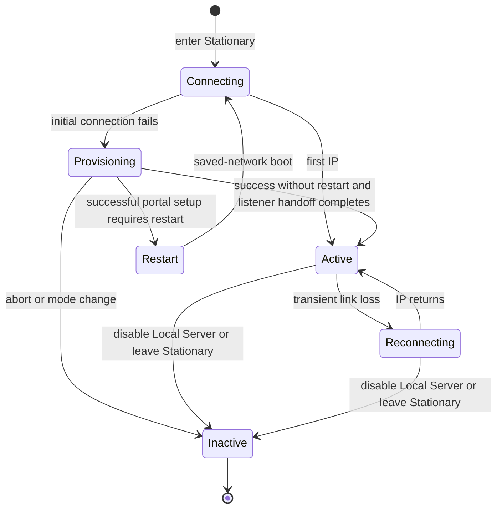

# Local Server

The AirGradient Go firmware source integrates the versioned Local Server API
for connected Stationary sessions. HTTP handlers run on the shared HTTP server
task, while the Go orchestrator owns snapshots, configuration persistence,
runtime activation, actions, Wi-Fi lifecycle, and discovery. The integration is
experimental; physical-device and external-client validation remains
incomplete.

## Files

| File | Purpose |
|---|---|
| [`products/go/main/go_local_api.h`](../main/go_local_api.h) | Product providers, snapshots, access state, and fixed request FIFO |
| [`products/go/main/go_local_api.cpp`](../main/go_local_api.cpp) | Go measures/config mapping, validation, admission, and queue signaling |
| [`components/airgradient-common/include/retained_uptime.h`](../../../components/airgradient-common/include/retained_uptime.h), `retained_uptime.cpp` | Shared RTC-retained monotonic uptime calculation |
| [`products/go/main/go_orchestrator.h`](../main/go_orchestrator.h) | Local endpoint state, retry deadline, and orchestration declarations |
| [`products/go/main/go_orchestrator.cpp`](../main/go_orchestrator.cpp) | Request processing, persistence, OTA policy, and Stationary lifecycle |
| [`products/go/main/go_wifi.h`](../main/go_wifi.h) | Shared listener and local mDNS lifecycle API |
| [`products/go/main/go_wifi.cpp`](../main/go_wifi.cpp) | Provisioning handoff, route/listener ownership, and mDNS profile wiring |
| [`products/go/tests/go_local_api.tests.cpp`](../tests/go_local_api.tests.cpp) | Host tests for mappings, policy, snapshots, FIFO, and queue epochs |
| [`products/go/tests/local-server-integration/`](../tests/local-server-integration) | Hardware integration test collection for the HTTP and mDNS contract |

## Dependencies

| Dependency | Source | Usage |
|---|---|---|
| `LocalServer` | [`airgradient-local-server`](../../../components/airgradient-local-server/README.md) | Versioned routes, JSON schema, parsing, serialization, and structured errors |
| `HttpServer` | `airgradient-http-server` (`hal/http_server.h`) | Shared port 80 listener used by provisioning and the local API |
| `WifiManager` | `airgradient-wifi` (`services/wifi_manager.h`) | Stationary connectivity and `_airgradient._tcp` mDNS lifecycle |
| `GoSettings`, `ConfigStore` | product (`go_settings.h`) | Authoritative configuration, validation, and persistence |
| `SensorProducer` | product (`go_sensor_producer.h`) | Asynchronous CO2 calibration execution |
| `retained_uptime` | `airgradient-common` (`retained_uptime.h`) | Completed-minute uptime for system information |
| `RTOS` | `airgradient-common` (`rtos.h`) | Snapshot mutex, event queue, lifecycle timers, and retained clock abstraction |

## Public API

`GoLocalApiService` implements the three provider interfaces consumed by
`LocalServer`. The orchestrator and `WifiService` drive the remaining methods.

| Responsibility | Caller Contract |
|---|---|
| Construction | Supply the central event queue and device identity; check `is_valid()` before enabling the endpoint. |
| GET providers | Return mutex-protected copies of measures, system information, and active config. HTTP handlers do not access live sensor drivers. |
| Writes and actions | `submit_config()` and `trigger()` validate/admit work without waiting for execution. Successful admission is not successful persistence or hardware completion. |
| Snapshot publication | The orchestrator publishes corrected measurements, active settings, and optional online RSSI. Readers see cached values until publication. |
| Access and request lifecycle | `set_access()` gates mutations. Clear queued work at lifecycle boundaries; `pop_request(epoch, ...)` accepts only the current generation. |

See [`go_local_api.h`](../main/go_local_api.h) for full signatures and
[request admission](#configuration) for FIFO capacity and policy ordering.

## Behavior

### Availability and Discovery

Local Server is controlled through **Settings → Operations → Local Server**,
visible only in Stationary mode, including while Wi-Fi is disconnected. The
selection defaults to Enable and persists across restarts and mode changes.

Manufacturing overrides this preference: the local API and mDNS stay disabled,
and Wi-Fi power saving stays enabled. The saved preference is unchanged.

In normal Stationary mode, Enable starts the local API and discovery when Wi-Fi
connects and disables Wi-Fi power saving for reliable access. Disable stops both, clears
queued requests and activation retries, and enables Wi-Fi power saving. Cloud
connectivity continues. Portable and **Energy Saving** modes do not expose the
endpoint.

Go uses model `P-1PSG` with the
[shared discovery contract](../../../docs/local_http_api.md#availability-and-discovery).

| Symbol | Default | Purpose |
|---|---|---|
| `CONFIG_AG_HTTP_PORT` | `80` | Shared local API/provisioning listener port |

Discovery starts only after the HTTP routes are reachable.

### Routes and Statuses

Go implements all routes in the [shared endpoint catalog](../../../docs/local_http_api.md#endpoints):
measurement/configuration GET, configuration PUT, and the calibration, LED-test,
and GPS-test actions. Response bodies, status codes, and the error envelope are
defined by the [shared HTTP contract](../../../docs/local_http_api.md#errors).

Go-specific admission and execution behavior is described below. In particular,
queue saturation returns `503 busy`, while source policy or OTA can reject an
otherwise valid operation with `403 forbidden`.

### Measures

`GET /api/v1/measures` reads a mutex-protected snapshot of the orchestrator's
latest corrected measures. The required fields are `serialNumber`, `model`,
`firmware`, and `boot`. `wifiRssi` is present only while Stationary Wi-Fi is
online.

`boot` is computed when system information is requested. It is retained
monotonic uptime floored to completed minutes: `0` throughout the first minute,
then `1` at 60,000 ms. Deep-sleep time counts because both the session start and
ESP32-C5 retained clock continue across deep sleep. Power-on, software, OTA,
panic, watchdog, brownout, and other non-deep-sleep resets start a new session.
The value advances without measurements and saturates at `UINT32_MAX`. Local
Server and cloud POSTs both consume the shared, transport-independent
`retained_uptime` utility; BLE can reuse it later.

The optional sensor fields are `co2`, `pm01`, `pm25`, `pm10`, `pm003Count`,
`pm005Count`, `pm01Count`, `pm02Count`, `pm50Count`, `pm10Count`, `temperature`,
`humidity`, `tvocIndex`, `tvocRaw`, `noxIndex`, `noxRaw`, `battPercent`,
`battVolt`, and `chargeVolt`. Particle counts and `battPercent` are integers;
the two voltage fields use two decimal places. `battPercent` uses the fuel gauge
when available, with the charger voltage-curve estimate as fallback. `chargeVolt`
is measured input/VBUS voltage, not a charging-state indicator.

Each field passes its field-specific validator before serialization; invalid
fields are omitted. Units, precision, and omission rules follow the
[shared measurement schema](../../../docs/local_http_api.md#read-measurements). Corrections are
applied before the Go common-measures snapshot is published, so local clients
receive the corrected PM2.5, temperature, and humidity view rather than the raw
cloud, storage, and BLE view.

### Configuration

`GET` always emits Go's complete supported subset, and `PUT` accepts partial
objects from the same subset. Device behavior fields are:

| Field | Values | Go Behavior |
|---|---|---|
| `pmStandard` | `ugm3`, `us-aqi` | Select mass concentration or US AQI presentation |
| `temperatureUnit` | `c`, `f` | Select product display temperature unit |
| `altitudeUnit` | `m`, `ft` | Select product display altitude unit; raw GPS and stored route altitude remain in meters |
| `pinnedChart` | `none`, `pm25`, `co2`, `temperature`, `humidity`, `tvoc`, `nox`, `pressure`, `altitude` | Select the Home chart; default `pm25` |
| `measurementInterval` | Integer 1 .. 3600 | Set the exact measurement interval in seconds; non-fixed UI values appear as custom |
| `gpsMode` | `off`, `tracking`, `always` | Disable GPS, run it only while tracking, or keep it active |
| `backLedIndicator` | `aqi`, `co2` | Select the back LED indicator; default `aqi` |
| `backLedBrightness` | Integer 0 .. 3 | Set back LED brightness: off, dim, mid, or bright |
| `touchLedIntensity` | Integer 0 .. 2 | V1 only: set touch LED intensity to off, dim, or bright |
| `buzzerEnabled` | Boolean | Enable or disable buzzer playback |

PUT `{"backLedIndicator":"co2"}` changes the indicator without changing brightness.
Invalid names or types return `400 invalid_value` with field `backLedIndicator`.
The selection appears in GET after successful persistence; existing
`configurationControl` rules apply. See [LED behavior](led_service.md#selected-indicator).

V2 retains `touchLedIntensity` in GET (default `0`). PUT containing this field
returns `404 not_found` with `field: "touchLedIntensity"`, including writes of
`0`. The whole request is rejected before queuing, so other supplied fields
remain unchanged. Availability comes from `Config::capabilities`; access and
source-policy checks still run first.

For example, PUT `{"pinnedChart":"co2"}` selects CO2. The choice is persisted
and shared with the UI and BLE. Names are case-sensitive strings; invalid names
or types return `400 invalid_value` with field `pinnedChart`. Existing
`configurationControl` rules apply. Temperature/Humidity remain selectable below
five minutes, where Home shows “Not available”; the preference is preserved.

The API edits the shared Portable/Stationary interval; Energy Saving retains its
separate preference. Accepted values are persisted and scheduled exactly. See
[interval presentation](settings.md#measurement-interval-presentation) for how
the UI preserves custom values.

Connectivity, sensor, and correction fields are:

| Field | Values | Go Behavior |
|---|---|---|
| `cloudConnection` | Boolean | Inverse of the product `disable_cloud` setting |
| `configurationControl` | `cloud`, `local`, `both` | Arbitrate Local Server PUT and Cloud Fetch sources |
| `co2AbcDays` | Integer `0` or 1 .. 200 | Set the automatic background calibration period for the supported CO2 sensor. `0` disables it; positive values are converted to hours. |
| `tvocLearningOffset` | Integer 1 .. 1000 | Set the SGP41 VOC gas-index learning-time offset in whole hours. |
| `noxLearningOffset` | Integer 1 .. 1000 | Set the SGP41 NOx gas-index learning-time offset in whole hours. |
| `corrections` | Object | Configure `pm25`, `temperature`, and `humidity` correction entries |

Go accepts `none` and `custom_via_pm25_raw` for PM2.5. Temperature
and humidity accept `none` and `custom`. Custom entries require finite
`intercept` and `scalingFactor` values. Go omits the shared `useEpa2021` field
from GET responses and ignores it when supplied in a PM2.5 PUT.

GET reports factory PM calibration as `custom_via_pm25_raw` with unchanged
coefficients. PUT does not accept `factory_calibration`; writing the returned
PM group back selects custom. Omit it when changing unrelated settings.

Partial correction objects preserve omitted active siblings. Other known v1
catalog fields are omitted from GET and return `404 not_found` on PUT when
endpoint and source policy otherwise permit the request.

The active source policy is:

| `configurationControl` | Local Server PUT | Cloud Fetch |
|---|---|---|
| `cloud` | Rejected, except an exact control-only change to `local` or `both` | Enabled |
| `local` | Enabled | Disabled before issuing the fetch |
| `both` | Enabled | Enabled |

BLE, UI, provisioning, factory, and system writes bypass this source gate but
still use complete-candidate validation and the common persistence path. A
candidate combining `configurationControl: cloud` with
`cloudConnection: false` is invalid. Setting `cloudConnection` false suppresses
subsequent cloud POST and Fetch attempts and automatic Stationary Wi-Fi OTA
without disabling the local endpoint. It does not cancel an in-flight cloud
request; a Fetch result can still apply if source policy permits it when
consumed.

PUT parsing is strict and completes before product policy checks. Integer fields
reject fractional JSON numbers rather than truncating them, and product
translation enforces the documented ranges. After translation, config and
action requests share one fixed four-entry FIFO.
Each entry posts one `LocalApiRequestReady` event carrying the FIFO epoch. A
failed central event-queue send rolls back the append. Queue saturation,
event-queue saturation, or an epoch change during admission returns `503 busy`.
An empty object is an accepted no-op and consumes no FIFO entry after the
current access and source gates pass.

`202 Accepted` means only that the validated update was admitted. The
orchestrator rechecks source policy, merges against the last active settings,
validates the complete candidate, persists and commits it, applies changed
timing, GPS, LED, and buzzer settings, and publishes new snapshots. CO2 ABC and
gas learning changes are requested asynchronously from the sensor task. A later
source-policy change, persistence failure, queue clear, or superseding writer
can prevent GET from converging. Sensor-application failure does not roll back
the persisted setting; the normal boot path retries it. There is no request
identifier, completion resource, correlation token, or automatic retry. Clients
that need confirmation poll `GET /api/v1/config` against their own deadline.

### Actions

`POST /api/v1/actions/calibrate-co2` admits an action into the same four-entry
FIFO and returns empty `200` once the request is queued. The orchestrator later
calls `SensorProducer::request_co2_calibration()`. The HTTP response does not
mean that calibration started or succeeded.

The implemented action path has no shared busy coordinator across HTTP, BLE,
and UI, no cached CO2 capability gate, and no request/completion correlation. It
does not reject a duplicate merely because another channel has queued or
started a calibration. Sensor completion is handled separately by the existing
UI and BLE result path; no completion is returned to the HTTP client.

`POST /api/v1/actions/test-leds` uses the same admission path and returns empty
`200` once queued. The orchestrator later blocks its own task for three seconds
while the LED worker exercises the back and touch groups, then restores
the configured levels and current selected indicator. The success response confirms only
queue admission. If an interactive hardware-test screen owns the LEDs when the
request is consumed, the diagnostic is ignored.

`POST /api/v1/actions/test-gps` also returns empty `200` once queued. The
orchestrator opens the live GPS Test screen and starts its existing receiver,
fast-posting, and TTFF behavior. The request is ignored while the Peripheral or
Accelerometer test is active and is a no-op when the GPS Test screen is already
open.

### Endpoint Lifecycle

With Local Server enabled:

With Local Server enabled, the first-IP `WifiConnected` event triggers endpoint
activation. The orchestrator registers routes, starts or confirms the listener,
publishes RSSI, enables read/write admission, then starts mDNS. Route or listener
startup failure rolls back the local routes and leaves access disabled. mDNS
failure leaves the reachable HTTP endpoint active. Either failure schedules
another activation attempt after `LOCAL_API_ACTIVATION_RETRY_MS`, which is 5
seconds. Ordinary Wi-Fi events use non-blocking central-queue sends and are not
retained, so queue saturation can skip this transition.

Provisioning exclusively owns its transport routes and the shared listener
while active. Successful portal sessions normally reboot before local API
activation; the next saved-network connection starts the endpoint. See the
[restart policy](wifi_service.md#provisioning-completion). Without a restart,
provisioning releases its routes after the success hold and retains any listener
for local activation. With Local Server disabled, the handoff stops any retained
listener and leaves routes and discovery inactive.

With Local Server enabled, a transient disconnect after the first connection
does not return to provisioning. It omits `wifiRssi`, retains local routes and
the HTTP listener, leaves admitted FIFO work intact, and requests a reconnect
after the configured 5-second delay. Normal reconnect uses saved networks only;
the factory network belongs to the separate
[manufacturing policy](wifi_service.md#manufacturing-factory-wi-fi). The
`StaIpAuto` mDNS profile follows the STA address lifecycle; reconnect reuses the
local server and starts mDNS again instead of rebuilding the route set.

Disabling Local Server, entering provisioning, leaving Stationary, and entering
committed OTA clear the mixed FIFO and increment its epoch. Stale central events
therefore cannot pop requests admitted in a later endpoint generation. Leaving
Stationary also disables admission, clears mDNS, stops the listener, and unregisters local
routes.

### OTA Behavior

A committed foreground Stationary Wi-Fi OTA changes existing read/write local
access to read-only and clears queued requests. An already-active listener and
local mDNS remain active while STA stays connected; an endpoint that was already
disabled remains disabled. When the endpoint is reachable during that interval:

| Request | Behavior |
|---|---|
| `GET /api/v1/measures` | `200` with the last cached measures snapshot |
| `GET /api/v1/config` | `200` with the last active config snapshot |
| Structurally valid config PUT | `403 forbidden` |
| Malformed config PUT | `400` parse error before OTA policy |
| Any registered action | `403 forbidden` before model support policy |

A non-rebooting OTA outcome restores the previous access state with an empty
FIFO. A successful OTA reboots.

### Trust Boundary

Go uses the [shared local API security model](../../../docs/local_http_api.md#security).
Its `configurationControl` setting arbitrates configuration sources; it does not
authenticate clients or restrict read access to a particular caller.

### External Clients

Clients must treat `202` as asynchronous admission and `503 busy` as temporary,
then poll GET when configuration convergence matters. Compatibility with
`python-airgradient` or Home Assistant requires separate integration validation;
firmware host tests do not establish it.

## Edge Cases / Errors

- Parsing precedes access policy, so malformed PUT remains `400` during OTA or
  while local writes are source-gated.
- Endpoint and source policy precede Go field/action support, so a valid but
  unsupported request can return `403` instead of `404` while read-only or
  source-gated.
- `202` and action `200` are admission responses. Post-admission drops and
  failures are visible only through lack of config convergence or separate
  product feedback.
- FIFO capacity is shared by config and action requests. The fifth outstanding
  mixed request returns `503 busy`, as does a central event-queue send failure.
- An mDNS start failure does not remove a reachable HTTP endpoint; the 5-second
  activation timer retries discovery setup.
- Transient disconnect does not clear accepted work, while committed OTA,
  provisioning entry, and Stationary exit do.
- GET serialization uses transient cJSON allocation in addition to the static
  Local Server response buffer. Hardware heap headroom has not been measured.

## Verification

[`go_local_api.tests.cpp`](../tests/go_local_api.tests.cpp) covers snapshots,
field mapping, board support, correction shapes, authority checks, FIFO
admission, and queue epochs. [Orchestrator tests](../tests/go_orchestrator.tests.cpp)
cover activation, lifecycle, and OTA policy; [Wi-Fi tests](../tests/go_wifi.tests.cpp)
cover listener/discovery ordering and failure handling. Run them through the
[host-test workflow](../../../tests/README.md).

The [local-server integration suite](../tests/local-server-integration/README.md)
describes physical-device checks. Hardware validation must establish concurrent
PUT behavior, provisioning listener handoff, reconnect, mDNS lifecycle, client
interoperability, and heap headroom during local GET, cloud TLS, and OTA.
Test collection or host success alone does not establish these results.
