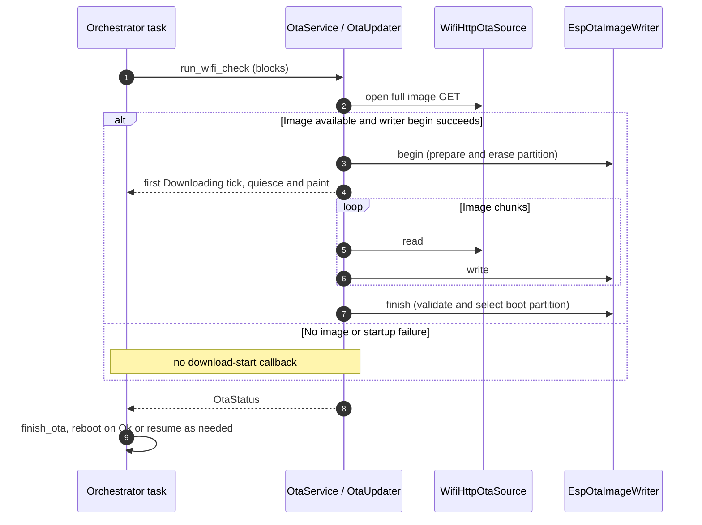

# OTA Service

`OtaService` is the product-side glue around the `airgradient-ota` component.
It provides **BLE push** and **Wi-Fi pull** and owns the borrowed-server BLE
registration. The orchestrator selects BLE while Portable, Wi-Fi while
Stationary, and neither while Offline; `OtaService` does not enforce mode policy
itself. It never spawns a task or reboots. Cloud calls the Wi-Fi
availability probe; the orchestrator runs transfers and decides reboot or resume
from `OtaStatus`. Both transfers use the same owned `EspOtaImageWriter`.

## Files

| File | Purpose |
|---|---|
| [`go_ota.h`](../main/go_ota.h) | `OtaService` declaration |
| [`go_ota.cpp`](../main/go_ota.cpp) | Implementation |

## Dependencies

| Dependency | Source | Usage |
|---|---|---|
| `OtaBleService` | `airgradient-ota` (`services/ota_ble_service.h`) | BLE push transport over the borrowed server (owned by value) |
| `OtaUpdater` | `airgradient-ota` (`services/ota_updater.h`) | WiFi pull orchestrator (constructed per check) |
| `WifiHttpOtaSource` | `airgradient-ota` (`backends/wifi/wifi_http_ota_source.h`) | HTTP GET image source (constructed per check) |
| `EspOtaImageWriter` | `airgradient-ota` (`backends/esp/esp_ota_image_writer.h`) | Universal flash-write core (owned by value) |
| `OtaStatus`, `OtaProgress`, `OtaRequest` | `airgradient-ota` (`types/ota_types.h`) | Result, progress, and request types |
| `AgBleServer` | `airgradient-ble` (`hal/ble_server.h`) | Borrowed GATT server, shared with `BleService` |
| `PowerService` | product (`go_power.h`) | External GPIO2 watchdog feeder |

## Public API

| Method | Returns | Purpose |
|---|---|---|
| `setup_ble()` | `bool` | Register the OTA GATT service on the borrowed server. Must run between the server's register phase and `start_advertising()` (Portable only). |
| `teardown_ble()` | `void` | Detach OTA write callbacks, latch an abort for any active transfer, and clear local characteristic pointers. Idempotent; does not remove the GATT service or `deinit()` the borrowed server. |
| `handle_disconnect()` | `void` | Forward a central disconnect so an in-flight `run_ble()` aborts. Runs synchronously in the NimBLE host-task callback. |
| `is_ble_active()` | `bool` | Start-edge probe: `true` from the moment a valid `START` latches (before `begin()`) until the terminal. |
| `run_ble()` | `OtaStatus` | Drive a phone-initiated BLE transfer to its terminal (wraps `run(0)`). Blocks on the caller (orchestrator) task. |
| `check_wifi_update() const` | `OtaStatus` | Zero-length Wi-Fi probe on the cloud task; `Ok` means an image is available. Does not touch flash, display, or watchdog. |
| `run_wifi_check(on_download_started)` | `OtaStatus` | Run the full image GET and transfer. Blocks; can still return `UpToDate` or `Declined` after a successful earlier probe. `on_download_started` fires once, on the first `Downloading` tick. |

See [`go_ota.h`](../main/go_ota.h) for full signatures.
The borrowed BLE server, power service, and configuration strings must outlive
the service. Transfers share one writer and must not run concurrently.

## Behavior

### Mode-to-Transport Mapping

| Operating Mode | OTA Path | Drive Model | Component Pieces |
|---|---|---|---|
| Portable | BLE push | Phone-initiated | `OtaBleService` on the borrowed `AgBleServer` + `EspOtaImageWriter` |
| Stationary | WiFi pull | Device-initiated | `WifiHttpOtaSource` + `OtaUpdater` + `EspOtaImageWriter` |
| Offline | None | — | — |

### Foreground, Exclusive Execution

There is **no dedicated OTA task**. `OtaBleService::run()` and `OtaUpdater::run()`
are single blocking calls that the orchestrator runs on its own task. BLE OTA
pauses sensitive services before the call. In Stationary, cloud runs the
availability probe sequentially with POST/FETCH, then disarms itself and sends
`WifiOtaAvailable` if an image is offered. The orchestrator rechecks eligibility
before calling `run_wifi_check()`; sensing, GPS, and PM pause only on its first
`Downloading` tick.
Between `enter_ota()` and the transfer's terminal the orchestrator main loop
never iterates, so mode switches and shutdown are implicitly deferred. The
orchestrator owns the trigger, quiesce, paint, and reboot decision — see
[`orchestrator.md` → OTA](orchestrator.md#firmware-update-ota).

For Wi-Fi, the foreground sequence is:

For BLE, the orchestrator quiesces before `run_ble()`. The shared BLE service
drives begin/finish on the caller task, while Data characteristic writes arrive
on the NimBLE host task. See the component's
[BLE transfer contract](../../../components/airgradient-ota/README.md).

### Watchdog Feeding

`OtaService` feeds the external GPIO2 watchdog from the component's
`set_on_progress()` callback on every **non-terminal** tick (`Starting` /
`Checking` / `Downloading` / `Applying`) via the borrowed `PowerService`. Logic
lives in the named handlers `_on_ble_progress()` / `_on_wifi_progress()`, wired
through thin forwarders. The pre-transfer start-gap feed is the orchestrator's
concern (`enter_ota()` for BLE; `on_wifi_ota_available()` for Wi-Fi).
These feeds follow progress callbacks; they are not an independent timer during
blocking network or flash operations. The BMS watchdog is disabled at BMS init.

### Lazy WiFi Commit

The cloud probe uses `&offset=0&length=0` and closes before the separate image
GET. The server can decline that later GET, so `run_wifi_check()` still defers
quiescing until download starts. `_on_wifi_progress()` invokes the stored `on_download_started`
exactly once, on the first `OtaState::Downloading` tick (one-shot guarded by
`_wifi_download_painted`). The orchestrator uses that callback to commit the full
quiesce + "Updating firmware…" paint.

This is the boundary for pausing services and changing the UI, not the first
flash operation. [`OtaUpdater::run()`](../../../components/airgradient-ota/services/ota_updater.cpp)
opens the image source and calls `writer.begin()` before emitting `Downloading`;
partition preparation and erase therefore precede quiescing. A begin failure
returns without the callback. `UpToDate` / `Declined` return before writer begin
and never stop sensing or paint the update screen.

### Local HTTP During Stationary OTA

The availability probe and subsequent streaming GET use separate outgoing
`esp_http_client` requests, independent of the inbound `HttpServer`. Committing
the transfer keeps an already-active local API readable from cached snapshots
so the device remains observable while sensing and the orchestrator loop are
paused. [Local Server's OTA behavior](local_server.md#ota-behavior) owns request
admission, queued-mutation handling, and access restoration; the
[orchestrator OTA lifecycle](orchestrator.md#firmware-update-ota) owns when those
changes occur.

### Reboot and Image Validity

`OtaService` never reboots. On `OtaStatus::Ok` the orchestrator reboots via the
shared `reboot()` free function. Before returning success, the writer finishes
ESP-IDF image validation and selects the new boot partition.
`CONFIG_BOOTLOADER_APP_ROLLBACK_ENABLE` is off in the checked-in
[`sdkconfig`](../sdkconfig),
so a flashed image boots directly with no mark-valid step or automatic revert.

## Edge Cases / Errors

| Case | Behavior |
|---|---|
| Central disconnect mid-BLE-transfer | `handle_disconnect()` latches `TransportError` synchronously on the host task; `run_ble()` unblocks and returns it → "Update failed". Not `Aborted`. |
| Explicit phone `ABORT` | `run_ble()` returns `Aborted` → "Update cancelled". |
| Disconnect within the `START → poll` window (before `begin()`) | Accepted stillborn-abort race: one wasted quiesce + partition erase, then a clean `TransportError`. |
| Stranded-active latch (auth cleared but `START` still latched) | The orchestrator gate keeps polling on `is_ble_active()`; the next `run_ble()` services the pending abort and clears the latch. |
| OTA `START` during an active Go BLE history export | Serialized, not concurrent — both run on the single orchestrator task; no image bytes flash until the export finishes. |
| `setup_ble()` failure | Non-fatal: the orchestrator logs, calls `teardown_ble()`, and keeps advertising Go data + provisioning without OTA. |
| WiFi drop mid-download | The source read fails and `run()` returns `TransportError`; the device stays Stationary-but-offline. The committed-exit queue drain can discard the queued disconnect event, so automatic reconnect is not guaranteed. |
| Local config/action during committed WiFi OTA | If the endpoint was active and remains reachable, existing routes return forbidden while cached GETs remain available; queued pre-commit mutations are discarded. |

## Configuration

The product configures these values in
[`sdkconfig.defaults`](../sdkconfig.defaults):

| Symbol | Go Value | Purpose |
|---|---|---|
| `CONFIG_AG_DEVICE_MODEL_GO` | `y` | Select the Go firmware endpoint |
| `CONFIG_BT_NIMBLE_ATT_PREFERRED_MTU` | `512` | Preferred BLE ATT MTU |

The component's `CONFIG_AG_OTA_*` knobs cover timeouts, buffer sizes, and BLE
Data/Control limits; see
[`airgradient-ota`](../../../components/airgradient-ota/README.md). The product
also provisions the NimBLE mbuf pool for the larger MTU. The
central must use the negotiated MTU and the component's Data size limit; the
preferred MTU does not guarantee negotiation at 512. At MTU 512, the ATT
Write-Command payload limit is `MTU − 3 = 509` bytes. Wi-Fi check timing lives in
[`CloudService::Config`](cloud_service.md#config); the orchestrator retains the
2 s BLE poll (`OTA_BLE_POLL_INTERVAL_MS`).

## Verification

Cloud scheduling and event delivery are tested in
[`go_cloud.tests.cpp`](../tests/go_cloud.tests.cpp). The **trigger, quiesce, and
outcome handling in the orchestrator** are exercised against a stubbed
`OtaService` in [`go_orchestrator.tests.cpp`](../tests/go_orchestrator.tests.cpp),
at the same boundary as `WifiService` / `BleService`.

The product wrapper is compiled on the host; the hardware backends use host
shells. Shared component tests cover the
[updater](../../../components/airgradient-ota/tests/ota_updater.tests.cpp),
[BLE protocol and lifecycle](../../../components/airgradient-ota/tests/ota_ble_service.tests.cpp),
and [URL construction](../../../components/airgradient-ota/tests/ota_url.tests.cpp).
See the [host-test workflow](../../../tests/README.md) for running them.

These tests do not verify real flash writes, radio transfer behavior, booting
the new image, or external watchdog timing. Those require hardware verification;
host coverage alone does not establish that they passed.
