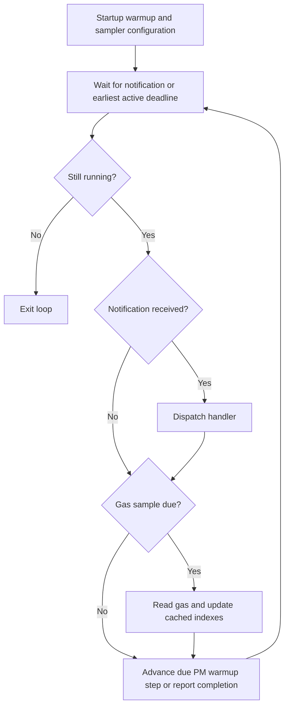

# Sensor Producer

Independent RTOS task that drives sensor measurements for AirGradient Go.
Wraps the shared `SensorManager` component: the orchestrator signals it with
an iteration count, sensor groups, and measurement origin via RTOS task
notification; the task blocks inside `SensorManager::start_measures()` for
the full averaging window, then posts a
`SensorDataReady` event to the orchestrator queue.

The same task also runs blocking CO2 calibration requests and posts their
completion as `Co2CalibrationDone`.

`SensorProducer` holds only a `SensorManager` reference and has no knowledge
of which sensors are wired — that is the product wiring layer's responsibility
(`go_hardware_board.cpp`).

## Files

| File | Purpose |
|---|---|
| [`products/go/main/go_sensor_producer.h`](../main/go_sensor_producer.h) | `SensorProducer` class declaration, `Config` struct |
| [`products/go/main/go_sensor_producer.cpp`](../main/go_sensor_producer.cpp) | Task loop, notification handling, event posting |

## Dependencies

| Dependency | Source | Usage |
|---|---|---|
| `SensorManager` | `airgradient-sensors` (`services/sensor_manager.h`) | Blocking multi-iteration sensor averaging |
| `Sensors` struct | `airgradient-sensors` (`services/sensor_manager.h`) | HAL pointer table injected into `SensorManager` by wiring layer |
| `MeasuresAGo` | `airgradient-common` (`measures_types.h`) | Averaging result, wrapped by `SensorEventData` |
| `RTOS` | `airgradient-common` (`rtos.h`) | `task_create()`, `task_delete()`, `queue_send()`, `task_notify_send()`, `task_notify_wait()` |
| `go_events.h` | product | `SensorEventData`, `MeasurementOrigin`, measurement and PM boundary events |
| `Co2CalibrationResult` | `airgradient-sensors` (`sensor_manager.h`) | Completion payload for asynchronous CO2 calibration |

## Public API

| Method | Purpose |
|---|---|
| `start()` / `stop(sleep_pm)` | Manage the producer task and PM shutdown policy |
| `request_measurement(iterations, groups, origin = MeasurementOrigin::Scheduled)` | Request readings tagged as scheduled or manual refresh |
| `request_prepare()` | Wake PM, schedule PM-only warmup steps, and report preparation boundaries |
| `request_pm_sleep()` | Sleep PM and report completion before the orchestrator isolates the bus |
| `request_self_test()` | Run the Hardware Test sensor sweep |

See [`go_sensor_producer.h`](../main/go_sensor_producer.h) for full signatures
and calibration/settings requests.

## AGo Sensor Wiring

The wiring layer (`go_hardware_board.cpp`) populates a `Sensors` struct and passes it to
`SensorManager`. `SensorProducer` never touches this struct directly.

| `Sensors` field | Driver | Notes |
|---|---|---|
| `temp_hum` | `SHT40` | Dedicated temperature + humidity sensor |
| `co2` | `S12`, `SCD4x`, or `STCC4` | Probed in order at boot; first detected wins |
| `pms_a` | `SPS30` | Single particulate matter sensor |
| `pms_b` | `nullptr` | No second PM sensor on AGo |
| `tvoc_nox` | `SGP41` | TVOC + NOx sensor |
| `pressure` | `DPS368` (V1), `SPL07-003` (V2) | Barometric pressure + altitude sensor |
| `o3_no2` | `nullptr` | No AlphaSense electrodes on AGo |

`temp_hum_a` uses the product fallback order `DEDICATED` → `CO2` →
`PRESSURE`. SHT40 is probed during sensor initialization. If it is unavailable,
SCD4x/STCC4 CO2-integrated T/RH can supply temperature and humidity; S12 cannot.
The selected pressure sensor is the final temperature-only fallback.

Battery management is handled separately by `PowerService` via the
`airgradient-bms` component and is not part of the `Sensors` struct.
Battery data comes from `PowerService::poll_bms()`, not from `SensorManager`.

## Configuration

`SensorProducer::Config` fields:

| Field | Default | Notes |
|---|---|---|
| `task_stack_size` | `4096` | RTOS task stack in bytes; tune at integration time |
| `task_priority` | `5` | Below input task; above idle |
| `co2_abc_days` | `7` | Automatic background calibration period applied before sensor warmup; `-1` disables it |
| `tvoc_learning_offset` | `12` | VOC gas-index learning-time offset in whole hours |
| `nox_learning_offset` | `12` | NOx gas-index learning-time offset in whole hours |

## Usage

```cpp
// Borrow the board's initialized SensorManager and central event queue.
SensorProducer producer(manager, event_queue, SensorProducer::Config{});
if (!producer.start()) {
    return; // caller handles unavailable worker
}
producer.request_measurement(1, SensorGroup::All);
// Later, stop before destroying the manager or event queue.
producer.stop(true);
```

See [`go_app.cpp`](../main/go_app.cpp) for composition and
[`go_orchestrator.cpp`](../main/go_orchestrator.cpp) for request admission.
Call `start()` only when stopped; it does not guard against duplicate workers.

The orchestrator selects the shutdown mode from the planned sleep duration.
Short sleeps that hold PM power pass `sleep_pm=false` and set the saved
`RtcAppFlag::SensorsWarm` flag. Long sleeps pass `sleep_pm=true` and clear
that flag, ensuring that the next timer boot performs the full PM warmup.
Both stop modes turn off the gas heater after the worker stops. This also
applies during provisioning and OTA pauses; restarting the producer runs
startup conditioning before gas sampling resumes.

## Event Output

`SensorProducer` posts `EventType::SensorDataReady` to the orchestrator queue
once per measurement cycle, after `start_measures()` returns.

For CO2 calibration, `handle_calibration()` calls the blocking
`SensorManager::calibrate_co2()` and attempts one zero-wait
`Co2CalibrationDone` carrying `Success`, `Unsupported`, or `Failed`; a full
central queue drops the completion without retry. The orchestrator maps a
delivered completion to the on-device snackbar and, when connected, the BLE
Config command result.

The event union contains `SensorEventData sensor_data`, with two members:

| Member | Meaning |
|---|---|
| `measures` | `MeasuresAGo` result; unavailable sensor fields retain invalid sentinels |
| `origin` | `MeasurementOrigin::Scheduled` (default) or `MeasurementOrigin::Refresh`, copied from the request |

The producer does not infer origin from timing. The orchestrator tags the
request; a scheduled measurement reused for a shake keeps `Scheduled`.
Both origins update current readings, while only `Scheduled` writes chart
cache and route points.

At startup, the producer posts `PmPreparationStarted`, calls `pm_wake()` and
blocking `warmup()` to condition the gas sensor, then posts `PmPrepared`.
Subsequent `request_prepare()` calls report the same boundaries while scheduling
PM-only warmup steps alongside gas sampling. `request_pm_sleep()` cancels any
active preparation and posts `PmSensorAsleep` after the sleep call. These events
report operation boundaries, not guaranteed sensor validity. Measurement and
PM boundary posts wait for central queue space. Calibration completion keeps
its existing zero-wait delivery.

## Iteration Count and Sensor Groups

On AGo, the orchestrator always requests 1 iteration. The product relies on
each driver's normal single-cycle measurement mode, so multi-iteration firmware
averaging adds no meaningful data quality. The per-iteration 2 s delay is
skipped when `iterations == 1`.

The `SensorGroup` parameter controls which sensor categories are polled:

| Group | Sensors |
|---|---|
| `PM` | `pms_a`, `pms_b` |
| `Other` | `temp_hum`, `co2`, `o3_no2`, `pressure` |
| `TvocNox` | `tvoc_nox` (SGP41 read + algorithm step when configured) |
| `All` | All of the above (default) |

The task encodes requests into the `uint32_t` notification: iterations in
bits 0–7, group mask in bits 8–15, and `NOTIFY_REFRESH` in bit 16 when origin
is `Refresh`. An unset origin bit means `Scheduled`. On decode, zero iterations
defaults to 1, and `SensorGroup::None` defaults to `All`.

Six sentinel values use the remaining notification space:

| Sentinel | Value | Purpose |
|---|---|---|
| `NOTIFY_CALIBRATION` | `UINT32_MAX` | CO2 background calibration |
| `NOTIFY_PREPARE` | `UINT32_MAX - 1` | PM sensor warmup after power cycle |
| `NOTIFY_PM_SLEEP` | `UINT32_MAX - 2` | Put the PM sensor to sleep, then post `PmSensorAsleep` |
| `NOTIFY_SELF_TEST` | `UINT32_MAX - 3` | Run one all-sensor self-test and post `SensorTestDone` |
| `NOTIFY_CO2_ABC_PERIOD` | `UINT32_MAX - 4` | Apply `Config::co2_abc_days` |
| `NOTIFY_TVOC_NOX_LEARNING_OFFSETS` | `UINT32_MAX - 5` | Apply `Config` gas-index learning offsets |

The producer applies the configured ABC period before normal sensor warmup. At
runtime, the orchestrator sends ABC changes through the producer and receives a
`Co2AbcPeriodDone` event after application, so the producer remains the sole
owner of CO2 I2C access.
S12 and SCD41 persist the setting in sensor EEPROM only when the requested
period differs from the current period or the sensor's automatic calibration is
disabled.

The producer configures the SGP41 VOC and NOx algorithms with their independent
learning offsets before enabling the sampler. Runtime changes yield a
`TvocNoxLearningOffsetDone` event. Applying an offset preserves every other
Sensirion tuning parameter and does not reset either algorithm, so it does not
introduce a new 45-second blackout.

## Internal Architecture

### Task Loop

After warmup, the producer enables a gas-index sampler when an SGP41
sensor is wired and `configure_tvoc_nox_index()` succeeds. The sampler
converts the indefinite `task_notify_wait` into a timeout-driven loop so
the Sensirion algorithm is fed at a fixed cadence (Kconfig-configurable,
default 10 s) independent of the measurement interval.



While PM preparation is active, the wait timeout includes its next discard-read
or iteration-completion deadline, even when no gas sensor is wired. If both
sensors are due, the gas sample runs first.

#### PM Preparation Handlers

`handle_prepare()` wakes PM, sets the remaining iteration count using the same
duration / interval calculation as `SensorManager::warmup()`, and schedules the
first step. It ignores duplicate prepare requests while warmup is active.
The task loop calls `warmup_step(false)` once per iteration, discarding PM
readings without repeating SGP41 conditioning or advancing its algorithm.
After the final iteration's pacing interval, it posts `PmPrepared` exactly once.
Failed discard reads do not abort preparation.

| Symbol | Default | Purpose |
|---|---|---|
| `CONFIG_SENSOR_WARMUP_DURATION_MS` | `10000` | Divided by the warmup interval to determine the iteration count |
| `CONFIG_SENSOR_WARMUP_INTERVAL_MS` | `1000` | Interval between PM discard reads during preparation |

Sleep cancels active preparation without posting `PmPrepared`. Restarting the
producer clears pending preparation and performs the normal startup warmup.

#### `handle_measurement(notify_value)`

When the sampler is active, the `TvocNox` bit is stripped from the
requested group mask so measurement notifications never read SGP41 at an
irregular cadence. After `start_measures()` returns, the cached TVOC/NOx
from the most recent sampler tick is spliced into the result before posting
`SensorDataReady`. When the sampler is inactive, the original mask is
preserved so `All`/`TvocNox` still reads raw SGP41 values.

The latest valid `temp_hum_a` from each measurement is cached for
compensation push.

For measurements requesting PM, the producer caches the complete PM snapshot
when PM2.5 is valid. If a later result has invalid PM2.5, it reuses that snapshot
while its age is less than 120 seconds, measured from completion of the last
valid measurement. Failures do not extend the deadline. Scheduled and refresh
measurements share this cache; requests omitting PM and hardware self-tests do
not use it. The cache starts empty and does not persist across reboot or deep
sleep.

CO2 uses an independent cache with the same 120-second lifetime and refresh
behavior. Measurements requesting the `Other` group update it only when
`CO2Data::is_valid()` passes; invalid results reuse the unexpired reading.
Requests omitting `Other` and hardware self-tests do not use the CO2 cache.

#### `handle_calibration()`

Calls `SensorManager::calibrate_co2()` synchronously on the producer task, then
posts the result to the central queue with zero wait. `Unsupported` means no CO2
sensor is selected or the selected driver does not support manual calibration.
S12 and SCD4x support it; the current STCC4 driver does not.

#### `handle_sampler_tick()`

Pushes cached temp/hum compensation to the SGP41 driver (if available),
then calls `start_measures(1, TvocNox)` and caches the result in
`_last_tvoc_nox`. Missed ticks are skipped, not replayed.

#### Offline (Fast Path)

The Offline timer fast path uses `SensorManager` directly. GoApp schedules
conditioning and two raw gas reads (first discarded), turns the heater off,
then reads `PM | Other` once. Raw ticks are retained in the raw fields and
copied into index fields for display and storage, preserving Offline's
placeholder behavior. Failed readings remain invalid. See
[Fast-Path Boot](hardware_init.md#fast-path-boot-goappexecute_fast_path).

### Orchestrator Signalling

```cpp
// Orchestrator calls this when a sensor timer fires:
sensor_producer.request_measurement(1, groups);

// Orchestrator calls this to warm up PM sensor after power-on:
sensor_producer.request_prepare();

// Internally every request uses the same overwrite notification slot:
uint32_t value = (static_cast<uint32_t>(groups) << 8) | iterations;
// Manual refresh requests also set NOTIFY_REFRESH (bit 16).
RTOS::task_notify_send(_task_handle, value);
// overwrites any unconsumed notification
```

All requests share one task-notification value with overwrite semantics. There
is no request FIFO, busy response, or in-flight calibration owner. Duplicate
prepare requests are ignored once preparation is active. A new request replaces
any unconsumed measurement, prepare, sleep,
self-test, or calibration request. While a handler is blocking, at most the
latest request remains latched for the next loop iteration; repeated requests
can therefore coalesce and do not guarantee one completion per call.

For scheduled measurements, shake refresh, and the peripheral-test sweep, the
orchestrator tracks one pending read and PM preparation/sleep state. It waits
for the relevant PM completion event before requesting a refresh measurement,
and reuses an already-requested normal measurement instead of sending another.
Peripheral Test wakes PM on entry, waits for preparation and any normal
measurement to finish, then requests its sweep. The sweep holds the same
pending flag until `SensorTestDone`; normal measurements complete through
`SensorDataReady`. The notification transport remains unchanged; there is no
command queue. See [Hardware Test](hardware_test.md#peripheral-test).

PM preparation after startup advances between command handlers, allowing
gas-index sampler ticks throughout warmup. Refresh results use the latest
sampler cache when the sampler is active. CO2 calibration remains blocking.

### Task Duration

Sensor reads and averaging block the producer task. Multi-iteration requests
include the configured pacing delays; a single iteration skips that delay but
still incurs driver I/O latency. During this time the orchestrator can continue
processing other events (GPS fixes, button presses, timers).  This is the primary reason for the independent task —
`SensorManager::start_measures()` is inherently blocking.

## Shutdown Behavior

`stop(sleep_pm)` clears `_running` and, when `sleep_pm` is true, calls
`SensorManager::pm_sleep()` synchronously on the caller. It wakes the worker,
waits 10 ms, then deletes the task without a completion handshake. It finally
stops the gas heater, after the worker can no longer issue gas reads.

The 10 ms grace period does not prove that an in-flight driver call or blocking
queue send finished. Callers must coordinate shutdown with sensor work; this
implementation is not a general cancellation-safe join. The task entry parks
after `run()` returns so only `stop()` deletes it, avoiding double deletion.
A later `start()` creates a new task and reruns startup conditioning.

## Initialization Order

The wiring layer must follow this sequence:

1. Initialise I2C/UART buses.
2. Construct concrete driver instances (`SHT40` when present, CO2, SPS30, SGP41).
3. Call `driver.init()` on each.
4. Populate a `Sensors` struct (unused pointers set to `nullptr`).
5. Construct `SensorManager(sensors)`.
6. Construct `SensorProducer(sensor_manager, event_queue, config)`.
7. Call `sensor_producer.start()`.

## Task Ownership and Errors

Lifecycle and request methods have one orchestrator-side caller. The producer
owns normal sensor I/O. Requests use the overwrite notification slot described
above; they are not an acknowledged queue. Runtime ABC and gas-learning setters
also update fields in `_config` that the worker reads. `_running` is a volatile
flag, not a mutex or atomic synchronization primitive; these fields do not make
the service safe for arbitrary concurrent callers.

Measurement and PM-boundary events wait indefinitely for central queue space.
The orchestrator must continue draining that queue during normal operation.
Calibration, self-test, ABC, and gas-learning completion events use zero-wait
sends and can be lost when the queue is full. A completed operation therefore
does not guarantee that its UI acknowledgement is delivered.

## Verification

[`go_sensor_producer.tests.cpp`](../tests/go_sensor_producer.tests.cpp) uses
mock sensor HALs, RTOS test doubles, and friend access to exercise handlers and
the task loop. Coverage includes origin tags, calibration, PM/CO2 cache expiry,
PM preparation, gas sampling, and shutdown heater handling. The orchestrator's
admission policy is covered in
[`go_orchestrator.tests.cpp`](../tests/go_orchestrator.tests.cpp).
See the [host-test workflow](../../../tests/README.md). Host tests do not prove
safe cancellation of target I/O or physical sensor warmup and power behavior.
