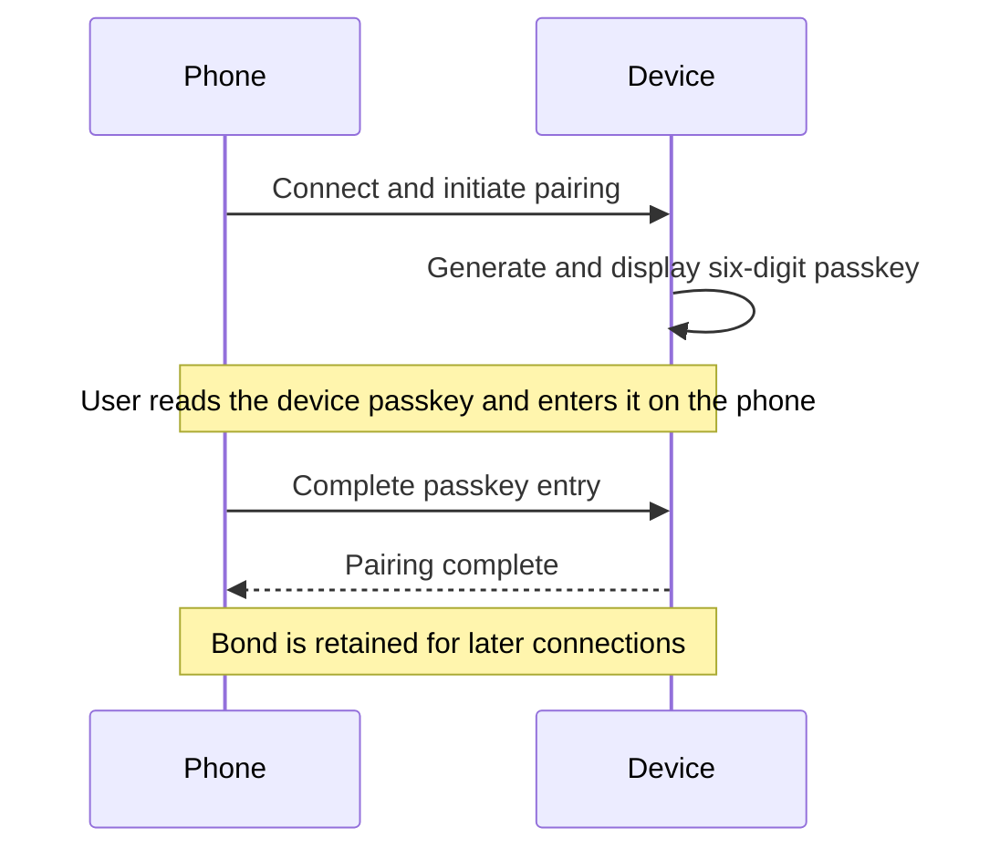
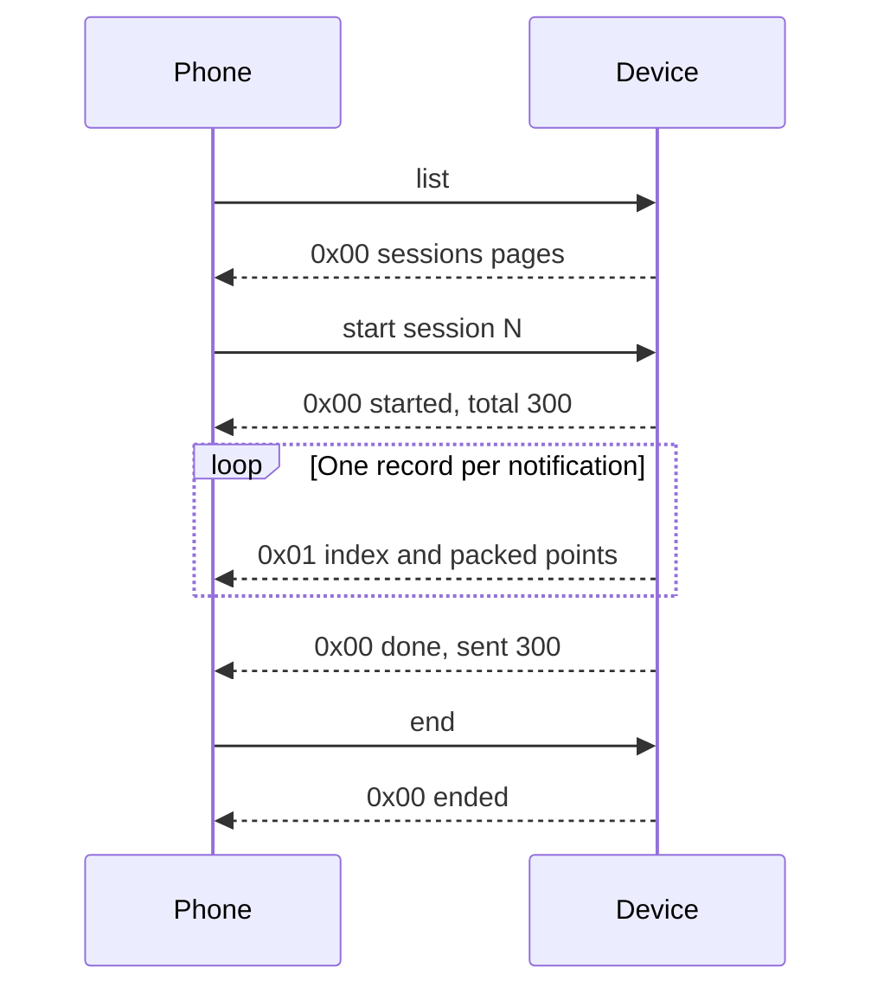
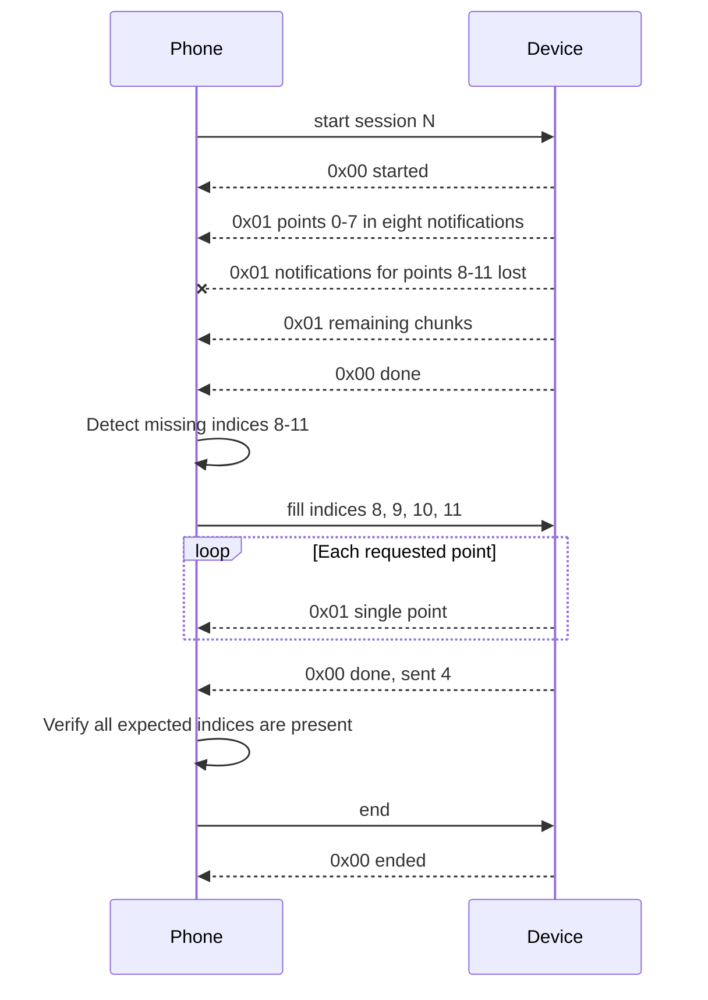
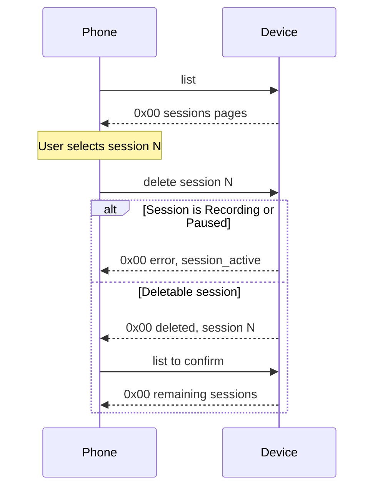
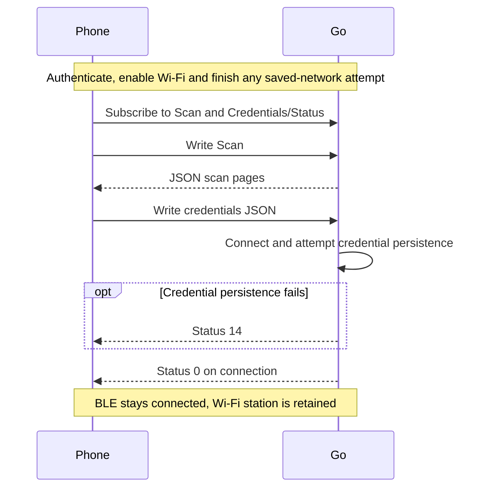
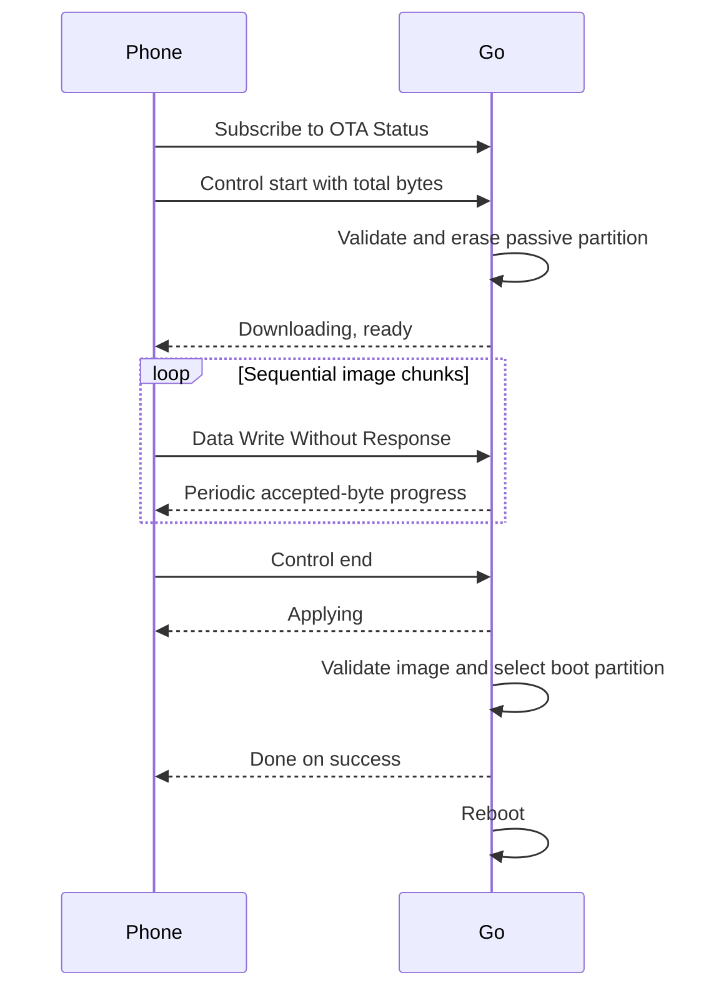

# AirGradient Go — BLE Client Reference

Current protocol reference for mobile app developers integrating with the
AirGradient Go (AGo) BLE peripheral. Covers discovery, pairing, GATT
operations, payload decoding, sleep-cycle measurement broadcasts, history
downloads, Wi-Fi provisioning, and firmware updates.

---

## Table of Contents

1. [Discovery and Connection](#1-discovery-and-connection)
2. [Pairing and Security](#2-pairing-and-security)
3. [GATT Service Overview](#3-gatt-service-overview)
4. [Serialization](#4-serialization)
5. [Measures Characteristic](#5-measures-characteristic)
6. [Status Characteristic](#6-status-characteristic)
7. [Config Characteristic](#7-config-characteristic)
8. [History Characteristic](#8-history-characteristic)
9. [Device Information Service](#9-device-information-service)
10. [Wi-Fi Provisioning](#10-wi-fi-provisioning)
11. [Firmware Update (OTA)](#11-firmware-update-ota)
12. [MTU Considerations](#12-mtu-considerations)
13. [Error Reference](#13-error-reference)
14. [Appendix: RoutePointWire Binary Format](#appendix-routepointwire-binary-format)
15. [Appendix: Measurement Record Binary Format](#appendix-measurement-record-binary-format)
16. [Appendix: CBOR Quick Reference](#appendix-cbor-quick-reference)
17. [Appendix: Invalid Sentinel Values](#appendix-invalid-sentinel-values)

---

## 1. Discovery and Connection

### Sleep-Cycle Measurement Broadcasts

Eligible timer wakes broadcast public, unencrypted measurements without a
connection, pairing, or bonding while Idle with Wi-Fi disabled or unavailable.
The same payload repeats at a configured 50 ms interval during display refresh,
then BLE shuts down. Reception on every wakeup is not guaranteed.

Filter by **service UUID `992f1fe6-4519-4d4f-8ca7-546d36126ee8`**, then read
manufacturer data for company ID `0xFFFF` (a testing placeholder to replace
before release). Match both: provisioning also uses this company ID.

The non-connectable advertisement contains two fields in the same 31-byte
advertising payload, with no Flags, local name, or scan response:

| Field | Type | Bytes Including Length/Type |
|---|---|---|
| Complete List of 128-bit Service UUIDs | `0x07` | 18: header + broadcast UUID |
| Manufacturer Specific Data | `0xFF` | 13: header + 2-byte little-endian company ID + 9-byte payload |

For normal iOS background scanning, enable `bluetooth-central` and scan for
the service UUID. Background discoveries may be coalesced and scanning less
frequent; the UUID list enables filtering, not guaranteed delivery. See
[Apple's scanning API](https://developer.apple.com/documentation/corebluetooth/cbcentralmanager/scanforperipherals(withservices:options:)).

The 9-byte **v1** payload follows the company ID. Fields are unsigned and
bit-packed: bit `n` is bit `n % 8` of byte `n / 8`, least significant bit first.

| Bits | Width | Measurement | Decode | Invalid |
|---|---|---|---|---|
| 0–2 | 3 | Format version (`1`) | — | — |
| 3–13 | 11 | Temperature | value / 10 − 40 °C | `2047` |
| 14–20 | 7 | Humidity | value %RH | `127` |
| 21–34 | 14 | PM2.5 | value / 10 µg/m³ | `16383` |
| 35–48 | 14 | CO₂ | value ppm | `16383` |
| 49–61 | 13 | Pressure | value / 10 + 300 hPa | `8191` |
| 62–68 | 7 | Battery | value % | `127` |
| 69–71 | 3 | Reserved (`0`) | — | — |

Measurements are raw (no user corrections). The encoder applies offsets and
scales before rounding to nearest, with ties away from zero. Invalid,
nonfinite, or unrepresentable readings use all-ones field sentinels. Check
sentinels before scaling; ignore versions other than `1` or payloads other
than 9 bytes. Barometric altitude is not transmitted; derive it from pressure
as `44330 × (1 − (hPa / 1013.25)^0.1903)` metres, not from GPS.
The payload has no timestamp, sample ID, serial number, or GPS position.

Clients may accept the first report per device and suppress identical payloads
for 5 seconds from that accepted report, without extending the window for
duplicates. Accept a changed payload immediately. This is a deduplication
convention, not a guarantee that reports belong to the same measurement cycle.

The [Python listener](../../scripts/ago_listen_measurements.py) prints every
matching scanner report as JSON, including duplicates; invalid values become
`null`, and `received_at` is the client's reception time. From the repo root:

```sh
python3 -m pip install bleak
python3 scripts/ago_listen_measurements.py
# Or run with uv:
uv run --with bleak python scripts/ago_listen_measurements.py
```

Stop with Ctrl+C. Optional `--address` filters by Bluetooth address or macOS
device UUID. These broadcasts do not open a connectable BLE window. The
connection and GATT sections below describe connecting to Go over BLE.

### When You Can Connect

- Go is connectable while unlocked or tracking (Recording or Paused).
  Advertising may take a few seconds to appear after unlocking.
- Auto-lock without a client allows another **60 seconds** to connect, starting
  once BLE is ready. Manual lock does not grant this window.
- Locking preserves an existing connection; there is no idle-client timeout.
- Disconnecting does not open another window. To reconnect to an idle, locked
  Go, unlock it again.
- Use [`release_ble`](#release-ble) when finished to lock Go and release the link.

### Advertised Name

The device advertises as **`AirGradient Go <suffix>`** where `<suffix>` is the
last four lowercase hex chars of the device serial (the bottom two bytes of
the device's Wi-Fi MAC address).

Example: MAC `aa:bb:cc:dd:ef:0e` advertises as `AirGradient Go ef0e`.

The total advertised name is 19 characters. The suffix provides ~65 000
distinct values, which is sufficient to disambiguate multiple devices in the
same household; collisions are possible in larger fleets, so clients should
not treat the suffix as a globally unique identifier — use the BLE address
or the device's reported serial for that purpose.

### Advertised Service UUID

The 128-bit service UUID is included in the advertising payload:

```text
d1c0c0a0-6b48-4b2a-9b1d-59f9f2b0a1e1
```

The complete local name is placed in the scan response data.

### Scanning Recommendations

- **Preferred**: filter by the service UUID above for reliable discovery.
  This is robust to future name format changes.
- **Fallback**: filter by name prefix `"AirGradient Go "` (note the trailing
  space).
- The device supports a single concurrent connection. While a client is
  connected, the device stops advertising. Advertising resumes after
  disconnect only while BLE remains available under the policy above.

### Connection Parameters

The device is a BLE peripheral (Broadcaster + Peripheral roles). It does not
initiate connections.

---

## 2. Pairing and Security

### Pairing Model

The Go data service connection, including its provisioning service, uses
**Passkey Entry** pairing with **Display Only** IO capability. Standalone Wi-Fi
setup uses the security described in [§10](#10-wi-fi-provisioning).
The device generates and displays a 6-digit numeric passkey (000000–999999)
on its e-paper screen. The user must enter this passkey on the phone to
complete pairing.

Security features:

- **Bonding**: Enabled. After successful pairing, the bond is stored and
  subsequent connections skip passkey entry.
- **MITM protection**: Enabled.

### Pairing Flow



### Characteristic Access

Security is always enabled in the current Go firmware. The following table
lists the characteristic access requirements:

| Characteristic | Read | Write | Notifications |
|---|---|---|---|
| Measures | Authenticated | — | Yes |
| Status | Authenticated | — | Yes |
| Config | Authenticated | Authenticated | Yes |
| History | — | Authenticated | Yes |
| OTA Control / Data (firmware update) | — | Authenticated | — |
| OTA Status (firmware update) | — | — | Yes |
| Wi-Fi Scan (provisioning) | — | Encrypted | Yes |
| Credentials/Status (provisioning) | Encrypted | Encrypted | Yes |
| Device Information (DIS) | Encrypted | — | — |

Complete passkey pairing on the Go data service connection before reading, writing,
or subscribing. Subscribe to the relevant notifications before sending requests.

### Development Builds

Development builds use the same mandatory pairing and bonding configuration.
There is no supported build-time or runtime option to disable BLE security.

---

## 3. GATT Service Overview

### Service

| Field | Value |
|---|---|
| UUID | `d1c0c0a0-6b48-4b2a-9b1d-59f9f2b0a1e1` |
| Type | Primary Service |

### Characteristics

| Name | UUID | Properties | Description |
|---|---|---|---|
| Measures | `d1c0c0a1-...` | Read, Notify | Live sensor + GPS data |
| Status | `d1c0c0a2-...` | Read, Notify | Device status snapshot |
| Config | `d1c0c0a3-...` | Read, Write, Notify | Get/set config, execute commands |
| History | `d1c0c0a4-...` | Write, Notify | Stored route and measurement-log export |

All UUIDs share the base `d1c0c0aX-6b48-4b2a-9b1d-59f9f2b0a1e1` where `X`
is the characteristic index (1–4).

The Measures characteristic requires authentication for reads and also supports
notifications. Complete pairing before reading or subscribing.

### Additional Services

The bonded connection exposes these alongside the AGo data service:

| Service | UUID | Purpose |
|---|---|---|
| AirGradient Provisioning | `acbcfea8-e541-4c40-9bfd-17820f16c95c` | Wi-Fi scan + credentials + live status (§10) |
| AirGradient OTA | `ab9a0001-1e3c-4f5a-9b6d-0a1b2c3d4e5f` | Firmware update push (§11) |
| Device Information (DIS) | `0x180A` | Model / Serial / Firmware / Manufacturer (§9) |

These service UUIDs are not added to the advertising payload; discover them via
GATT service discovery after connecting.

---

## 4. Serialization

The Go data service uses **CBOR** for Measures, Status, Config, and History
control messages. History data is tagged packed binary, provisioning uses
UTF-8 JSON, and OTA Data carries raw firmware bytes. Read the framing rules
for the specific characteristic before decoding.

### Conventions

- **Map keys**: Short lowercase ASCII strings (e.g., `"t"`, `"pm25"`,
  `"co2"`).
- **Missing keys**: If a sensor reading is unavailable or invalid, the key
  is omitted entirely. A missing key means "data not available" — not zero.
- **Numeric types**:
  - Unsigned integers (`uint`): CO2, TVOC, NOx, counts, `trk` state, most timestamps.
    Measurement-log UTC uses signed 64-bit values in its binary records.
  - Float32 (`float`): Temperature, humidity, PM, pressure, altitude.
  - Float64 (`double`): GPS latitude and longitude (for precision).
  - Boolean: Config toggles, legacy `tracking` active-session flag.
  - Text string: Enum values (charging state, GPS mode, etc.).

### Payload Sizes and Transport

The device's preferred ATT MTU is **512 bytes**, but the final MTU is negotiated
with the phone and may be lower. For notifications and Write Without Response,
the usable ATT payload is `MTU - 3` bytes. A characteristic Read Response has an
`MTU - 1` byte payload; a larger characteristic value is retrieved with
Read-Long / Read Blob operations.

Notifications are single ATT PDUs and are never fragmented by the application.
The Config snapshot is therefore not a notification payload: it is a Read-Long
value. Clients must support Read-Long and must not assume that one Read Response
contains the full snapshot.

| Characteristic | Typical Size | Max/Limit | Transport |
|---|---:|---:|---|
| Measures | ~120 B | ~135 B | One notification when MTU is at least 138 |
| Status Read | Varies | ≤256 B | Read; notifications carry small deltas |
| Status Tracking Notify | 33–35 B while active | 35 B | One notification carrying `tracking`, `session`, `trk`, and `stop` |
| Config Read | — | <512 B | Read-Long / Read Blob |
| Config Notify | — | <180 B | One notification when MTU is at least 185 |
| History control | ~40 B; larger for lists | Varies with list metadata | One notification per response; request MTU 512 |
| History data | 42 B (measurement), 59 B (route) | 59 B | One record per notification; see §12 for MTU requirements |
| OTA data | — | `MTU - 3` (509 B at MTU 512) | Sequential Write Without Response |

---

## 5. Measures Characteristic

**UUID**: `d1c0c0a1-6b48-4b2a-9b1d-59f9f2b0a1e1`
**Properties**: Read, Notify
**Direction**: Device -> Phone

### Read

Read this characteristic at any time to get the latest sensor measurements.
The device updates the characteristic value on every measurement cycle
regardless of connection state, so a phone can read immediately after
connecting without waiting for the first notification.

### Subscription

Subscribe to notifications on this characteristic to receive live sensor
data. The device sends a notification each time a new measurement cycle
completes (typically every few seconds, configurable via Config).

Complete pairing before reading or subscribing. If the client reads or enables
notifications before pairing, the BLE stack may trigger the passkey pairing
flow automatically.

Notifications are sent to a connected BLE client when measurements complete.
Idle uses `idle_int`; Recording and Paused use `tracking_int`. Locking controls
does not stop notifications to an existing client.

Measures contain the device's raw sensor values. The correction settings in the
Config characteristic do not alter Measures reads or notifications; clients may
apply those settings locally or use their own correction policy.

Temperature and humidity custom correction is `scale * raw + intercept`. PM
custom preserves exact raw zero; otherwise it computes
`max(0, scale * raw + intercept)`. See
[Measurement Corrections](docs/measurement_corrections.md) for
field-validity behavior and consumer ownership.

### Payload

CBOR map. All keys are optional except `"ts"`.

| Key | Type | Unit | Description |
|---|---|---|---|
| `"t"` | float32 | Celsius | Temperature |
| `"h"` | float32 | % | Relative humidity |
| `"pm1"` | float32 | ug/m3 | PM 1.0 |
| `"pm25"` | float32 | ug/m3 | PM 2.5 |
| `"pm10"` | float32 | ug/m3 | PM 10 |
| `"co2"` | uint | ppm | CO2 concentration |
| `"tvoc"` | uint | index | TVOC index (zero is accepted during startup) |
| `"nox"` | uint | index | NOx index (zero is accepted during startup) |
| `"pres"` | float32 | hPa | Atmospheric pressure |
| `"lat"` | float64 | degrees | GPS latitude |
| `"lon"` | float64 | degrees | GPS longitude |
| `"alt"` | float32 | meters MSL | GPS altitude |
| `"fix"` | uint | enum | GPS fix type: 0=none, 2=2D, 3=3D |
| `"sat"` | uint | count | Satellite count |
| `"ts"` | uint | unix seconds | Measurement timestamp (**always present**) |

### GPS Field Rules

GPS fields (`"lat"`, `"lon"`, `"alt"`, `"fix"`, `"sat"`) are only included
when the device has a valid GPS fix. Pausing tracking does not stop live GPS
updates; GPS remains enabled according to `gps_mode`, including `"tracking"`
while the session is paused. Without a valid fix, all GPS keys are absent.

When GPS is included:

- `"fix"` and `"sat"` are always present in the group.
- `"lat"`, `"lon"`, `"alt"` are individually omitted if that specific
  reading is invalid.

### Examples

**All sensors active, GPS has 3D fix:**

```json
{
  "t": 23.5, "h": 45.2,
  "pm1": 5.0, "pm25": 8.3, "pm10": 12.1,
  "co2": 450, "tvoc": 120, "nox": 5,
  "pres": 1013.2,
  "lat": 47.376887, "lon": 8.541694, "alt": 408.0,
  "fix": 3, "sat": 12,
  "ts": 1711234567
}
```

**Idle, CO2 sensor warming up:**

```json
{
  "t": 23.5, "h": 45.2,
  "pm1": 5.0, "pm25": 8.3, "pm10": 12.1,
  "tvoc": 120, "nox": 5,
  "pres": 1013.2,
  "ts": 1711234567
}
```

GPS keys absent (no valid fix in this example). `"co2"` key absent (sensor not ready).

---

## 6. Status Characteristic

**UUID**: `d1c0c0a2-6b48-4b2a-9b1d-59f9f2b0a1e1`
**Properties**: Read, Notify
**Direction**: Device -> Phone

### Usage

Read this characteristic at any time to get a snapshot of the device's
current status. The device refreshes the value on connection, periodic battery
polls, charging/tracking transitions, and storage reconciliation. GPS fix events
update the internal GPS cache; they do not independently refresh Status.

### Notifications

Subscribe to receive an immediate push on **urgent transitions**. The device
fires NOTIFY only for the events listed below — _not_ on every periodic Status
refresh. Clients that want live GPS / flash-usage in between should keep polling
via Read (see [Polling the non-urgent fields](#polling-the-non-urgent-fields)).

A Status **NOTIFY carries only a delta** — never the full snapshot. There are
**three delta shapes**, distinguished by which keys are present (there is **no**
`"type"` discriminator on Status notifications):

- **Tracking transition** — `{"tracking": <bool>, "session": <uint>, "trk": <uint>, "stop": <uint>}`.
- **Charging transition** — `{"charging": <text>, "bat_pct": <uint>, "bat_v":
  <float32>}`, pushed when the user plugs in, unplugs, or the battery finishes
  charging.
- **Disconnect notice** — `{"disc": <text>}`, pushed just before the device drops
  the BLE link (see [Disconnect notice](#disconnect-notice-disc) below).

The shapes have **disjoint keys**, so just **merge whichever keys arrive** into
your local model. A notification is a single ATT PDU and is kept bounded by
sending the relevant state fields. The **Read** value remains the full 11-key snapshot
(see Payload); re-read Status for the full state on connect.

| Event | NOTIFY? | Payload Reflects |
|---|---|---|
| `start_tracking` succeeded without restart | Yes | `tracking: true`, `session: N`, `trk: 1` |
| `start_tracking` failed at storage open | Yes | `tracking: false`, `session: 0`, `trk: 0` |
| `pause_tracking` from Recording | Yes, including sync/close failure | `tracking: true`, same `session: N`, `trk: 2` |
| `resume_tracking` from Paused succeeded | Yes | `tracking: true`, same `session: N`, `trk: 1` |
| `stop_tracking` from Recording or Paused | Yes | `tracking: false`, `session: 0`, `trk: 0` |
| Duration expires in Recording or Paused | Yes | `tracking: false`, `session: 0`, `trk: 0`, `stop: 2` |
| Charging transition (plug in / unplug / charge complete) | Yes | `charging`, `bat_pct`, `bat_v` |
| Device about to shut down | Yes | `disc` |
| Silent tracking-start restart | No guaranteed pre-reset result | Reconnect and Read Status to learn whether the new session started |
| Periodic BMS / GPS refresh (no charging change) | No | — |

#### Disconnect Notice (`disc`)

Before shutdown, Go pushes a single-key `{"disc": <text>}` notice so the client
can treat the imminent disconnect as expected. This is not a notification for
every disconnect: accepted `release_ble`, setup transport changes, firmware updates
and a silent tracking-start restart can drop the connection without a Status
`disc` notice. Use the relevant command result and re-read state after reconnecting.

`disc` is **NOTIFY-only** — it never appears in the Status Read snapshot.
Delivery is best-effort; if the device disconnects without a `disc` (lost
notification), treat the disconnect itself as the signal.

| `"disc"` value | Meaning |
|---|---|
| `"overheat"` | Safety shutdown — battery temperature outside the discharge range, hot or cold. This legacy value is shared by both temperature shutdown reasons |
| `"low_batt"` | Safety shutdown — battery over-discharge (critically low) |
| `"user"` | User-initiated shutdown (long-press power) |

#### Read Is Authoritative

NimBLE silently drops notifications to peers that have not yet enabled
the CCCD, and notifications can be lost in transit. Treat Status NOTIFY
as best-effort. Clients that just connected MUST issue a Read on Status
before relying on subsequent notifies to learn the current state.

#### Tracking Commands and Notifications

When a BLE command starts, pauses, resumes, or stops a session and changes its
state without restarting Go, it produces **two** notifications on different
characteristics:

1. **Status NOTIFY** (this characteristic) — broadcasts the state change
   (`tracking`, `session`, `trk`, `stop`).
2. **Config NOTIFY** (`type: "cmd_result"`) — the response to the issued
   command, carrying `ok` and optionally `err`.

The two are distinct protocol events on distinct characteristics, not
redundant transport. Handle them in their own listeners. A Start that requires
a [silent GPS restart](#tracking-start-and-gps-restart) can disconnect before
either notification; reconnect and Read Status instead of blindly retrying Start.

Repeated Pause while already Paused and Resume while already Recording return
`ok: true` without another Status notification. Resume failure keeps the session
Paused and sends only the failed Config result. Pause sync/close failure still
changes the state to Paused and sends both the Status delta and a failed Config
result.

#### Reconciling an Unexpected Session End

If you receive a NOTIFY with `trk: 0` that did **not** follow
a client-issued `stop_tracking` command, treat it as "session ended on
device" and refresh local state from the device (re-list History,
re-read Status). `stop: 2` identifies countdown expiry;
`stop: 1` covers normal Stop, including the device menu and data clearing.
Older firmware may omit `stop`.
Do not assume a route append failure will end tracking automatically; reconcile
state and downloaded data separately.

### Payload

The **Read** value is a CBOR map with **all 11 keys always present**. A **NOTIFY**
payload carries only one of the delta shapes (tracking transition, charging
transition, or the NOTIFY-only `disc` notice); every snapshot key is available
via Read. The `disc` key is never part of the Read snapshot.

| Key | Type | In NOTIFY? | Description |
|---|---|---|---|
| `"gps_fix"` | uint | No (Read-only) | GPS fix type: `0` = none, `2` = 2D, `3` = 3D |
| `"gps_sat"` | uint | No (Read-only) | Satellite count (0 if unavailable) |
| `"bat_pct"` | uint | Yes (charging delta) | Battery percentage, 0–100; unavailable becomes 0 |
| `"bat_v"` | float32 | Yes (charging delta) | Battery voltage in volts; unavailable becomes 0 |
| `"charging"` | text | Yes (charging delta) | Charging state (see table below) |
| `"tracking"` | bool | Yes (tracking delta) | Compatibility flag: `true` while Recording or Paused |
| `"session"` | uint | Yes (tracking delta) | Current session ID, retained while Paused; 0 when Idle |
| `"trk"` | uint | Yes (tracking delta) | Tracking state: `0` = Idle, `1` = Recording, `2` = Paused |
| `"stop"` | uint | Yes (tracking delta) | Stop reason: `0` = none (boot/successful Start), `1` = user (normal Stop), `2` = duration expired; retained across BLE reconnects, not reboots |
| `"flash_kb"` | uint | No (Read-only) | Total flash storage capacity in KB |
| `"used_kb"` | uint | No (Read-only) | Used flash storage in KB |

Use `trk` for the full tracking state. `tracking` remains in the current
Read and notification payloads for compatibility; it is `true` for both
Recording and Paused and `false` for Idle. Clients should tolerate unknown map
keys. When supporting older firmware without `trk`, use `tracking` as a fallback;
that firmware cannot report Paused.

Pause stops new sensor/GPS route-point writes, retains the session ID, and
flushes/closes its file. Live readings, charts, GPS, and BLE Measures continue.
Resume appends to the same file. Paused data can be exported through History,
but the retained session cannot be deleted until it is stopped.

The firmware version is **not** in this payload. Read it from the Device
Information Service Firmware Revision characteristic (`0x2A26`, see §9).

#### Polling the Non-Urgent Fields

The Read-only fields (`gps_fix`, `gps_sat`, `flash_kb`, `used_kb`) are never
pushed as Status deltas. Poll Status while a screen needs them. A roughly
30-second cadence matches the periodic full battery poll, though transitions
can refresh the snapshot sooner.

Also poll when displaying battery percentage or voltage: these values change
without a charging transition and therefore without a notification. Charging
deltas report changes in power source or charging-versus-not-charging state;
they are not a continuous battery telemetry stream.

### Charging State Values

| Value | Meaning |
|---|---|
| `"none"` | Not charging |
| `"trickle"` | Trickle charge |
| `"pre"` | Pre-charge |
| `"fast"` | Fast charge |
| `"taper"` | Taper charge |
| `"topoff"` | Top-off timer active |
| `"done"` | Charge complete |
| `"unknown"` | Unknown state |

### Example

```json
{
  "gps_fix": 3,
  "gps_sat": 12,
  "bat_pct": 72,
  "bat_v": 3.85,
  "charging": "none",
  "tracking": true,
  "session": 10042,
  "trk": 1,
  "stop": 0,
  "flash_kb": 262144,
  "used_kb": 8192
}
```

---

## 7. Config Characteristic

**UUID**: `d1c0c0a3-6b48-4b2a-9b1d-59f9f2b0a1e1`
**Properties**: Read, Write, Notify
**Direction**: Bidirectional

This characteristic supports three operations:

1. **Read** — Get current device configuration.
2. **Write** — Set config values or execute commands.
3. **Notify** — Receive config change confirmations and command results.

### 7.1 Read: Get Current Config

Read the characteristic to receive the full device configuration.

#### Payload (20-Key CBOR Map)

| Key | Type | Description |
|---|---|---|
| `"idle_int"` | uint | Idle Interval: 1–3600 seconds; default 300. Used without an active tracking session. |
| `"tracking_int"` | uint | Tracking Interval: 1–3600 seconds; default 10. Used in Recording and Paused. |
| `"wifi"` | bool | Saved Wi-Fi preference; default `false`. Does not report current connection state. |
| `"log_m"` | bool | Saved raw measurement logging preference; default `false`. Logs scheduled measurements while Idle. |
| `"temp_f"` | bool | `true` = Fahrenheit, `false` = Celsius |
| `"alt_ft"` | bool | `true` = feet, `false` = meters |
| `"pm_aqi"` | bool | `true` = US AQI for PM, `false` = raw ug/m3 |
| `"pchart"` | uint | Pinned Chart: 0=None, 1=PM2.5, 2=CO2, 3=Temperature, 4=Humidity, 5=TVOC, 6=NOx, 7=Pressure, 8=Altitude |
| `"gps_mode"` | text | GPS mode (see table below) |
| `"auto_lock"` | uint | Auto-lock timeout (seconds) |
| `"bledi"` | text | Back LED indicator: `"aqi"` (default) or `"co2"` |
| `"bled"` | uint | Back LED brightness: 0=Off, 1=Dim, 2=Mid, 3=Bright |
| `"tled"` | uint | Touch LED intensity: 0=Off, 1=Dim, 2=Bright |
| `"buz"` | bool | Buzzer enabled |
| `"abc"` | int | CO2 ABC period: `-1` disables, otherwise 1–200 days |
| `"tlo"` | uint | TVOC learning-time offset: 1–1000 hours |
| `"nlo"` | uint | NOx learning-time offset: 1–1000 hours |
| `"pm25_corr"` | map | PM2.5 correction (`s`, `v`) |
| `"temp_corr"` | map | Temperature correction (`s`, `v`) |
| `"hum_corr"` | map | Humidity correction (`s`, `v`) |

`temp_f`, `alt_ft`, and `pm_aqi` affect device presentation only. They do not
change the units in Measures. `pchart` selects the Home chart; its default is
PM2.5 (1). Temperature/Humidity remain selectable below a five-minute interval,
but Home shows “Not available” until the active interval permits them. Both
interval fields always refer to their named preferences, regardless of current
tracking state. Updating one does not change the other.

Correction maps contain schema version `s` and a positional value array `v`.
Schema version 1 uses `[algorithm, scale, intercept]` for temperature and
humidity, and `[algorithm, scale, intercept, flags]` for PM2.5. All coefficients
are finite float32 values. Algorithm enums are `0 = none`, `1 = custom` for
temperature/humidity, and `0 = none`, `2 = custom_via_pm25_raw`
for PM2.5. PM2.5 flag bit 0 is reserved for compatibility. Go always emits it
clear and ignores it on `custom_via_pm25_raw` writes.
Canonical `none` uses scale `1.0`, intercept `0.0`, and clear flags. The current
decoder accepts other finite coefficients for `none`; correction math ignores
them and persisted loading canonicalizes them.

Factory PM calibration appears as custom (ID `2`) in reads and notifications,
with unchanged coefficients. Writing this group back selects custom; omit
`pm25_corr` when changing unrelated settings to preserve factory calibration.

#### Measurement Logging Preference

`log_m` is a saved toggle, default `false`. It logs scheduled measurements
while Idle; Recording and Paused suspend logging without changing the toggle.
Turning it off preserves existing logs. Older logs may be automatically deleted
when storage fills.

```json
{"op":"set","log_m":true}
```

A changed value produces `{"type":"config","log_m":true}`. Use
[History](#8-history-characteristic) to list and download logs.

#### GPS Mode Values

| Value | Meaning |
|---|---|
| `"off"` | GPS always off |
| `"tracking"` | GPS on while a session is Recording or Paused |
| `"always"` | GPS stays active regardless of tracking state, including during Go's sleep cycles |

#### Compatibility With Earlier Clients

Operating modes are no longer selectable. `op_mode` and `meas_int` are absent
from Config reads and notifications. A `set` containing either key returns:

```json
{"type":"cmd_result","cmd":"set","ok":false,"err":"unknown_config_key"}
```

The entire write is rejected without changing settings. Use `idle_int` and
`tracking_int` for intervals. There is no direct replacement for `op_mode`:
Wi-Fi preference and tracking commands are independent.

#### Example

```json
{
  "idle_int": 300, "tracking_int": 10, "wifi": false, "log_m": false,
  "temp_f": false, "alt_ft": false,
  "pm_aqi": false, "pchart": 1, "gps_mode": "tracking",
  "auto_lock": 60,
  "bledi": "aqi", "bled": 3, "tled": 2, "buz": true,
  "abc": 7, "tlo": 12, "nlo": 12,
  "pm25_corr": {"s": 1, "v": [2, 1.08, -0.2, 0]},
  "temp_corr": {"s": 1, "v": [0, 1.0, 0.0]},
  "hum_corr": {"s": 1, "v": [0, 1.0, 0.0]}
}
```

### 7.2 Write: Set Config

Write a CBOR map to update device configuration. Include `"op": "set"` and
**exactly one** config key to change. Omitted keys retain their current values.

#### Format

```json
{"op": "set", "tracking_int": 30}
```

The `"op"` key is required. The Read payload defines the config keys; board
capability restrictions still apply, including V2's read-only `tled` field.

Serialize writes: Config and History each have one pending request slot, and a
new write can replace an unconsumed request. A GATT write response acknowledges
transport receipt, not application completion. Subscribe first, wait for the
expected result/delta, and use Read for reconciliation. An unchanged config
write produces no delta. Empty, malformed, or over-256-byte Config/History
writes can be ignored without an application error response.

**Single field per write.** A `set` may carry **only one** recognized config
key. This keeps the resulting Config NOTIFY (a delta — see 7.4) within a single
ATT PDU regardless of how many config fields exist. A write carrying more than
one recognized config key (or the same key twice) is rejected before any value
is applied. To change several settings, send one `set` per field.

Deprecated keys (`"pm_int"`, `"other_int"`, `"disp_int"`) are accepted and
silently ignored for backward compatibility. They do not modify any setting.

#### Config Key Types for Writes

| Key | Expected Type | Notes |
|---|---|---|
| `"idle_int"` | uint | 1–3600 seconds; affects Idle cadence only |
| `"tracking_int"` | uint | 1–3600 seconds; affects Recording/Paused cadence only |
| `"wifi"` | bool | Enable/disable the saved Wi-Fi preference; credentials are preserved |
| `"log_m"` | bool | Enable/disable persistent raw measurement logging; accepts a CBOR boolean only |
| `"temp_f"` | bool | |
| `"alt_ft"` | bool | Altitude display unit: `true` = feet |
| `"pm_aqi"` | bool | |
| `"pchart"` | uint | 0–8, using the Read payload metric IDs |
| `"gps_mode"` | text | `"off"`, `"tracking"`, or `"always"` |
| `"auto_lock"` | uint | 0 (disabled), 10, 30, or 60 seconds |
| `"bledi"` | text | `"aqi"` or `"co2"` |
| `"bled"` | uint | 0–3 (back LED brightness) |
| `"tled"` | uint | 0–2 (touch LED intensity; writes supported on V1 only) |
| `"buz"` | bool | Buzzer enabled |
| `"abc"` | int | `-1` disables ABC; otherwise 1–200 days |
| `"tlo"` | uint | 1–1000 hours |
| `"nlo"` | uint | 1–1000 hours |
| `"pm25_corr"` | map | Complete PM2.5 correction group |
| `"temp_corr"` | map | Complete temperature correction group |
| `"hum_corr"` | map | Complete humidity correction group |

For example, `{"op":"set","pchart":2}` selects the CO2 chart. A changed choice
produces `{"type":"config","pchart":2}`; an unchanged choice produces no notification.
Out-of-range IDs and non-integer values return `invalid_config_value`.

Correction writes replace one complete correction group and count as one
recognized config key:

```json
{"op": "set", "pm25_corr": {"s": 1, "v": [2, 1.08, -0.2, 1]}}
```

The device validates the schema version, array length, algorithm enum, flags, and
finite coefficients. A successful correction write persists the settings and
updates the display and selected back LED indicator. It does not send a Measures
notification because the raw measurement data did not change. Measures and
History remain raw; clients may apply the Config corrections locally.

#### Response

After applying the config change, the device sends a **Config notification**
(see 7.4 below). No progress notification is sent for config set operations.

The write is rejected before any value is applied if it contains an
**unrecognized config key** (`unknown_config_key`, checked first), an invalid
interval, Wi-Fi, measurement-logging, GPS mode, LED, buzzer, ABC, learning-offset,
or correction value (`invalid_config_value`), or **more than one recognized config key**
(`single_field_only`). After these checks, V2 rejects `tled` writes with
`unsupported`, including writes of `0`. The field remains readable (default
`0`); rejected writes emit no Config delta. A settings persistence failure returns
`config_save_failed` and leaves active settings unchanged. Persistence has no
multi-key rollback, so that error does not guarantee unchanged storage after a
reboot. Validation rejections apply nothing. Errors use a Config notification:

```json
{"type": "cmd_result", "cmd": "set", "ok": false, "err": "unknown_config_key"}
```

```json
{"type": "cmd_result", "cmd": "set", "ok": false, "err": "single_field_only"}
```

Aiding keys (`lat`, `lon`, `alt`, `pos_acc`, `epoch`, `time_acc`) are valid only
under `op:"cmd"` (`set_aiding`); under `op:"set"` they are rejected as
`unknown_config_key`.

### 7.3 Write: Execute Command

Write a CBOR map to execute a device command.

#### Format

```json
{"op": "cmd", "cmd": "co2_cal"}
```

#### Supported Commands

| `"cmd"` Value | Action |
|---|---|
| `"co2_cal"` | Request manual CO2 calibration |
| `"clear_data"` | End any History export, erase stored routes and measurement logs, and clear chart cache |
| `"factory_rst"` | Reset to factory defaults: clears data, restores default settings, deletes BLE bonds, and reboots the device |
| `"start_tracking"` | Begin GPS + sensor route logging session |
| `"stop_tracking"` | End the current route logging session |
| `"tracking_duration"` | Replace/cancel the active countdown; see [Tracking Duration](#tracking-duration) |
| `"pause_tracking"` | Stop route-point writes while retaining the current session |
| `"resume_tracking"` | Resume recording into the retained session |
| `"release_ble"` | Lock controls and disconnect BLE |
| `"set_aiding"` | Inject A-GNSS aiding data (position and/or time) to speed up GPS fix |

Tracking commands use the existing Config characteristic. Encode each JSON map
below separately as CBOR:

```json
{"op": "cmd", "cmd": "start_tracking"}
{"op": "cmd", "cmd": "stop_tracking"}
{"op": "cmd", "cmd": "pause_tracking"}
{"op": "cmd", "cmd": "resume_tracking"}
```

#### Response

Long-running commands (`"co2_cal"`, `"clear_data"`, `"factory_rst"`) send
a **command progress notification** (see 7.5 below) immediately when the
command is accepted, followed by a **command result notification** (see 7.6
below) when the operation completes or fails.

Treat `cmd_progress` only as acknowledgement that the command was accepted. Keep
the command pending until a `cmd_result` arrives; the GATT write response and
progress notification are not completion signals.

Other commands (`"start_tracking"`, `"stop_tracking"`, `"pause_tracking"`,
`"resume_tracking"`, `"tracking_duration"`, `"release_ble"`, `"set_aiding"`) normally respond with a
command result notification only (no progress notification). A successful
tracking-start power reset can occur before its result is sent.

**Notes**:

- After `"factory_rst"`, the device reboots. The BLE connection will
  drop, and all bond information is erased. The phone will need to re-pair on
  the next connection.
- `"start_tracking"` fails with `"err": "already_tracking"` if a tracking
  session is Recording or Paused, or with `"err": "flash_error"` if the storage
  layer cannot open the route file (NAND unmounted, session-id space
  exhausted, or fsync failure on the empty file). The same `flash_error` is
  also used when provisioning/setup or OTA blocks Start, or startup fails.
  Read Status to reconcile a failed Start.
- `"stop_tracking"`, `"pause_tracking"`, and `"resume_tracking"` fail with
  `"err": "not_tracking"` when Idle. Stop accepts both Recording and Paused.
- Pause reports `"err": "flash_error"` if the final sync/close fails; it still
  enters Paused. Resume reports the same error if reopening fails and remains
  Paused. Both retain the session ID.
- Tracking state changes also push **Status NOTIFY** with `tracking`, `session`,
  `trk`, and `stop`. Repeated Pause/Resume in the requested state succeeds without a
  Status push (see §6).
- `"set_aiding"` accepts optional position and/or time fields (see below).
  At least one useful piece of data must be present; otherwise the command
  fails with `"err": "no_aiding_data"`.
- Keep at most one `"co2_cal"` request outstanding. The firmware has no shared
  duplicate/busy gate and the sensor task keeps only the latest unconsumed
  request, so repeated writes can coalesce. A `co2_cal` result has neither a
  request ID nor an origin and can result from BLE, local HTTP, or UI
  calibration. Wait for a result before retrying, but do not assume it belongs
  to a particular BLE write.

#### Tracking Start and GPS Restart

`start_tracking` can restart Go to wake GPS, dropping BLE before its command
result arrives. Bonds are retained. Reconnect, authenticate and Read Status:
`trk: 1` confirms recording; `trk: 0` means no session is active. Check
`stop` in case a short countdown already expired before reconnecting.
Check Status before retrying the command.

#### Tracking Duration

Send these commands to the Config characteristic as CBOR:

```json
{"op": "cmd", "cmd": "start_tracking", "duration_min": 30}
{"op": "cmd", "cmd": "tracking_duration", "duration_min": 60}
{"op": "cmd", "cmd": "tracking_duration", "duration_min": 0}
```

These start a 30-minute session, replace its countdown with 60 minutes from now,
and cancel auto-stop without stopping tracking.

- Duration must be an unsigned integer from **1–1440 minutes**.
- On Start, omit `duration_min` to disable auto-stop. Explicit zero is invalid.
- For `tracking_duration`, zero cancels auto-stop.
- Pause does **not** pause the countdown.

Replacement and cancellation return a Config result:

```json
{"type": "cmd_result", "cmd": "tracking_duration", "ok": true}
```

When time expires, Go stops tracking and sends a **Status notification**:

```json
{"tracking": false, "session": 0, "trk": 0, "stop": 2}
```

Invalid arguments return `invalid_config_value`. Changing duration while Idle
returns `not_tracking`.

BLE does not report remaining time. Avoid automatically retrying a duration
change after a timeout: each accepted request restarts the countdown.

#### Release BLE

Send this authenticated Config command when finished with the connection:

```json
{"op":"cmd","cmd":"release_ble"}
```

An accepted request queues:

```json
{"type":"cmd_result","cmd":"release_ble","ok":true}
```

Go locks controls and disconnects after allowing the result notification to
send. Delivery is best-effort. The saved Wi-Fi preference is unchanged.

Recording or Paused, an active History export, a Wi-Fi scan/credential operation,
an on-device setup session, an active/committed update, or an already pending
release rejects the command with `ok: false, err: "busy"`. While release is
pending, new Config and History work is rejected with `busy`. Do not start OTA
after requesting release.

#### Set Aiding Payload

The `"set_aiding"` command carries optional aiding data fields in the same
CBOR map. The device forwards valid data to the GPS module to reduce
cold-start time-to-first-fix (TTFF).

```json
{
  "op": "cmd",
  "cmd": "set_aiding",
  "lat": 47.376887,
  "lon": 8.541694,
  "alt": 408.0,
  "pos_acc": 50.0,
  "epoch": 1711234567,
  "time_acc": 2000
}
```

| Key | Type | Unit | Description | Required |
|---|---|---|---|---|
| `"lat"` | float64 | decimal degrees | Approximate latitude | No |
| `"lon"` | float64 | decimal degrees | Approximate longitude | No |
| `"alt"` | float32 | meters MSL | Approximate altitude | No |
| `"pos_acc"` | float32 | meters (1-sigma) | Position accuracy estimate | No |
| `"epoch"` | uint | POSIX seconds | Current UTC time | No |
| `"time_acc"` | uint | milliseconds | Time accuracy estimate | No |

**Position injection** requires both `"lat"` and `"lon"` to be present and
valid. `"alt"` and `"pos_acc"` are optional refinements.

**Time injection** requires `"epoch"` to be non-zero.

The phone should send this command shortly after connecting, using the
phone's own location and clock as the data source. It can also be re-sent
whenever the phone obtains a significantly updated position.

**System clock side effect:** the BLE command handler immediately sets the
system clock whenever a non-zero `"epoch"` is supplied, even if GPS previously
synchronized it. The GPS worker separately applies aiding to the receiver; a
successful command result does not prove receiver acceptance or a new fix.
Send trustworthy UTC time because subsequent timestamps can change. See
[GPS clock behavior](docs/gps_service.md) for worker synchronization rules.

### 7.4 Notify: Config Changed

Subscribe to Config notifications to receive confirmation when any
configuration change is applied (whether from this BLE client, another
source, or the device's own UI).

#### Payload (Delta CBOR Map)

A Config NOTIFY is a **delta**, not the full snapshot: `"type": "config"` plus
**only the field(s) that changed**. A single-field `set` (and the device UI,
which normally changes one setting at a time) yields a 2-key map:

```json
{"type": "config", "tracking_int": 10}
```

Merge the changed key(s) into your local model. Production sends no Config
notification for a no-op write. The full config is always available via **Read /
Read-Long** (no `"type"` key) — re-read it on connect to establish the baseline.
Collect Read-Long fragments when the negotiated MTU cannot carry the complete
snapshot. The `"type"` key distinguishes this from command notifications (all
arrive on the same characteristic; Read always returns the config snapshot
regardless of which notification kind was last sent).

If a notification **fails to CBOR-decode**, do not guess — re-Read the
characteristic. A notification is a single ATT PDU and is never fragmented, so a
payload that exceeds the negotiated MTU may be lost or incomplete. Re-read
Config to recover settings; a command result is not retained by that Read.
Keep MTU at least 185 for the notification budget in §12, and retain timeout
handling for lost notifications.

Decoupling NOTIFY from the Read snapshot keeps every notification within one ATT
PDU, independent of how many config fields the snapshot grows to carry.

### 7.5 Notify: Command Progress

For long-running commands (`"co2_cal"`, `"clear_data"`, `"factory_rst"`),
the device sends a progress notification immediately when the command is
accepted, before the actual work begins. This lets the client show a
loading indicator while waiting for the final result.

```json
{"type": "cmd_progress", "cmd": "co2_cal"}
```

2 keys: `"type"`, `"cmd"`. No `"ok"` or `"err"` keys.

The `"cmd"` value echoes the command string from the write request.

**Client handling**: When a `"cmd_progress"` notification arrives, display a
progress/loading state for the indicated command. The device reports the final
outcome through a separate, best-effort `"cmd_result"` notification. Clients that
do not recognize `"cmd_progress"` can safely ignore it — the `"cmd_result"`
notification is unchanged and self-contained.

For `"co2_cal"`, do not clear the loading state or issue another calibration
when progress arrives. Wait for `{"type":"cmd_result","cmd":"co2_cal",...}`;
if the result times out or the BLE link drops first, treat the outcome as
unknown. Reconnecting does not provide a calibration-status query.

**Timing**: The progress notification arrives promptly after the write.
Unsupported sensors or command failures may return immediately. Otherwise the
sensor manager polls every 5 seconds for up to 12 attempts, so a result can take
about 60 seconds. Use a timeout exceeding 60 seconds plus notification margin;
if no result arrives, treat the outcome as unknown rather than issuing
overlapping retries.

### 7.6 Notify: Command Result

After executing a command, the device sends a result notification.

#### Success

```json
{"type": "cmd_result", "cmd": "co2_cal", "ok": true}
```

3 keys: `"type"`, `"cmd"`, `"ok"`.

#### Failure

```json
{"type": "cmd_result", "cmd": "co2_cal", "ok": false, "err": "calibration_failed"}
```

4 keys: `"type"`, `"cmd"`, `"ok"`, `"err"`.

The `"err"` key is only present when `"ok"` is `false` and an error
description is available.

#### Command Error Strings

| Error String | Command | Cause |
|---|---|---|
| `"busy"` | `release_ble` | Tracking, export, provisioning/setup or update prevents release, or release is already pending |
| `"busy"` | Config writes | BLE release is pending |
| `"invalid_config_value"` | `set`, `start_tracking`, `tracking_duration` | Invalid field type, range, correction group, settings candidate, or duration argument |
| `"config_save_failed"` | `set` | Persistence failed; active settings were not replaced |
| `"unsupported"` | `set` | Touch LED writes are unavailable on V2 |
| `"unsupported"` | `co2_cal` | No CO2 sensor is selected or the selected driver does not support manual calibration; S12 and SCD4x support it, while the current STCC4 driver does not |
| `"calibration_failed"` | `co2_cal` | CO2 calibration procedure failed |
| `"clear_failed"` | `clear_data` | Route data erase did not complete fully |
| `"factory_reset_failed"` | `factory_rst` | Settings save, data clear, or bond delete failed |
| `"already_tracking"` | `start_tracking` | Session was already Recording or Paused |
| `"flash_error"` | `start_tracking`, `pause_tracking`, `resume_tracking` | Start was blocked or could not establish tracking; Pause failed to sync/close; Resume could not reopen the route. Read `trk` to reconcile state. |
| `"not_tracking"` | `stop_tracking`, `pause_tracking`, `resume_tracking`, `tracking_duration` | No tracking session was active |
| `"no_aiding_data"` | `set_aiding` | No valid position or time data in the payload |
| `"unknown_command"` | (any) | Unrecognised `"cmd"` string |
| `"unknown_config_key"` | `set` | Config write contained an unrecognised key (or an aiding key under `op:"set"`); entire write rejected |
| `"single_field_only"` | `set` | Config write carried more than one recognized config key (or a duplicate); entire write rejected |

### 7.7 Notification Dispatch

Config notifications always contain a `"type"` key. Use it to dispatch:

| `"type"` Value | Notification Kind |
|---|---|
| `"config"` | Config changed — delta (changed key(s) only); merge into local model |
| `"cmd_progress"` | Command accepted — show loading state |
| `"cmd_result"` | Command finished — check `"ok"` and `"err"` |

---

## 8. History Characteristic

**UUID**: `d1c0c0a4-6b48-4b2a-9b1d-59f9f2b0a1e1`
**Properties**: Write, Notify
**Direction**: Bidirectional

Download routes and measurement logs using CBOR control messages and packed
binary records. All operations require authentication. Readings are raw;
clients may apply Config corrections locally.

Omit `kind` for routes; use `"kind":"measurements"` on `list`, `start`, and
`delete` for logs. No other `kind` is supported. Keep the kind with each ID:
routes and logs have separate IDs and record layouts.

Only one download can be active. A `start` that passes authentication and busy
checks replaces the previous download, even if opening the requested file fails.

### 8.1 Notification Format

Every History notification starts with a **1-byte type tag**:

| Tag | Content | Meaning |
|---|---|---|
| `0x00` | CBOR map | Control response (session list, started, done, ended, error) |
| `0x01` | Binary data | Route or measurement record chunk |

**Important**: Strip the first byte before decoding. CBOR payloads start at
byte index 1.

### 8.2 Write Commands (Phone -> Device)

All writes are CBOR maps with an `"op"` key.

#### List Sessions

```json
{"op": "list"}
```

Request the list of stored route sessions. Wait until provisioning/setup is
idle and no BLE release is pending.

For measurement logs, request one file at a time using a sequence cursor:

```json
{"op":"list","kind":"measurements","after":0}
```

Use the response's `next` as the next request's `after` (default 0).
Stop when `logs` is empty and `next` is 0.

#### Start Download

```json
{"op": "start", "session": 10042}
```

Start downloading all points for the specified session. The `"session"` value
is a session ID obtained from the session list. Existing sessions with zero
points are valid download targets.

For a measurement log, use its sequence as `session`:

```json
{"op":"start","kind":"measurements","session":42}
```

Use `started.total` as the download's fixed record count. Later measurements
are excluded; start a new download to retrieve them. The log cannot be
automatically deleted while its download remains active.

#### Fill Missing Points

```json
{"op": "fill", "pts": [12, 13, 14, 15, 78]}
```

Request retransmission of specific point indices that were missed during the
initial download. The `"pts"` array contains zero-based point indices. Can
only be sent after a download has completed (after receiving `"done"`).

Send at most 50 indices per request and keep the complete encoded command
within 256 bytes and the negotiated write limit. For larger gaps, send multiple
`fill` requests, waiting for each `done` before sending the next. For either
dataset, omit `kind` and `session`. All indices must be below `started.total`
(`invalid_index` otherwise); requests during streaming return `busy`.

#### End Download

```json
{"op": "end"}
```

Close the active download for either dataset.

#### Delete Session

```json
{"op": "delete", "session": 10042}
```

Delete a single route session from the device's flash storage. The
`"session"` value is a session ID obtained from the session list.

The device rejects deletion of the current Recording or Paused session
(returns `"session_active"` error). If the session is currently being
downloaded, the device silently ends the export before deleting.

After a successful delete, the device updates its Status characteristic
internally so the next read reflects the reduced `"used_kb"`.

Can be sent at any time (does not require an active download). Listed sessions
with zero points can be deleted normally.

For a measurement log:

```json
{"op":"delete","kind":"measurements","session":42}
```

Deleting the log currently being recorded returns `delete_failed`; disable
`log_m` first to close it. Deleting a log being downloaded ends that download,
even if deletion fails. Success returns the same `deleted` response as routes.

### 8.3 Notify Responses (Device -> Phone)

All CBOR responses are prefixed with tag byte `0x00`. Decode the CBOR
starting at byte index 1.

#### Session List

Sent in response to `{"op": "list"}`. The response is **paginated** — the
device sends one notification per page. Each notification is self-contained
with pagination metadata. Collect pages until `"pg" == "tpg"`.

```json
{
  "type": "sessions",
  "sessions": [
    {"id": 10001, "pts": 150, "ts": 1737000000},
    {"id": 10002, "pts": 300, "ts": 1737100000}
  ],
  "pg": 1,
  "tpg": 3,
  "cnt": 13
}
```

| Field | Type | Description |
|---|---|---|
| `"id"` | uint | Session ID |
| `"pts"` | uint | Number of route points in this session |
| `"ts"` | uint | Session start time (unix seconds), or 0 when the session has no points |
| `"pg"` | uint | Current page number (1-based) |
| `"tpg"` | uint | Total number of pages |
| `"cnt"` | uint | Total number of sessions across all pages |

Sessions are paginated in groups of 6 per notification. There is no hard
cap on the total number of sessions — all sessions stored on the device
are included. If the device has no sessions, a single page is sent with
an empty `"sessions"` array and `"cnt": 0`.

A route stopped before its first measurement is still a valid stored session.
It is included with `"pts": 0` and `"ts": 0` and remains downloadable and
deletable.

#### Measurement Log List

Sent in response to `{"op":"list","kind":"measurements","after":0}`:

```json
{
  "type":"list", "kind":"measurements", "next":42,
  "logs":[{
    "session":42, "count":300, "boundary":1,
    "first_ts":0, "last_ts":1790000000, "version":1
  }]
}
```

Each response contains at most one log with a sequence greater than `after`.
Request each page explicitly using `next`.

| Field | Type | Description |
|---|---|---|
| `session` | uint32 | File sequence for `start` and `delete`; not reused after deletion |
| `count` | uint | Records when listed; use `started.total` for downloads |
| `boundary` | uint | File start reason: 1=cold boot, 2=logging enabled, 3=after tracking, 4=rollover |
| `first_ts`, `last_ts` | int | First and last record's UTC Unix seconds; 0 means unknown |
| `version` | uint | Measurement format version; currently 1 |
| `next` | uint32 | Cursor for the next request; 0 marks the end |

#### Download Started

Sent at the beginning of a `start` operation, before binary data streaming
begins.

```json
{"type": "started", "session": 10042, "total": 300, "pt_size": 56}
```

For a measurement log:

```json
{"type":"started","session":42,"total":300,"pt_size":39,"kind":"measurements","version":1}
```

| Field | Type | Description |
|---|---|---|
| `"session"` | uint | Route session ID or measurement file sequence |
| `"total"` | uint | Fixed number of records in this export |
| `"pt_size"` | uint | Bytes per record: 56 for routes, 39 for measurement version 1 |
| `"kind"` | text | `"measurements"` for measurement logs; absent for routes |
| `"version"` | uint | 1 for measurement logs; absent for routes |

Validate the format before decoding; send `end` if unsupported. Use the
[route layout](#appendix-routepointwire-binary-format) or
[measurement layout](#appendix-measurement-record-binary-format).

For an empty session, `"total"` is 0. The device sends no binary chunks and
immediately follows `"started"` with `{"type": "done", "sent": 0}`. The
client should still send `{"op": "end"}` when it finishes the download.

#### Binary Data Chunks

Sent after `"started"`. Tagged with `0x01`.

Binary layout:

```text
[0x01] [uint16_le point_index] [packed records...]
```

| Offset | Size | Type | Description |
|---|---|---|---|
| 0 | 1 | uint8 | Tag: `0x01` |
| 1 | 2 | uint16_le | Index of the first point in this chunk |
| 3 | N × pt_size | bytes | Packed records using the layout from `started` |

Current firmware sends **one record per notification**: 59 bytes for a route
point or 42 bytes for a measurement record, including the three-byte header.
Derive the record count from `(notification_length - 3) / pt_size`; reject
payloads that are not an exact multiple.

Points are streamed sequentially starting from index 0. The `point_index`
field tells the client which points are in this notification. Use it to
detect gaps (missed notifications).

Downloads above 65,535 records return `unsupported_export`.

#### Download Done

Sent after all binary data has been streamed (for both `start` and `fill`
operations).

```json
{"type": "done", "sent": 300}
```

| Field | Type | Description |
|---|---|---|
| `"sent"` | uint | Records submitted successfully for notification in this pass; not a client receipt acknowledgement |

After `done`, check received indices and use `fill` for gaps, then `end`.
An empty `fill` returns `sent:0`; a record read failure ends the download with
`flash_error`.

The download remains active after `done` but closes on disconnect, transfer
failure, or 60 seconds without progress or a new `fill`. Listing does not renew
this timeout. After silent expiration, `fill` returns `no_active_download`;
send `start` again.

#### Download Ended

Sent in response to `{"op": "end"}`.

```json
{"type": "ended"}
```

#### Session Deleted

Sent in response to a successful `{"op": "delete"}`.

```json
{"type": "deleted", "session": 10042}
```

| Field | Type | Description |
|---|---|---|
| `"session"` | uint | Route session ID or measurement file sequence that was deleted |

#### Error

Sent when an operation fails.

```json
{"type": "error", "err": "session_not_found"}
```

| Error String | Cause |
|---|---|
| `"session_not_found"` | The requested route session ID does not exist |
| `"no_active_download"` | `fill` was sent without an active export, including after timeout |
| `"flash_error"` | Measurement snapshot setup failed (including missing file or sync failure), or a record read failed |
| `"delete_failed"` | File deletion failed, including a missing log or the current measurement writer |
| `"unsupported_export"` | Export exceeds 65,535 records |
| `"invalid_index"` | A `fill` index is outside the fixed export count |
| `"session_active"` | Cannot delete the active tracking session |
| `"busy"` | `fill` arrived during streaming, provisioning/setup blocks `list` / `start` / `fill`, or BLE release is pending (see §10) |

### 8.4 Download Protocol Flow

#### Complete Download



#### With Gap Recovery

BLE notifications are unreliable — they can be lost. The client should track
which point indices it received and use `fill` to request any gaps.



#### Delete a Session



### 8.5 Client Implementation Guide

1. **Subscribe** to History notifications before sending any write commands.
2. **List data** with `{"op":"list"}` for routes, or
   `{"op":"list","kind":"measurements","after":0}` for logs. Follow the
   selected dataset's pagination rules.
3. **Start download** with `{"op":"start","session":<id>}`; include
   `"kind":"measurements"` for logs. Validate the `started` record format.
4. **Buffer incoming notifications** — dispatch by first byte tag:
   - `0x00`: Decode CBOR, handle control message.
   - `0x01`: Extract `point_index` (bytes 1-2, little-endian uint16), then
     parse records starting at byte 3 using the selected layout.
5. **Track received indices** to detect gaps after `"done"` is received.
6. **Fill gaps** if any point indices are missing, using one or more `fill`
   commands.
7. **End download** with `{"op": "end"}` when all data is received.
8. **Delete files** when needed with `{"op":"delete","session":<id>}`;
   include `"kind":"measurements"` for logs. For routes, check Status `trk`
   and `session` to avoid deleting the current Recording or Paused session.
   Measurement writer deletion can fail with `delete_failed`.

**Gap detection**: Compare received indices with `[0, total-1]`. Each binary
notification gives its starting index; derive its record count from the payload
length and `pt_size`.

---

## 9. Device Information Service

Standard BLE Device Information Service (`0x180A`) exposing read-only device
identity. All characteristics require an encrypted connection: the
passkey-paired link, or the standalone setup link described in §10.

| Characteristic | UUID | Type | Value |
|---|---|---|---|
| Model Number | `0x2A24` | UTF-8 | `"P-1PSG"` |
| Serial Number | `0x2A25` | UTF-8 | 12-char lowercase hex device serial |
| Firmware Revision | `0x2A26` | UTF-8 | Firmware version string |
| Manufacturer Name | `0x2A29` | UTF-8 | `"AirGradient"` |

Read these once after connecting to identify the device. The same service is
also present during standalone Wi-Fi setup.

The **Firmware Revision** characteristic (`0x2A26`) is the canonical source for
the running firmware version; it is not duplicated in the Status characteristic
(§6).

---

## 10. Wi-Fi Provisioning

The provisioning service is registered alongside the AGo data service.
Use the same authenticated BLE connection to scan or add Wi-Fi credentials;
no second pairing or BLE reconnect is needed. Successful provisioning retains
both the BLE link and the new Wi-Fi connection.

Provisioning payloads are **JSON** (UTF-8), not CBOR.

### Service and Characteristics

| Field | Value |
|---|---|
| Service UUID | `acbcfea8-e541-4c40-9bfd-17820f16c95c` |

| Characteristic | UUID | Properties | Direction |
|---|---|---|---|
| Wi-Fi Scan | `467a080f-e50f-42c9-b9b2-a2ab14d82725` | Write, Notify | Bidirectional |
| Credentials/Status | `703fa252-3d2a-4da9-a05c-83b0d9cacb8e` | Read, Write, Notify | Bidirectional |

Discover this service through GATT after connecting to the
advertised AGo data service. The provisioning UUID is advertised only by
standalone setup, described below.

### Before Sending Requests

- Enable the `wifi` preference and finish passkey authentication. Go must be
  Idle; Recording and Paused reject provisioning requests.
- Requests are rejected while another scan or connection attempt is active,
  during connectivity changes, History export, OTA, or BLE release. A rejected
  request reports `{"status":10}` on **Credentials/Status**, including when
  the request was a scan. Subscribe to both characteristics before requesting.
- With Wi-Fi already enabled, scan and credential requests do not open the
  on-device setup screen. An app can add another network without opening setup.
- Scan requests retain an existing Wi-Fi connection. Credential submissions
  switch to the supplied network while keeping BLE connected.
- Wait for each operation, including all scan pages, before sending another.
  A newer pending request can replace one the device has not consumed.

### Enabling Wi-Fi and On-Device Setup

While Idle, send `{"op":"set","wifi":true}` as CBOR on Config to enable
Wi-Fi. Changing Off to On attempts saved credentials, or opens setup if none
exist or the attempt fails. Wait for any connection attempt to finish before
requesting a scan or submitting credentials. The BLE connection is preserved.
Setting `wifi: true` when already enabled does not retrigger setup.

Standalone Wi-Fi setup advertises the provisioning UUID and uses **Just Works**
pairing instead of a passkey. Only provisioning and Device Information are
available on that connection. After successful standalone setup, reconnect to
the AGo data service. Switching setup to the Wi-Fi portal disconnects BLE.

### 10.1 Wi-Fi Scan

Write **any** non-empty value to the Wi-Fi Scan characteristic to trigger a
scan, for example UTF-8 `1` (hex `31`). Results arrive as one or more
**paginated** notifications on the same characteristic (3 networks per page).
Scanning is asynchronous and can take tens of seconds with BLE coexistence
and both Wi-Fi bands.

Page payload:

```json
{
  "wifi": [
    {"s": "HomeWiFi", "r": -45, "o": 0},
    {"s": "Cafe", "r": -67, "o": 1}
  ],
  "page": 1,
  "tpage": 2,
  "found": 5
}
```

| Key | Type | Description |
|---|---|---|
| `"wifi"` | array | Up to 3 networks for this page |
| `"s"` | text | SSID |
| `"r"` | int | RSSI (dBm) |
| `"o"` | uint | `1` = open network, `0` = secured |
| `"page"` | uint | Current page (1-based) |
| `"tpage"` | uint | Total pages |
| `"found"` | uint | Total networks found across all pages |

Empty result (no networks): a single notification `{"found": 0}`.

Collect pages until `"page" == "tpage"`. Results are deduplicated and
RSSI-sorted by the device.

### 10.2 Submit Credentials

Write a JSON object to the Credentials/Status characteristic:

```json
{
  "ssid": "HomeWiFi",
  "password": "mypassword",
  "disableCloud": false,
  "staticIp": {
    "ip": "192.168.1.50",
    "netmask": "255.255.255.0",
    "gateway": "192.168.1.1",
    "dns": "192.168.1.1"
  }
}
```

| Key | Type | Required | Notes |
|---|---|---|---|
| `"ssid"` | text | Yes | Target network SSID |
| `"password"` | text | No | 8–63 chars; omit or empty for an open network |
| `"disableCloud"` | bool | No | Defaults to false; saved on connection when settings persistence succeeds. Suppresses subsequent cloud POST, Fetch, and Wi-Fi update checks |
| `"staticIp"` | object | No | Supply all four sub-fields for a usable configuration; omit for DHCP |

`"staticIp"` sub-fields (`"ip"`, `"netmask"`, `"gateway"`, `"dns"`) are dotted
IPv4 strings. An invalid supplied address string or a missing/zero `ip` causes
the credentials request to be ignored, not converted to DHCP. Missing other
sub-fields remain zero in the current parser; clients should supply the full
record. Malformed JSON, missing/empty SSID, and invalid password length are also
ignored without an error notification. Apply a client timeout and correct the
payload before retrying. Omit `staticIp` to request DHCP and clear prior static
metadata after a successful save.

### 10.3 Status Notifications

After credentials are admitted on the Go data service connection, Go allows
up to 30 seconds for the connection attempt; failures can be reported earlier.
Results arrive on the Credentials/Status characteristic:

```json
{"status": 0}
```

| Code | Meaning |
|---|---|
| `0` | `WIFI_CONNECTED` — Wi-Fi connection succeeded; see persistence warning below |
| `10` | `WIFI_CONNECT_FAILED` — connection failed/timed out, scan could not start, or the request was rejected by the admission rules |
| `14` | `CREDENTIALS_NOT_SAVED` — connection succeeded but credential persistence failed; emitted before `0` |

### After Connection

`WIFI_CONNECTED` confirms a Wi-Fi connection, not cloud reachability. Credential
saving is attempted first; retain a preceding `14` warning even when `0`
follows. Status delivery is best-effort, and `0` is not an acknowledgement that
Go's separate cloud/static-IP settings were persisted. Other server-reachability
codes in the shared catalog are not part of this Go completion flow.

Successful connection retains Wi-Fi and BLE, and the provisioning service
remains available. A failed connect leaves the device listening; submit
corrected credentials to retry. Failed credentials are not saved.

### History Export Contention

History `list`, `start` and `fill` return `{"type":"error","err":"busy"}`
while a scan/credential operation or on-device setup session is active.
Retry after provisioning/setup finishes; Wi-Fi can remain connected.

### Flow



### GATT Cache After an Upgrade

A bonded phone can retain an older GATT layout after firmware changes. If
services are missing after an upgrade, rediscover services using the platform's
GATT-cache handling or remove and re-pair the device. Do not treat cached
service discovery as proof of the current firmware's capabilities.

---

## 11. Firmware Update (OTA)

Push a firmware image over the **authenticated BLE connection**.
The device exposes a dedicated OTA service alongside the data service; the
phone drives the transfer. Standalone Wi-Fi setup does not expose OTA.

> The image is the raw application binary (`airgradient-go.bin`). It is written
> to the passive OTA partition; the device reboots into it on success.

### Service and Characteristics

| Field | Value |
|---|---|
| Service UUID | `ab9a0001-1e3c-4f5a-9b6d-0a1b2c3d4e5f` |

| Characteristic | UUID | Properties | Direction |
|---|---|---|---|
| Control | `ab9a0002-1e3c-4f5a-9b6d-0a1b2c3d4e5f` | Write | Phone -> Device |
| Data | `ab9a0003-1e3c-4f5a-9b6d-0a1b2c3d4e5f` | Write Without Response | Phone -> Device |
| Status | `ab9a0004-1e3c-4f5a-9b6d-0a1b2c3d4e5f` | Notify | Device -> Phone |

All three require an authenticated (bonded MITM) link — the same pairing the
data service uses, so no second bond. Status is **NOTIFY-only** (no readable
value); subscribe to its CCCD before starting. Control payloads are **CBOR**;
Data payloads are **raw image bytes** (not CBOR).

The OTA service UUID is not advertised; discover it after connecting. A bonded
phone may need to refresh its GATT cache after a firmware upgrade (see §10).

### 11.1 Control (Phone -> Device)

CBOR map with an `"op"` key.

#### Start

```json
{"op": "start", "total": 1837008, "fw": "3.4.0"}
```

| Key | Type | Required | Notes |
|---|---|---|---|
| `"op"` | text | Yes | `"start"` |
| `"total"` | uint | Yes | Image size in bytes (1 .. 2^32-1) |
| `"fw"` | text | No | Informational version string (≤ 32 bytes) |

The device validates the request, then **erases the OTA partition** (takes
several seconds) and emits the **ready** Status NOTIFY (`state = downloading`).
**Do not send Data until the ready NOTIFY arrives.** Allow a generous
`start -> ready` timeout (≥ ~10 s): the device may finish other foreground work
before it erases.

A `start` while a transfer is already active is ignored. A malformed or
oversized `start` is answered with a `Failed / InvalidArgument` Status NOTIFY and
the device stays idle.

#### End

```json
{"op": "end"}
```

Send after the last Data chunk. The device verifies the received byte count
equals `total`, validates the image, sets it as the boot partition, emits
`Applying` then `Done`, and reboots. A byte-count mismatch yields
`Failed / TransportError`.

#### Abort

```json
{"op": "abort"}
```

Cancel an in-flight transfer. The device discards the partial image and emits
`Failed / Aborted`.

### 11.2 Data (Phone -> Device)

After the ready NOTIFY, stream the **raw image bytes in order** via
**Write-Without-Response** to the Data characteristic. No framing, no CBOR —
just the file bytes split into chunks.

- Each write must be ≤ **`MTU − 3`** bytes (the ATT Write-Command payload) and
  ≤ **512** bytes (the device's hard cap). Negotiate MTU 512 (the device
  prefers 512) for a 509-byte chunk.
- Send chunks sequentially; the device flashes each as it arrives.
- Write-Without-Response has no ATT ACK. Respect the platform's transmit
  readiness/backpressure and monitor device progress; no fixed inter-chunk
  delay guarantees delivery on every phone.
- Sending Data during Start before ready aborts with `TransportError`. During
  downloading, empty or oversized writes and bytes beyond `total` do likewise.
  Data outside an active transfer is ignored.

### 11.3 Status (Device -> Phone)

Subscribe for progress and the terminal result. CBOR map, always 3 keys:

```json
{"state": 1, "result": 0, "bytes": 524288}
```

| Key | Type | Description |
|---|---|---|
| `"state"` | uint | Transfer state (see below) |
| `"result"` | uint | Result code (see below); `0` while in progress |
| `"bytes"` | uint | Bytes the device has accepted/flashed (true progress) |

Drive the progress bar from `"bytes"`, **not** your own send count — with
Write-Without-Response the send count runs ahead of what the device has flashed.

#### State Values

| Value | State | Meaning |
|---|---|---|
| `1` | Downloading | Partition ready / streaming (the **ready** signal and each progress tick) |
| `2` | Applying | All bytes received; validating + setting the boot partition |
| `3` | Done | Image applied; the device reboots into it |
| `4` | Failed | Transfer failed (see `result`) |

#### Result Values

| Value | Result | Meaning |
|---|---|---|
| `0` | Ok | In progress, or success (`state = done`) |
| `1` | FlashError | Flash write/finish failure |
| `2` | InvalidImage | Image failed validation at finish |
| `3` | TransportError | Disconnect, stall, truncation, or protocol violation |
| `4` | Aborted | Phone sent `abort` |
| `5` | InvalidArgument | Malformed / oversized `start` |

A mid-transfer **disconnect** ends the transfer as `TransportError` (not
`Aborted`); only an explicit `abort` yields `Aborted`. If no Data arrives for
~10 s the device aborts the stall with `TransportError`.

### 11.4 Flow



### 11.5 Constraints

- Stop Recording or Paused tracking before OTA. Otherwise OTA reports
  `Failed / InvalidArgument` before preparing or writing the image.

- **One transfer at a time**, on the authenticated BLE connection.
- Do not start OTA after requesting `release_ble`.
- Finish Wi-Fi provisioning and leave any on-device setup session before starting.
- **Do not interleave** an OTA `start` with an active History export (§8) — the
  two share the device's single foreground task. Finish or abort the export
  first.
- Negotiate **MTU 512** before starting for best throughput (see §12).

### 11.6 Connection Parameters

When the transfer begins the device requests a **fast connection interval**
(15–30 ms, slave latency 0, ~2 s supervision timeout) to maximize Data
throughput, and restores a relaxed window (30–50 ms) on a non-success terminal
(a successful update reboots, so no restore is needed).

This is a peripheral-initiated connection-parameter-update request — the central
(phone) may accept, clamp, or reject it, and iOS / Android each enforce their own
interval policy. Use platform flow control and keep data moving within the
stall timeout; connection parameters affect both throughput and the ability to
finish without a timeout.

---

## 12. MTU Considerations

### Negotiation

- The Go firmware sets its preferred ATT MTU to **512 bytes**. This is a local
  preference, not a guarantee: the final value is negotiated with the phone and
  is the lower value supported by both peers.
- Request the highest MTU supported by the phone immediately after connecting,
  preferably 512, and wait for the MTU exchange to complete before starting
  history or OTA transfers. Use the reported negotiated value for all chunk
  sizes; do not hard-code 512-byte writes.
- For notifications and Write Without Response, the usable payload is `MTU - 3`.
  The default ATT MTU of 23 therefore provides only 20 application bytes. A
  notification larger than the negotiated payload is not application-fragmented;
  the client should treat a failed CBOR decode as a reason to re-Read the
  characteristic.

### Required MTUs by Operation

- **Config Read**: the full 20-key snapshot is bounded by a 512-byte
  characteristic buffer. Use Read-Long / Read Blob and
  collect all fragments. Config Read does not require MTU 512, but it does
  require a client API that supports long reads.
- **Config and Status notifications**: notifications contain deltas, not the
  full Config or Status snapshot. Keep the negotiated MTU at **185 bytes or
  higher** for the documented notification budget (up to 180 application
  bytes). Re-Read the characteristic if a notification cannot be decoded.
- **Measures notifications**: the maximum Measures payload is approximately
  135 bytes, requiring an MTU of at least 138 bytes. MTU 185 or higher is
  recommended for normal operation.
- **History notifications**: current binary chunks contain one record: 59
  application bytes for routes (MTU at least 62), or 42 for measurement logs
  (MTU at least 45). These binary minima do not cover the larger CBOR control
  responses. Request the preferred **MTU 512** to leave room for CBOR list
  responses. A larger MTU does not increase records per chunk.
- **OTA Data writes**: use Write Without Response with chunks no larger than
  `MTU - 3`, and no larger than the device's 512-byte write cap. At the preferred
  MTU 512, the maximum ATT payload is 509 bytes.

---

## 13. Error Reference

### Config Command Errors

Command result notifications (`"type": "cmd_result"`) may include an `"err"`
field. See [Command Error Strings](#command-error-strings) for the supported
errors and [Config Response](#response) for validation and persistence behavior.

### History Protocol Errors

| Error | Meaning | Recovery |
|---|---|---|
| `"session_not_found"` | Route session ID does not exist | Re-list route sessions |
| `"no_active_download"` | No export is active, including after timeout | Send `start` again |
| `"flash_error"` | Measurement snapshot setup or a record read failed | Re-list, then retry `start` or skip the file |
| `"delete_failed"` | Delete failed or file is the current measurement writer | End logging to close the writer, or retry a different file |
| `"unsupported_export"` | More than 65,535 records | Skip the export; this protocol cannot transfer it |
| `"invalid_index"` | `fill` index is outside the snapshot | Use indices below `started.total` |
| `"session_active"` | Cannot delete the active tracking session | Stop tracking first via Config `"stop_tracking"` command, then retry |
| `"busy"` | `fill` during streaming, provisioning/setup contention, or BLE release pending | Wait for `done` or setup completion; reconnect after release |

### Connection Errors

- If the device disconnects during a history download, the download state is
  automatically cleaned up on the device side. The client must restart the
  download from `start` after reconnecting.
- The device is a single-connection peripheral. Only one phone can connect
  at a time.

---

## Appendix: RoutePointWire Binary Format

Each route point is 56 bytes, packed little-endian. Use this layout to parse
binary data from History notifications.

| Offset | Size | Type | Field | Invalid Sentinel |
|---|---|---|---|---|
| 0 | 4 | uint32_le | timestamp (unix seconds) | — |
| 4 | 8 | float64_le | latitude (degrees) | `91.0` |
| 12 | 8 | float64_le | longitude (degrees) | `181.0` |
| 20 | 4 | float32_le | altitude (meters MSL) | `-10000.0` |
| 24 | 1 | uint8 | gps_fix (0=none, 2=2D, 3=3D) | — |
| 25 | 4 | float32_le | temperature (Celsius) | `-1001.0` |
| 29 | 4 | float32_le | humidity (%) | `-1.0` |
| 33 | 4 | float32_le | pm1.0 (ug/m3) | `-1.0` |
| 37 | 4 | float32_le | pm2.5 (ug/m3) | `-1.0` |
| 41 | 4 | float32_le | pm10 (ug/m3) | `-1.0` |
| 45 | 2 | int16_le | co2 (ppm) | `-1` |
| 47 | 2 | int16_le | tvoc_index | `-1` |
| 49 | 2 | int16_le | nox_index | `-1` |
| 51 | 4 | float32_le | pressure (hPa) | `-1001.0` |
| 55 | 1 | uint8 | battery_percentage (0–100 %) | `255` |

**Total**: 56 bytes per point.

### Parsing Notes

- All multi-byte fields are **little-endian**.
- Check each field against its sentinel value to determine validity. If a
  field equals its sentinel, treat it as "not available."
- The `timestamp` has no wire sentinel, but can be zero or approximate before
  clock synchronization. Its presence does not establish clock accuracy.
- The `gps_fix` field is always valid (0 means no fix).

---

## Appendix: Measurement Record Binary Format

Use this 39-byte, little-endian layout when `started` reports
`kind:"measurements"`, `version:1`, and `pt_size:39`. No GPS fields are included.

| Offset | Size | Type | Field | Invalid Sentinel |
|---|---|---|---|---|
| 0 | 8 | int64_le | UTC timestamp (Unix seconds) | `0` (unknown) |
| 8 | 4 | float32_le | temperature (Celsius) | `-1001.0` |
| 12 | 4 | float32_le | humidity (%) | `-1.0` |
| 16 | 4 | float32_le | pm1.0 (ug/m3) | `-1.0` |
| 20 | 4 | float32_le | pm2.5 (ug/m3) | `-1.0` |
| 24 | 4 | float32_le | pm10 (ug/m3) | `-1.0` |
| 28 | 2 | int16_le | co2 (ppm) | `-1` |
| 30 | 2 | int16_le | tvoc_index | `-1` |
| 32 | 2 | int16_le | nox_index | `-1` |
| 34 | 4 | float32_le | pressure (hPa) | `-1001.0` |
| 38 | 1 | uint8 | battery_percentage (0–100 %) | `255` |

Floats use IEEE 754 binary32. Check sentinels per field. Timestamp 0 means
unknown time, not an invalid record; order records by file sequence and index.

---

## Appendix: CBOR Quick Reference

CBOR (RFC 8949) is a binary serialization format. Most platforms have CBOR
libraries available:

| Platform | Library |
|---|---|
| iOS/Swift | `SwiftCBOR`, `CBORCoding` |
| Android/Kotlin | `cbor-java`, `jackson-dataformat-cbor` |
| JavaScript/TypeScript | `cbor-x`, `cbor-web` |
| Python | `cbor2` |
| Dart/Flutter | `cbor` |

### Decoding Example

```python
import cbor2

measures = cbor2.loads(measures_bytes)
temperature = measures.get("t")  # None means unavailable
if history_bytes[0] == 0x00:
    control = cbor2.loads(history_bytes[1:])
elif history_bytes[0] == 0x01:
    first_index = int.from_bytes(history_bytes[1:3], "little")
    packed_records = history_bytes[3:]  # Use started.kind/version/pt_size.
```

See [`ago_protocol.py`](tests/ble-integration/ago_protocol.py) for complete
route History framing and binary decoding used by the integration tests.
The measurement-record layout above defines the additional log format.

---

## Appendix: Invalid Sentinel Values

The [RoutePointWire table](#appendix-routepointwire-binary-format) and
[measurement-record table](#appendix-measurement-record-binary-format) list the
binary sentinels. Measures CBOR omits unavailable fields; Status always emits
its snapshot keys and substitutes zero for unavailable battery readings.
