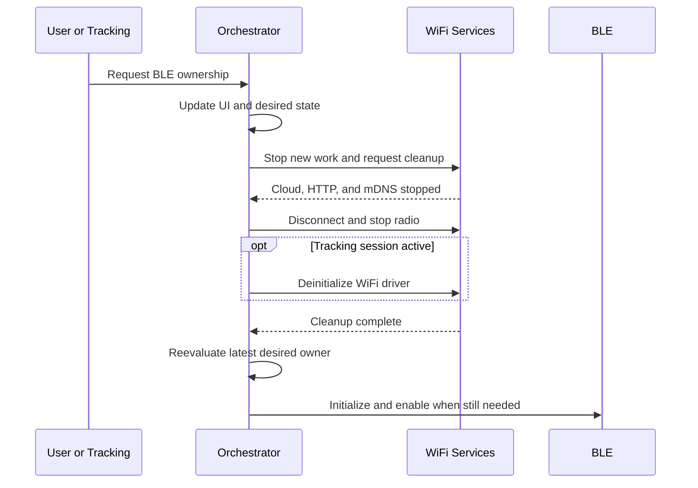

# AirGradient Go BLE and WiFi Handoff Extension

> **Status: agreed behavior specification; not implemented.** This standalone
> extension changes connectivity ownership and lock behavior from
> [Operation and Measurement Logging](operation_and_measurement_logging.md).
> Where their requirements conflict, this extension takes precedence for the
> subjects identified below. Keep the original specification unchanged.
> Retain the [heap experiment specification](runtime_memory_experiments.md);
> its deletion remains the user's decision.

Go will hand connectivity between BLE and WiFi according to interaction,
tracking, connection, and transfer state. Ordinary BLE use will suspend WiFi
services and stop its radio while retaining the initialized driver. Tracking
will additionally deinitialize WiFi. Locking will preserve an established BLE
client connection, and a client release command will lock Go and relinquish BLE
ownership explicitly.

## Problem

Heap experiments reduced several reservations, but simultaneous BLE and Cloud
operation still exhausts memory. With HTTP and mDNS stacks reduced to 4 KiB and
2 KiB, `result.local.log.3` includes successful Cloud POSTs followed by repeated
allocation failures. A subsequent user-supplied locked-state excerpt shows a
successful POST with 71,348 bytes free before TLS, compared with approximately
35 KiB during unlocked operation with BLE available.

These observations motivate avoiding overlap between ordinary BLE ownership
and WiFi network services. They do not prove that radio coexistence is
inherently unreliable, establish a memory leak, or guarantee that every future
operation will fit. The completed heap experiments are recorded separately.

Auto-lock currently offers Off, 10, 30, or 60 seconds. A user can unlock Go,
reach for their phone, and lose connectable BLE before opening the app. Another
user can leave auto-lock Off and want the app to return Go to WiFi or sleeping
operation. Both cases need predictable behavior independent of when a client
connects relative to locking.

## Goals

- Prevent ordinary BLE ownership from overlapping Cloud TLS, Local Server,
  mDNS, or active WiFi station operation.
- Retain the WiFi driver during ordinary unlock/BLE use to limit allocation churn.
- Fully release WiFi driver resources when tracking starts.
- Keep the UI responsive while services shut down and ownership changes.
- Preserve established BLE connections across manual lock and auto-lock.
- Provide a bounded opportunity to connect after auto-lock.
- Let an authenticated client explicitly lock Go and release BLE ownership.
- Preserve acquisition, recording, settings, and existing safety contracts.

## Non-Goals

- Reintroducing Operating Modes or adding user-configurable handoff timers.
- Further stack, TLS-buffer, BLE-pool, or NAND memory reductions.
- Changing saved Enable WiFi or Local Server preferences during a handoff.
- Uploading historical measurements accumulated during a Cloud suspension.
- Redesigning tracking, measurement logs, temporary charts, or GPS scheduling.
- Fully deinitializing WiFi solely because Go is unlocked or a client connects.
- Changing provisioning transports without resolving the exception below.
- Implementing a phone app, editing existing specs, or updating doc indexes.

## Design

### 1. Scope and Precedence

This extension supersedes the base spec's ordinary WiFi-availability rule while
BLE owns connectivity, its rule disconnecting idle clients on lock, and its
restriction on ordinary connectable availability after auto-lock. An established
authenticated client may continue normal BLE operations after locking; it is
not restricted to finishing only a previously admitted transfer.

Tracking Recording and Paused remain active sessions. Measurement intervals,
recording and storage rules, tracking stop reasons, GPS settings, and validity
contracts remain as specified previously. The retained WiFi preference and
tracking state continue to select the existing acquisition/correction policy;
temporary radio suspension must not silently change that policy.

The eventual implementation references are [Orchestrator](../docs/orchestrator.md),
[WiFi Service](../docs/wifi_service.md), [Local Server](../docs/local_server.md),
[Power Management](../docs/power_management.md), and the
[BLE Client Reference](../go_ble_client.md). They describe existing behavior,
not completion of this extension. Broad documentation and VHUB updates remain
deferred for the present specification task.

### 2. Ownership and WiFi Resource Lifetime

Treat UI lock state, BLE ownership, saved WiFi preference, and actual WiFi
runtime state as separate concepts. Compute desired ownership centrally rather
than starting services independently from lock, tracking, and connection callbacks.

| Situation | BLE Ownership | WiFi Radio and Services | WiFi Driver |
|---|---|---|---|
| Unlocked, no tracking | Retained | Suspended | Retain if initialized |
| Locked, valid connection window | Retained | Suspended | Retain if initialized |
| Established client connected, either lock state | Retained | Suspended | Retain if initialized |
| Admitted BLE download or OTA requires its transport | Retained | Suspended | Retain unless already deinitialized |
| Tracking Recording or Paused | Retained | Suspended | Deinitialized |
| Locked, no remaining BLE reason, WiFi enabled | Release after applicable delay | Resume enabled services | Initialize if needed |
| Locked, no remaining BLE reason, WiFi disabled | Release after applicable delay | Off | Follow existing disabled/sleep lifecycle |

For these handoffs, only tracking requires full WiFi driver deinitialization.
Normal shutdown, deep sleep, and existing lifecycle cleanup remain distinct.
Retaining a driver does not require initializing an absent one just to stop it.
If tracking ends while Go is unlocked or connected over BLE, leave WiFi
deinitialized until WiFi ownership is actually needed again.

Keep Cloud, HTTP, and mDNS stopped while BLE owns ordinary connectivity. Suspend
WiFi retries, connection deadlines, and scanning; disconnect and stop the radio.
Merely disabling Cloud requests without releasing its task and buffers is
insufficient. Driver retention during ordinary BLE use reduces allocation churn,
but must be measured rather than described as a fragmentation guarantee.

### 3. Connection Window and Return Delay

These timers serve different purposes and are fixed firmware constants, not
NVS preferences or menu settings. Their eventual code names are implementation
details.

| Parameter | Value | Purpose |
|---|---:|---|
| BLE connection window | 60 seconds | Allow time to open the phone app after unlocking |
| Automatic return delay | 5 seconds | Avoid restarting WiFi during rapid lock/unlock changes |

Grant a connection window on an explicit unlock. Start its clock when BLE is
actually connectable, after the handoff completes; if BLE is already ready,
start at unlock. Waiting for Cloud cleanup must not consume the window. An
auto-lock before BLE becomes ready must not cancel the pending opportunity.

The connection window runs independently of the UI inactivity timer. If it
expires while Go is still unlocked, BLE remains available because of the
unlocked state. If Go auto-locks before expiry, advertising continues until the
remaining window expires. A connection does not need to finish within that
window. Established ownership lasts until disconnect or explicit release.

Disconnecting does not renew the window. A subsequent physical unlock grants
a new window. Tracking does not need a window, and stopping tracking does not
create one; reevaluate any window already granted by unlock.

Start the five-second return delay only when the last ordinary BLE reason has
ended. For example, window expiry while locked begins this delay; it does not
run concurrently with the window. Manual lock without a client cancels the
unused window and starts the shorter delay instead.

During the return delay, stop accepting new ordinary connections but retain the
BLE stack for reuse if the user unlocks again. Keep WiFi suspended. At expiry,
release BLE resources before starting WiFi. This delay must not become another
connectable window. A new unlock, tracking start, or other valid ownership
reason cancels the pending return. Do not repeatedly extend the delay on timer
ticks or unrelated events.

Explicit client release skips the five-second delay, but never skips required
resource cleanup. With WiFi disabled, the same ordinary release process leads
to existing sleep eligibility rather than WiFi startup.

### 4. Lock and Connection Cases

| Event or Condition | Required Behavior |
|---|---|
| Unlock, no tracking | Request BLE ownership; suspend WiFi; grant the connection window when ready |
| Auto-lock without a client | Retain only the remaining connection window, then begin automatic return |
| Manual lock without a client | Cancel unused window; begin automatic return unless another BLE reason exists |
| Manual lock or auto-lock with an established client | Lock controls; preserve the connection and BLE ownership |
| Window expires with an established client | Preserve the connection; window expiry alone does not release BLE |
| Client disconnects while unlocked | Continue advertising; WiFi remains suspended |
| Client disconnects while locked | Retain any unexpired window or tracking/transfer reason; otherwise begin automatic return |
| Auto-lock is Off | Stay unlocked and BLE-capable until manual lock or successful client release |
| Tracking stops while locked | Reevaluate connection, transfer, and remaining window; return only when no BLE reason remains |

Preserve authentication requirements. A link undergoing pairing must have a
bounded opportunity to finish authentication; an unauthenticated connection
must not become an indefinite ownership exception. Reuse existing security
timeouts where adequate; identify any missing bound during implementation.

An authenticated idle client can intentionally keep WiFi and Cloud unavailable.
The client is responsible for disconnecting or releasing BLE when finished.
Unexpected link loss must trigger firmware reevaluation without requiring a
command from a client that is no longer reachable.

### 5. Client Command: Release BLE and Lock

Add an authenticated control operation whose semantic intent is to lock Go and
relinquish BLE ownership. The name here is descriptive, not an assigned opcode,
UUID, or wire payload. Resolve encoding through the existing control protocol.

Reject the command with an appropriate existing-style busy/conflict result when
tracking is Recording or Paused, or when a download/update must finish or be
explicitly cancelled first. Rejection must not lock Go, cancel the window, or
change connectivity. Do not silently stop tracking or cancel a transfer.

For an accepted request:

1. Validate and latch the release intention in the orchestrator.
2. Acknowledge it before intentionally disconnecting. Use the transport's
   completion mechanism or a bounded drain procedure rather than freeing BLE
   immediately after queuing the response.
3. Lock controls if needed, cancel the connection window and pending ordinary
   return delay, and prevent new BLE work from extending this session.
4. Disconnect and release BLE resources safely.
5. Resume eligible WiFi services if Enable WiFi is On. Otherwise follow existing
   sleep conditions, including sensor, storage, display, and GPS requirements.

The command does not change Enable WiFi, Local Server, auto-lock, or credentials.
Acknowledgement means the handoff was accepted, not that an AP connection or
sleep has already completed. Calling ordinary lock alone is insufficient,
because ordinary lock now preserves an established connection.

This handles the forgotten-lock case with auto-lock Off: the app can request
release, Go locks, and the usual locked-state flow resumes. Do not introduce an
unlocked state in which the command starts ordinary WiFi services.

If the link disappears after acceptance, continue the accepted release. Serialize
the operation with other events; a later physical unlock or tracking request
must be reevaluated rather than allowing stale completion callbacks to start
the wrong owner. Once acknowledgement has accepted release, reject successive
client work that would conflict with the handoff.

### 6. Asynchronous Handoff and Resource Ordering

Reflect unlock or tracking state changes in the UI immediately. Do not block the
orchestrator while waiting for network cleanup. The current Cloud stop waits for
its worker and can wait approximately one HTTP timeout; split shutdown request
from completion handling using existing RTOS/service boundaries.

Finish or safely cancel outstanding HTTP/TLS work, close clients/sockets, and
release service tasks/buffers before enabling BLE. Do not forcibly delete a
task that still owns TLS or transport resources. HTTP configuration changes
already accepted must follow their existing completion contract.

For return to WiFi, finish the applicable delay, disable BLE advertising, close
connections, and complete BLE deinitialization before reconnecting. Initialize
WiFi only if absent, then start its radio and connect. Start Cloud and Local
Server/mDNS only after connectivity and their settings permit them. Respect
Cloud disable/configuration-authority settings and Local Server preference.

An active OTA retains its transport until completion or explicit cancellation.
Unlock may update controls immediately but must not interrupt WiFi OTA to
enable BLE. Normal admission rules continue to govern tracking during updates.

Maintain one transition at a time and reevaluate the latest desired state at
completion boundaries. If the user locks while WiFi is stopping, do not start
BLE unnecessarily after its reasons have disappeared. If the user unlocks
during return, cancel or complete the in-flight step safely before taking BLE
ownership. Tag or otherwise invalidate stale connection, retry, and completion
events so they cannot restart services under the wrong owner.

A failed or incomplete shutdown must not be treated as permission to start the
other owner's memory-heavy services. Keep the UI responsive and report failure
through existing diagnostics; settle cleanup or retry within bounded existing
lifecycle behavior. Do not add another permanent worker merely for handoff
coordination if the orchestrator's event loop can own it.

### 7. Tracking and Measurement Continuity

Establish a valid tracking session according to the existing storage admission
rules. A rejected tracking start must not leave connectivity in tracking's
deinitialized-WiFi state. Once tracking starts, fully deinitialize WiFi even if
ordinary BLE ownership had already stopped its radio. Pause does not restore it.

When tracking stops, retain BLE if Go is unlocked, connected, inside a valid
window, or finishing an admitted transfer. Otherwise use the ordinary return
flow. Do not restart a tracking duration or create a new session during handoff.

Keep measurements, normal/tracking intervals, GPS deadlines, recording, storage
sync, and temporary chart behavior independent of connectivity transitions.
Preserve the existing continuous-acquisition and correction selection based on
Enable WiFi or active tracking. Do not mistake a temporarily stopped radio for
the user disabling WiFi. No new backlog upload is implied when Cloud resumes.

Brief nonconnectable measurement broadcasts remain distinct from these ordinary
connection windows and must retain the existing measurement-wake behavior.
Do not create a 60-second window on a scheduled measurement or GPS-maintenance
wake. Driver retention alone must not prevent otherwise eligible deep sleep.

### 8. Provisioning, Settings, and Boot

Preserve saved credentials and all durable enable flags across suspension.
Changing Enable WiFi while BLE owns connectivity changes the eventual return
target, not permission to start ordinary Cloud/HTTP services concurrently.
Changing Local Server preference while suspended takes effect on return.

Intentional disconnects must not consume connection-failure budgets, trigger
provisioning, or schedule background retries while BLE owns connectivity.
Retain whether the device was previously online so a normal handoff return is
not repeatedly misclassified as a cold-boot initial failure. A genuinely new
credential configuration or initial connection retains the base spec's policy.

At boot or wake, derive desired ownership before starting services. Avoid
briefly starting Cloud only to tear it down when the initial UI is unlocked.
Existing setup, charging-only, shutdown, and safety flows keep their own
admission and lifecycle rules.

Provisioning is a separately admitted setup flow, not ordinary Local Server
operation. Credential verification can require WiFi while a BLE setup transport
is active. Do not silently force this flow through the ordinary exclusivity
rule or start Cloud/Local Server as a side effect of verification. Resolve the
explicit setup exception listed below before implementing that path.

## Implementation Plan

1. Define the ownership decision and transient timer/transition state in Go's
   orchestration policy. Keep policy testable through existing service seams.
2. Separate asynchronous Cloud/network shutdown request and completion. Audit
   cancellation, accepted HTTP work, socket cleanup, and stale callbacks.
3. Add WiFi suspension that retains the initialized driver for ordinary BLE
   ownership, with tracking-specific deinitialization and conditional restart.
4. Integrate unlock, manual lock, auto-lock, BLE authentication/disconnection,
   tracking, transfers, and the two fixed timers through the same decision path.
5. Add authenticated Release BLE and Lock handling using the existing control
   service conventions and completion acknowledgement.
6. Resolve setup exceptions and exercise provisioning/OTA alongside ordinary
   paths. Preserve acquisition, recording, and power-policy contracts.
7. Run the tests below and retain diagnostic evidence. Before eventual release,
   reconcile owning docs and VHUB coverage; those edits are deferred for now.

Keep this extension standalone. Do not edit the original operation/logging
specification, delete the heap specification, or add index links as part of
this task. This specification does not itself authorize firmware implementation.

## Testing Strategy

### Host Tests

- Exercise every ownership and lock-table case, including Recording and Paused.
- Verify the 60-second window begins at actual BLE readiness, survives auto-lock,
  expires once, and is not renewed by disconnect or unrelated activity.
- Verify manual lock without a client cancels the window, while either lock
  preserves an established authenticated client.
- Check the five-second return delay at its boundary, cancellation on unlock,
  and disabled connectability during the delay. Explicit release must bypass it.
- Check release when unlocked with auto-lock Off, when already locked, and
  when WiFi is disabled. Verify rejection leaves state unchanged during
  tracking, transfer, or update; accepted release locks before WiFi resumes.
- Verify no BLE startup precedes required Cloud/HTTP/mDNS and radio cleanup,
  and no WiFi-service startup precedes BLE teardown.
- Verify ordinary unlock retains the driver; tracking deinitializes it; failed
  tracking start and tracking stop obey the appropriate ownership rules.
- Inject delayed completion, failed cleanup, rapid reversals, stale got-IP and
  disconnect events, client loss during acknowledgement, and settings changes.
- Verify acquisition/corrections, recording cadence, session duration, and
  nonconnectable measurement wakes do not change due to temporary suspension.
- Exercise provisioning and OTA admission once their remaining details are set.

Use existing service fakes for application logic. Do not introduce driver host
tests or direct ESP-IDF dependencies into the product policy to test this work.

### Firmware and Hardware Verification

Build Go and affected shared-component consumers according to the repository
verification rules. Flashing, monitoring, and device verification are user-only.

On hardware, repeat lock/unlock, auto-lock, connect/disconnect, explicit release,
tracking start/pause/stop, and WiFi service resume cycles. Include auto-lock Off,
WiFi disabled, AP unavailable, Local Server disabled, and a client that remains
connected beyond the window. Confirm the UI remains responsive during slow
Cloud requests and network shutdown. Exercise actual downloads and OTA safely.

Retain heap and stack diagnostics at matched transition boundaries: before
network shutdown, after service cleanup, after radio stop, after tracking's
driver deinitialization, after BLE startup/teardown, and after WiFi resume.
Compare free heap and largest free block across repeated visits to the same
state, plus allocation failures and successful Cloud/local requests. Do not
compare unlike states as evidence of a leak or fragmentation.

Check current consumption during stopped-radio driver retention and tracking's
full teardown. Neither the power saving nor freedom from fragmentation is an
acceptance result until measured. Ensure interrupted connectivity does not
silently lose locally required tracking/log records or change their validity.

## Remaining Implementation Decisions

1. **Release command encoding and acknowledgement:** choose the existing control
   channel, unused operation value, response/error mapping, and bounded response
   drain behavior. Do not invent a new service unless existing capabilities are
   insufficient. The lock/release behavior itself is agreed.
2. **Provisioning exception:** define ownership during BLE credential verification
   and explicit setup while unlocked, including requests during tracking. Decide
   whether to retain the existing temporary dual-radio setup flow or defer setup
   until tracking stops. Ordinary Cloud/Local Server must remain suspended.
3. **Authentication bounds and failures:** verify existing pairing/link timeouts
   prevent unauthenticated links retaining ownership indefinitely, and define
   recovery when acknowledgement or service teardown cannot complete normally.
   Do not introduce an idle timeout for authenticated clients without a separate
   behavior decision; their retained connection is intentional.

Resolve these details before implementing their affected paths. They do not
reopen the agreed 60-second window, five-second return delay, lock semantics,
tracking ownership, or driver-retention policy.
